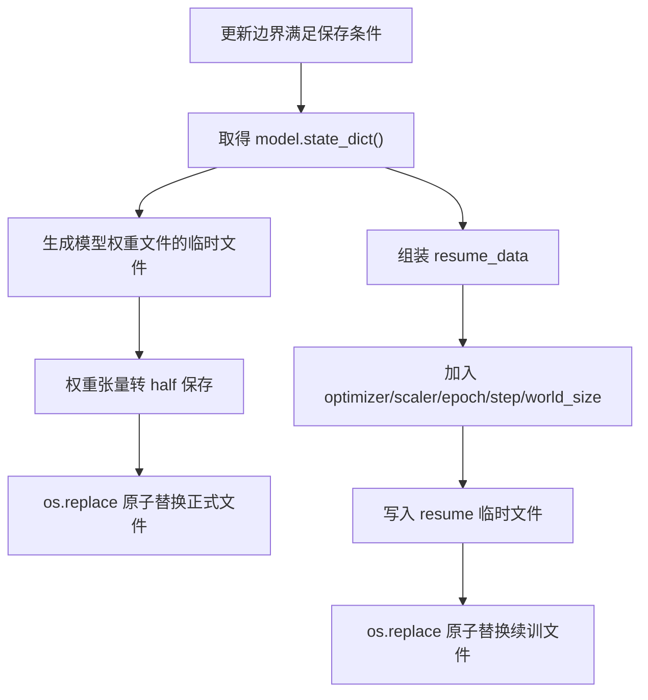
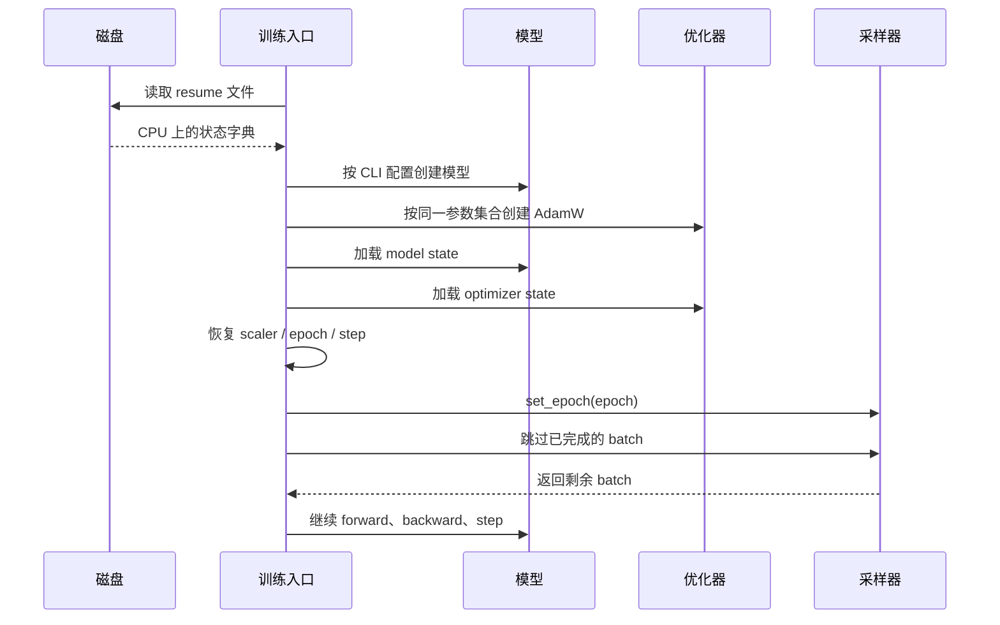

# Checkpoint 精讲：保存什么、如何恢复、怎样继续优化

Checkpoint 可以理解成训练现场的“可重新装配快照”。它不只是某一张权重矩阵，也不只是一个文件名；一个真正可续训的快照至少要回答四个问题：

1. 当前模型参数是多少？
2. AdamW 已经积累了哪些更新历史？
3. 数据已经处理到哪一个 batch？
4. 下次启动时，怎样重新构造同样的模型、优化器和数据顺序？

本仓库把“推理用权重”和“续训用 checkpoint”分开保存。前者尽量简单，后者保留更多训练状态。本页只讲当前仓库真实实现，不把它描述成保存了所有随机状态的完美时间机器。

配套源码：

- 保存与加载：[trainer/train_utils.py](../trainer/train_utils.py) 的 `lm_checkpoint()`。
- 预训练入口：[trainer/train_pretrain.py](../trainer/train_pretrain.py)。
- 按已完成 batch 跳过数据：[trainer/train_utils.py](../trainer/train_utils.py) 的 `SkipBatchSampler`。
- 真实三批恢复实验：[scripts/lesson_lab.py](../scripts/lesson_lab.py) 的 `lesson_resume()`。
- 只读检查脚本：[scripts/inspect_checkpoint.py](../scripts/inspect_checkpoint.py)。

## 1. 先分清三种“状态”

### 1.0 先回答：checkpoint 文件从哪里来

当前预训练入口不是一启动就生成 checkpoint，而是在训练循环的保存条件满足后调用 `lm_checkpoint()`：

```text
__main__
  → 创建 model / optimizer / scaler
  → train_epoch
  → 某个 batch 完成更新
  → lm_checkpoint(...)
  → 写出 .pth 与 *_resume.pth
```

以当前 128 维教学实验为例：

```bash
.venv/bin/python -m trainer.train_pretrain \
  --device cpu --dtype float32 \
  --hidden_size 128 --num_hidden_layers 2 \
  --data_path dataset/demo_pretrain.jsonl \
  --save_dir out/checkpoint_lesson \
  --checkpoint_dir checkpoints/checkpoint_lesson \
  --from_weight none --from_resume 0 \
  --epochs 1 --batch_size 1 --num_workers 0 \
  --max_seq_len 64 --accumulation_steps 2 \
  --max_steps 3 --save_interval 2 --log_interval 1
```

这条命令中的来源关系是：

```text
X/Y/mask：来自 dataset/demo_pretrain.jsonl
model：    MiniMindConfig + 随机初始化
optimizer：AdamW(model.parameters())
scaler：   grad_scaler("cpu", float32)，当前为空状态
step：     train_epoch 已处理的 batch 计数
```

运行三批、两次更新后，常见文件关系为：

```text
out/checkpoint_lesson/pretrain_128.pth
checkpoints/checkpoint_lesson/pretrain_128.pth
checkpoints/checkpoint_lesson/pretrain_128_resume.pth
```

`out/` 下的普通权重通常给推理或下一阶段初始化；`checkpoints/` 下的普通权重是保存目录中的同类副本；`*_resume.pth` 才是包含续训信息的完整训练快照。

### 1.0.1 文件名怎样组成

普通语言模型的路径由下面几部分拼成：

```text
{save_dir}/{weight}_{hidden_size}{_moe 可选}.pth
{checkpoint_dir}/{weight}_{hidden_size}{_moe 可选}_resume.pth
```

例如：

```text
save_weight = "pretrain"
hidden_size = 128
use_moe = False

普通权重：pretrain_128.pth
续训文件：pretrain_128_resume.pth
```

如果开启 MoE，文件名会包含 `_moe`。这只是路径命名约定；文件中没有自动保存完整的命令行参数，所以加载时仍要手动提供匹配的模型结构。

### 1.1 内存中的训练现场

训练运行时，至少有这些对象：

```text
model                 当前模型参数、buffer 和模块结构
optimizer             AdamW 参数组、一阶/二阶历史
scaler                CUDA float16 时的梯度缩放状态
epoch / step          当前轮号、已处理 batch 数
sampler / DataLoader  本轮数据顺序与组批方式
.grad                 当前累积组尚未使用的梯度
计算图                 当前 batch 为 backward 保存的中间关系
```

这些对象不在同一个地方：

| 对象 | 是否属于普通 `model.state_dict()` | 能否简单保存 |
| --- | --- | --- |
| 模型参数 | 是 | 可以 |
| 持久 buffer | 是 | 可以 |
| AdamW 的 `exp_avg` / `exp_avg_sq` | 否 | 需要保存 `optimizer.state_dict()` |
| 当前 `.grad` | 否 | 当前实现不保存 |
| 计算图 | 否 | 不能靠 checkpoint 保存并恢复 |
| DataLoader worker 随机状态 | 否 | 当前实现不保存 |
| Python / NumPy / PyTorch 随机状态 | 否 | 当前实现不保存 |

所以保存“模型权重”与保存“可继续训练现场”是两个不同目标。

### 1.2 推理权重文件

例如：

```text
out/debug_accum/pretrain_128.pth
```

它主要回答：“创建同样结构后，怎样得到训练到当前时刻的模型参数？”

推理时只需要模型参数，不需要 AdamW 的动量，也不需要知道已经处理了第几批。文件更小，加载路径更简单。

它的来源是保存时的：

```python
state_dict = model.state_dict()
torch.save({k: v.half() for k, v in state_dict.items()}, ckp_tmp)
```

所以普通权重文件的顶层通常就是参数名：

```text
{
  "model.embed_tokens.weight": Tensor,
  "model.layers.0.self_attn.q_proj.weight": Tensor,
  ...
  "lm_head.weight": Tensor
}
```

它没有：

```text
optimizer
epoch
step
scaler
```

因此它能回答“模型现在是什么样”，不能回答“训练已经处理到哪里、AdamW 下一次应该怎样接着调”。

### 1.3 Resume 文件

例如：

```text
checkpoints/debug_accum/pretrain_128_resume.pth
```

它回答：“如果按照同一训练计划重新启动，怎样从已完成位置继续？”

当前语言模型 resume 文件的字段实测为：

```text
epoch
model
optimizer
scaler
step
wandb_id
world_size
```

`model` 是模型状态字典；`optimizer` 是 AdamW 状态字典；`step` 是已处理 batch 数，不是 AdamW 更新次数。

resume 文件的外层结构可以画成：

```text
resume_payload
├── model       → 模型参数和 buffer
├── optimizer   → AdamW 参数组、一阶/二阶状态
├── scaler      → AMP 梯度缩放器状态
├── epoch       → 当前轮的内部编号
├── step        → 已处理的 batch 数
├── world_size  → 保存时的进程/GPU 数
└── wandb_id    → 可选实验记录运行 ID
```

当前三批实验的实际含义是：

```text
epoch = 0
step = 3
optimizer.state[*]["step"] = 2
world_size = 1
scaler = {}
```

这表示“第 0 轮已经处理到第 3 批，并完成了 2 次 AdamW 更新”。`step=3` 不是第三次参数更新。

## 2. 一次保存到底执行了什么

训练入口在满足保存条件后调用：

```python
lm_checkpoint(
    lm_config,
    weight=args.save_weight,
    model=model,
    optimizer=optimizer,
    scaler=scaler,
    epoch=epoch,
    step=step,
    wandb=wandb,
    save_dir=args.checkpoint_dir,
)
```

可以拆成下面 8 步：



源码中最关键的保存动作是：

```python
state_dict = model.state_dict()
torch.save({k: v.half() for k, v in state_dict.items()}, ckp_tmp)
os.replace(ckp_tmp, ckp_path)

resume_data = {
    "model": state_dict,
    "optimizer": optimizer.state_dict(),
    "epoch": epoch,
    "step": step,
    "world_size": ...,
    "wandb_id": ...,
}
torch.save(resume_data, resume_tmp)
os.replace(resume_tmp, resume_path)
```

这里有一个容易忽略的转换关系：

```text
内存中的 model 参数
  ├─ half() 副本 -> 推理权重文件
  └─ 原精度 state_dict + optimizer/scaler/进度 -> resume 文件
```

`half()` 作用在传给 `torch.save()` 的字典表达式上，不会把内存中的训练模型永久转换成 float16。当前 CPU/float32 课程实验中：

```text
推理权重：通常是 float16 张量
resume 的 model：保留当前训练精度，课程中为 float32
```

具体文件是否包含 CPU 或 CUDA 张量，取决于保存时参数所在设备。加载时仓库使用 `map_location` 把它们放到目标设备或 CPU。

### 2.1 为什么先写 `.tmp` 再 `os.replace`

如果直接覆盖正式文件，进程在写到一半时中断，可能留下损坏文件。当前实现先写：

```text
pretrain_128.pth.tmp
pretrain_128_resume.pth.tmp
```

写完后再用 `os.replace()` 替换正式文件。这样“旧文件仍可用”或“新文件完整出现”的概率更高。

这不是远程对象存储的事务系统，也不能修复磁盘损坏；它只是缩小本地写文件中途失败造成半文件的风险。

### 2.2 为什么只让主进程保存

训练循环用：

```text
if (...保存条件...) and is_main_process():
    ...
```

DDP 中多个进程共同计算梯度，但通常只让 rank 0 写文件，避免多个进程同时覆盖同一个路径。`model` 如果被 DDP 包装，保存前会取：

```python
model.module.state_dict()
```

而不是把 DDP 包装对象本身序列化。

## 3. 推理权重、resume 和 VLM 的区别

### 3.1 普通语言模型

`lm_checkpoint()` 会保存：

```text
save_dir/weight_H.pth
save_dir/weight_H_resume.pth
```

预训练入口还会在 `args.save_dir` 手动保存一次权重，因此常见目录中可能有两份普通权重：

```text
out/debug_accum/pretrain_128.pth
checkpoints/debug_accum/pretrain_128.pth
checkpoints/debug_accum/pretrain_128_resume.pth
```

两份普通权重的用途都可以是加载模型；续训时真正需要的是 `_resume.pth`。

### 3.2 VLM checkpoint

VLM 使用单独的 `vlm_checkpoint()`：

```python
clean_state_dict = {
    k: v for k, v in state_dict.items()
    if not k.startswith("vision_encoder.")
}
```

推理权重会排除 `vision_encoder.` 参数，因为视觉塔应从同一路径重新挂载；VLM resume 的 `model` 仍保存完整状态字典。

因此不能把普通 LM checkpoint 和 VLM checkpoint 的“哪些参数被排除”混为一谈：

| 类型 | 推理权重 | resume 的 model |
| --- | --- | --- |
| 普通 LM | 模型状态 | 模型状态 |
| VLM | 排除视觉塔状态 | 当前实现保留完整状态 |

`strict=False` 允许 VLM 加载时出现缺失或多余键，但它不会自动修复同名参数的 shape mismatch，也不代表所有参数都正确加载。

## 4. 文件中的每个字段是什么

### 4.1 `model`

它是 `state_dict`，本质是：

```text
{
    "model.embed_tokens.weight": tensor(...),
    "model.layers.0.self_attn.q_proj.weight": tensor(...),
    "model.layers.0.mlp.gate_proj.weight": tensor(...),
    "lm_head.weight": tensor(...),
    ...
}
```

它保存参数名到张量的映射，不保存 Python 类定义。加载时必须先用相同配置创建模型，才能知道这些名字应该放回哪些模块。

当前模型把 Embedding 和 lm_head 权重绑定为同一个参数对象。保存 state_dict 时会看到对应键，但加载到同样的模型结构后，权重绑定关系仍由模型构造代码负责。

### 4.2 `optimizer`

AdamW 的 `state_dict()` 通常包含：

```text
state
param_groups
```

`param_groups` 记录学习率、weight_decay、betas 和参数组；`state` 为已经参与过更新的参数保存历史。对 AdamW，常见历史包括：

```text
step       这个参数已经更新多少次
exp_avg    梯度的一阶移动平均
exp_avg_sq 梯度平方的二阶移动平均
```

这些历史不是模型前向所需的权重，却会影响下一次更新。如果只加载 `model`、重新创建 AdamW，模型可以继续算 loss，但优化轨迹已经改变。

可以把参数和 optimizer 状态比作：

```text
model：      目前旋钮拧到了哪里
exp_avg：    最近几次建议大致往哪个方向
exp_avg_sq：最近几次建议有多大
step：       这套历史已经使用了几次
```

### 4.3 `scaler`

当前项目使用 `grad_scaler(device_type, dtype)`：

```text
CPU / float32       -> disabled
CUDA / bfloat16     -> disabled
CUDA / float16      -> enabled
```

所以课程 CPU resume 中 `scaler` 通常是空状态。CUDA float16 训练时，它可能记录当前缩放因子和增长/回退计数；恢复它可以避免重新从一个完全不同的缩放起点开始。

### 4.4 `epoch` 和 `step`

当前入口约定：

```text
epoch：内部轮号，从 0 开始
step：本轮已经处理的 batch 数
```

例如三批、`accumulation_steps=2`：

```text
checkpoint["step"] = 3
AdamW 某参数 state["step"] = 2
```

两者不冲突：

```text
batch 1 -> 没更新
batch 2 -> 第 1 次 AdamW 更新
batch 3 -> 第 2 次 AdamW 更新
```

### 4.5 `world_size`

它记录保存时参与分布式训练的进程数。加载 resume 时，如果当前 world size 不同，当前实现会转换：

```python
ckp_data["step"] = saved_step * saved_world_size // current_world_size
```

直观上，原来的一个 step 处理了：

```text
单卡 batch_size × saved_world_size
```

换了进程数后，为了让“已经处理的样本量”大致对应，需要调整 step。

这只是当前实现的进度换算。要获得严格一致，还要保持数据切分、batch size、sampler 和学习率计划兼容；不能把 world size 转换理解为任意分布式变更都能精确续训。

### 4.6 `wandb_id`

当前项目实际在 `--use_wandb` 时导入 SwanLab。这个字段用于让实验记录工具尝试继续同一运行。它不参与模型前向，也不影响参数恢复；没有启用记录时通常为 `None`。

### 4.7 每个字段恢复到哪里

保存字段和恢复目标是一一对应的：

| 文件字段 | 保存来源 | 重新启动后写入哪里 | 作用 |
|---|---|---|---|
| `model` | `model.state_dict()` | `model.load_state_dict(...)` | 恢复当前模型参数 |
| `optimizer` | `optimizer.state_dict()` | `optimizer.load_state_dict(...)` | 恢复 AdamW 参数组和历史 |
| `scaler` | `scaler.state_dict()` | `scaler.load_state_dict(...)` | 恢复 float16 AMP 缩放状态 |
| `epoch` | `train_epoch` 外层编号 | `start_epoch` | 从哪一轮继续 |
| `step` | 已处理 batch 的编号 | `start_step` | 跳过多少批，并恢复日志/调度位置 |
| `world_size` | 当前分布式进程数 | 加载函数内部 | 必要时换算 `step` |
| `wandb_id` | SwanLab/W&B 运行对象 | 记录系统初始化 | 续接实验曲线，不参与模型计算 |

入口中的真实恢复代码可以简化为：

```python
ckp_data = lm_checkpoint(
    lm_config,
    weight=args.save_weight,
    save_dir=args.checkpoint_dir,
)

model.load_state_dict(ckp_data["model"])
optimizer.load_state_dict(ckp_data["optimizer"])
scaler.load_state_dict(ckp_data["scaler"])
start_epoch = ckp_data.get("epoch", 0)
start_step = ckp_data.get("step", 0)
```

加载以后，checkpoint 字典仍然可能留在 CPU 内存中；模型参数已经被拷贝到当前模型对象，optimizer 状态也被拷贝到当前 optimizer 对象。训练继续使用的是这些对象，不是每次 batch 直接读取磁盘文件。

```text
磁盘 checkpoint
  ↓ 启动时读取一次
ckp_data（CPU 字典）
  ├── model     → model 参数对象
  ├── optimizer → AdamW 状态对象
  ├── scaler    → AMP 状态对象
  └── epoch/step → 训练循环局部变量

之后的每个 batch 不再反复读取 checkpoint 文件。
```

这也是为什么训练中不能删除或覆盖当前 optimizer：恢复完成后，真正持续变化的是内存中的 optimizer 和 model。

### 4.8 文件里没有什么

当前普通 LM resume 文件没有完整保存下面这些内容：

| 没有保存的内容 | 影响 |
|---|---|
| Python/NumPy/PyTorch 随机数状态 | 随机增强或随机采样不保证逐位复现 |
| DataLoader worker 内部状态 | `num_workers>0` 时恢复边界更复杂 |
| 未完成累积组的 `.grad` | 保存点必须尽量放在更新边界 |
| 当前 batch 的计算图 | 不能从中断处继续半个 backward |
| 数据文件内容 | 数据改了，旧 `step` 仍可能指向不同样本 |
| 完整 config JSON | 加载时仍需手动传 hidden size、层数、MoE 等 |

因此“恢复 checkpoint”准确含义是：

```text
恢复保存时的模型、优化器和进度，
再按兼容的数据与配置继续训练。
```

它不等于把进程内的所有瞬时状态逐字节冻结。

## 5. 如何把 checkpoint 加载到内存

### 5.1 先把文件放到 CPU 内存

仓库统一通过：

```python
from trainer.train_utils import torch_load

payload = torch_load(
    "checkpoints/debug_accum/pretrain_128_resume.pth",
    map_location="cpu",
)
```

`torch_load()` 内部使用：

```python
torch.load(path, map_location="cpu", weights_only=True)
```

这一步有三个目的：

1. 不管文件原来保存于哪块 GPU，先统一放到 CPU。
2. 使用受限的 `weights_only=True` 加载张量和简单元数据。
3. 在创建目标模型前先查看文件内容。

CPU 内存中此时得到的是 Python 字典和张量，不是一个已经运行的模型。

### 5.2 先创建结构，再拷贝参数

```python
config = MiniMindConfig(
    hidden_size=128,
    num_hidden_layers=2,
    intermediate_size=384,
)
model = MiniMindForCausalLM(config)
state_dict = payload["model"]  # resume 文件
model.load_state_dict(state_dict)
```

转换关系是：

```text
磁盘 bytes
  -> torch.load
CPU 上的 state_dict
  -> MiniMindForCausalLM(config)
  -> load_state_dict
模型参数对象
```

`load_state_dict` 不是创建模型结构。它要求结构已经存在，并按名字把张量拷贝到对应参数。

如果配置错了，常见结果是：

```text
missing keys
unexpected keys
size mismatch
```

例如保存的是 `hidden_size=128`，加载时却创建默认 `hidden_size=512`，Embedding、Q/K/V、FFN 和 lm_head 的形状都可能不匹配。

### 5.3 再把模型搬到目标设备

```python
model = model.to("cuda:0")
```

也可以先 `.to("cuda:0")` 再 `load_state_dict`。重要的是模型参数与输入张量在同一设备：

```text
CPU checkpoint tensor -> 模型参数 -> cuda:0
X -> cuda:0
前向在同一设备执行
```

配套检查脚本：

```bash
.venv/bin/python scripts/inspect_checkpoint.py \
  checkpoints/debug_accum/pretrain_128_resume.pth \
  --hidden_size 128 --num_hidden_layers 2 --device cpu
```

它会打印 checkpoint 类型、字段、模型张量、optimizer 状态和加载后的设备。

### 5.4 加载 optimizer 到内存

模型加载后，先创建与原来相同参数结构的优化器：

```python
model = model.to(device)
optimizer = torch.optim.AdamW(model.parameters(), lr=5e-4)
optimizer.load_state_dict(payload["optimizer"])
```

优化器不是从文件中“自己找到参数对象”，而是把保存的状态按参数组结构映射到当前 optimizer。以下条件要匹配：

```text
参数数量和顺序
可训练参数集合
参数组划分
模型结构
```

如果训练阶段用了 LoRA，只把基础模型参数传给新 optimizer，再加载包含 LoRA 参数的 optimizer state，就会出现组数或参数数量不匹配。

优化器状态可能需要放到目标设备。通常 `optimizer.load_state_dict()` 会按当前参数设备处理状态；如果手动加载或自定义优化器没有完成迁移，可以检查：

```python
for state in optimizer.state.values():
    for name, value in state.items():
        if torch.is_tensor(value):
            print(name, value.device)
```

### 5.5 加载 scaler

```python
scaler = grad_scaler(device_type, dtype)
scaler.load_state_dict(payload["scaler"])
```

CPU/float32 时这个状态通常为空。不要因为看到空字典就删除这一步；保留统一调用，切换到 CUDA float16 时仍能恢复对应状态。

### 5.6 一张张“表”怎样变回内存里的参数

磁盘里的 checkpoint 不是一个正在运行的模型，而是一个保存好的字典。加载过程可以想成把仓库里的零件重新装回机器：

```text
磁盘文件 bytes
  ↓ torch.load(map_location="cpu")
Python 字典 + CPU Tensor
  ↓ MiniMindConfig 创建结构
带有随机参数的模型对象
  ↓ model.load_state_dict(...)
被 checkpoint 数值覆盖的参数对象
  ↓ model.to("cuda:0")
GPU 上可计算的模型
```

这里有三个容易混淆的对象：

| 对象 | 形象理解 | 是否能直接调用 `model(X)` |
| --- | --- | --- |
| `.pth` 文件 | 装零件的箱子 | 不能 |
| `state_dict` | 按名称排列的零件表 | 不能 |
| `MiniMindForCausalLM` | 已装配的机器 | 可以 |

所以加载不能只写：

```python
payload = torch_load(path)
```

还必须：

```python
model = MiniMindForCausalLM(config)
model.load_state_dict(payload["model"] if "model" in payload else payload)
model.to(device)
```

`load_state_dict` 是“按名字和 shape 拷贝数值”，不会替你创建缺失的层，也不会把 128 维结构自动改成 512 维。结构配置、词表和 checkpoint 必须属于同一套约定。

可以把 dtype 和 device 分开理解：

```text
dtype：每个数用 float32 还是 float16 表示
device：这些数在 CPU 还是 cuda:0 上
```

普通权重文件可能保存成 float16，但加载到 float32 模型后，参数会转换为模型当前要求的 dtype。保存精度和运行精度是两个阶段，不要只看文件后缀判断前向精度。

## 6. 从 checkpoint 重新开始的完整步骤

训练入口的恢复顺序可以画成：



### 步骤 1：保持结构和数据条件

至少保持这些设置兼容：

```text
tokenizer
hidden_size
num_hidden_layers
num_key_value_heads
intermediate_size / use_moe
数据文件内容与顺序
batch_size
accumulation_steps
sampler seed
学习率计划的总步数
```

`max_seq_len` 也应保持一致，除非你明确知道改变它只影响后续数据，并接受学习率和样本边界的变化。

### 步骤 2：让入口找到 resume 文件

以预训练为例：

```bash
.venv/bin/python -m trainer.train_pretrain \
  --device cpu --dtype float32 \
  --hidden_size 128 --num_hidden_layers 2 \
  --data_path dataset/demo_pretrain.jsonl \
  --save_dir out/debug_accum \
  --checkpoint_dir checkpoints/debug_accum \
  --from_weight none \
  --from_resume 1 \
  --epochs 1 --batch_size 1 --num_workers 0 \
  --max_seq_len 64 --accumulation_steps 2 --max_steps 3 \
  --log_interval 1 --save_interval 2
```

`--from_resume 1` 会让入口调用：

```python
ckp_data = lm_checkpoint(
    lm_config,
    weight=args.save_weight,
    save_dir=args.checkpoint_dir,
)
```

这里 `model=None`，所以函数走加载分支，而不是保存分支。

### 步骤 3：加载三类训练状态

```python
model.load_state_dict(ckp_data["model"])
optimizer.load_state_dict(ckp_data["optimizer"])
scaler.load_state_dict(ckp_data["scaler"])
start_epoch = ckp_data.get("epoch", 0)
start_step = ckp_data.get("step", 0)
```

此时模型参数回到保存时的 W，AdamW 历史也回到保存时的历史，训练入口知道前面已经处理了多少 batch。

### 步骤 4：恢复采样顺序并跳过已完成 batch

```python
train_sampler.set_epoch(start_epoch)
batch_sampler = SkipBatchSampler(
    train_sampler,
    batch_size=args.batch_size,
    skip_batches=start_step,
)
loader = DataLoader(
    train_ds,
    batch_sampler=batch_sampler,
    num_workers=args.num_workers,
)
```

注意两个动作：

```text
set_epoch：重新得到本轮同样的索引顺序
SkipBatchSampler：按完整 batch 丢弃前 start_step 批
```

只把 `enumerate(..., start=start_step+1)` 改成 3，不会跳过数据；它只改显示编号。

### 步骤 5：正确计算剩余总范围

如果原轮有 5 批，已经完成 2 批，剩余 loader 有 3 批：

```python
train_epoch(
    epoch,
    loader,
    len(loader) + start_step,  # 3 + 2 = 5
    start_step,
    wandb,
)
```

这样函数内部的 `step` 会从 3 开始，学习率调度仍能使用原轮的全局位置。

### 步骤 6：恢复后的“继续”不是重新训练已完成批次

恢复分支应该看到：

```text
Epoch [1/1]: 跳过前2个step，从step 3开始
```

如果恢复后又从 batch 1 开始，常见原因是：

```text
没有使用 --from_resume 1
checkpoint_dir 指错
weight 名称或 hidden_size 不一致
sampler 没有 set_epoch
使用了普通 DataLoader 而不是 SkipBatchSampler
```

### 6.1 到底恢复到哪个瞬间

如果 checkpoint 在 batch 2 的更新完成后写出，它恢复到的是这个瞬间：

```text
batch 1：已 forward、loss、backward
batch 2：已 forward、loss、backward、optimizer.step、zero_grad
checkpoint：保存这里
batch 3：尚未处理
```

因此恢复后的“起点”不是 batch 2 的开头，也不是 batch 2 的 backward 中间，而是：

```text
参数：W1
AdamW：第 1 次更新后的历史
.grad：上一组已经清空
数据：下一次读取 batch 3
```

如果保存发生在某批 forward 之后但 optimizer.step 之前，理论上还需要保存该批的计算图或未完成梯度；当前实现没有保存这些瞬时对象，所以训练入口把周期保存限制在更新边界。保存位置决定了“能从哪里安全继续”。

### 6.2 恢复后加载到内存的层次

可以把恢复过程分成四层：

```text
第 1 层：文件层
  pretrain_128_resume.pth

第 2 层：字典层
  ckp_data["model"]
  ckp_data["optimizer"]
  ckp_data["step"]

第 3 层：对象层
  model / optimizer / scaler / start_step

第 4 层：训练层
  set_epoch → SkipBatchSampler → 剩余 batch
```

只有走完第 4 层，才是真正“从中断处恢复训练”。只执行 `torch.load()` 只能说明文件读到了内存；只执行 `model.load_state_dict()` 只能恢复模型数值；没有恢复 optimizer 和数据进度，仍不是完整续训。

## 7. 如何从“普通权重”开始一个新阶段

续训和阶段迁移不是一回事。

### 7.1 从预训练权重开始 SFT

```text
读取 out/pretrain_128.pth
-> 创建 SFT 的新 optimizer
-> 使用 SFTDataset
-> epoch/step 从 0 开始
```

命令示例：

```bash
.venv/bin/python -m trainer.train_full_sft \
  --device cpu --dtype float32 \
  --hidden_size 128 --num_hidden_layers 2 \
  --data_path dataset/demo_sft.jsonl \
  --save_dir out/debug_accum \
  --checkpoint_dir checkpoints/sft_lesson \
  --from_weight pretrain \
  --from_resume 0 \
  --epochs 1 --batch_size 1 --num_workers 0 \
  --max_seq_len 128 --max_steps 2
```

这里 `--from_weight pretrain` 是从另一个阶段的普通模型权重初始化；`--from_resume 0` 表示不拿预训练阶段的 batch 进度和 AdamW 历史来续训 SFT。

### 7.2 恢复 SFT 自己的中断

```bash
--from_weight full_sft
--from_resume 1
--checkpoint_dir checkpoints/sft_lesson
```

SFT resume 文件的 `weight` 名称是 `full_sft`，不能误读成预训练的 `pretrain_128_resume.pth`。阶段、任务、mask 和优化器历史都应属于同一个训练阶段。

### 7.3 LoRA 附件不是普通 resume

LoRA 的小文件只保存 A/B 附件：

```text
基础模型权重 + LoRA 注入结构 + adapter A/B
```

它不包含一份可以单独前向的完整模型，也不等价于 `lm_checkpoint()` 保存的全量续训文件。LoRA 的训练 resume 仍可能保存完整模型和优化器状态，必须看实际入口与文件字段。

## 8. 优化 checkpoint 的存储、内存和可靠性

### 8.1 为什么 resume 文件明显比推理权重大

以当前 1,196,672 参数的教学模型粗略估算：

```text
float32 模型参数：约 1,196,672 × 4 bytes ≈ 4.8 MB
float16 推理权重：约 2.4 MB
AdamW exp_avg：    约 4.8 MB
AdamW exp_avg_sq： 约 4.8 MB
```

还要加 tensor 元数据、参数组和其他字段。25.83M 模型按相同方法估算会扩大约 21.6 倍。

因此：

```text
推理部署：保留半精度权重
训练恢复：保留模型 + optimizer + scaler + 进度
```

两者不能只按“文件越小越好”评价。删掉 optimizer 历史可以节省空间，但就不再是同一条 AdamW 优化轨迹。

### 8.2 只在有意义的边界保存

当前预训练入口的周期保存条件是：

```python
(step % save_interval == 0 and
 step % accumulation_steps == 0) or step == iters
```

目的：

1. 周期保存发生在完整累积组结束后。
2. 最后一批即使是尾组，也会先更新再保存。
3. 不把未保存的 `.grad` 与已经跳过的 batch 混成一个不完整现场。

如果你希望更频繁保存，应同时设计“未完成累积梯度怎么保存”，否则恢复时跳过这些 batch 会丢掉未更新反馈。

### 8.3 限制加载内存峰值

当前推荐顺序：

```text
torch_load(map_location="cpu")
-> 检查字段与结构
-> 创建模型
-> 将模型放到目标设备
-> load_state_dict
-> 创建/加载 optimizer
```

不要为了“更快”把多个完整模型和 optimizer 同时搬到 GPU，尤其是 DPO、蒸馏和 PPO 本身就可能同时存在 Policy、Reference、Critic 或 Teacher。

可以先只加载普通推理权重做生成检查；只有确认结构和路径正确后，再加载包含 optimizer 的 resume 文件。

### 8.4 保存版本与校验

当前文件名包含：

```text
weight 名称 + hidden_size + 可选 _moe
```

它没有把完整 config JSON 自动嵌入文件。因此建议实验目录同时保存：

```text
训练命令或 args
tokenizer 路径
数据文件版本/哈希
模型结构参数
checkpoint 文件
```

当前代码使用原子替换，但没有内置 SHA256 校验、多个历史版本保留或远程备份。需要长期训练时，可以在外层增加：

```text
checkpoint-000100/
checkpoint-000200/
latest -> checkpoint-000200/
```

不要只保留一个文件并在同一路径上反复覆盖；文件损坏时没有回滚点。

### 8.5 改哪些设置风险最大

| 改动 | 对恢复的影响 |
| --- | --- |
| 学习率 | 可以继续，但优化轨迹改变 |
| epochs / max_steps | 改变总步数和余弦调度 |
| batch_size | step 对应的样本量改变，跳批边界改变 |
| accumulation_steps | 更新次数和梯度尺度改变 |
| 数据内容/顺序 | 相同 step 不再代表相同样本 |
| hidden_size/层数 | state_dict 形状不匹配 |
| tokenizer | ID 语义可能错位 |
| world_size | 当前实现会换算 step，但仍需检查数据切分 |
| num_workers | 通常不改变样本顺序，但 worker 随机状态不在快照中 |

“能加载”只证明键和形状可以匹配，不证明恢复后的训练语义与中断前相同。

### 8.6 Checkpoint 的实用优化策略

长时间训练时，可以把 checkpoint 设计成“最新、最好、可回滚”三类：

```text
latest/      最近一次保存，用于意外中断恢复
best/        验证指标最好的版本，用于推理或发布
archive/     少量历史版本，用于回滚和比较
```

建议同时保留一份 manifest，写下：

```text
训练命令
git commit
tokenizer 路径或版本
数据文件路径与 hash
hidden_size / 层数 / use_moe
batch_size / accumulation_steps
dtype / device / world_size
```

这样即使文件能加载，也能判断它是否属于当前实验，而不是把不同 tokenizer 或不同模型结构的文件误当成同一条训练轨迹。

存储空间紧张时，可以采用以下顺序优化：

1. 推理副本保存为 float16 或 bfloat16，续训文件保留训练所需精度。
2. 只保留最近 N 个普通权重，保留 `latest` 和 `best`。
3. 对超大模型采用分片保存，避免一次性创建巨大临时文件。
4. 先 CPU/offload 再保存，减少 GPU 峰值；确认内存足够后再使用。
5. 使用临时文件、原子替换和文件 hash，避免半文件被误当成最新版本。

不要为了压缩空间删除 optimizer 状态后继续声称“完全恢复训练”。删除 `exp_avg`、`exp_avg_sq` 后仍可从模型权重开始训练，但它是重新建立优化历史的另一条轨迹。

### 8.7 保存频率怎样取舍

保存越频繁，意外中断后丢失的计算越少，但磁盘写入和训练暂停越多。可以按预计重跑成本决定：

```text
短实验：每个更新边界保存
中等实验：每几十或几百个更新保存
长实验：周期保存 + best 保存 + 定期归档
```

当前入口按 batch 的 `save_interval` 判断，但还会检查是否处在梯度累积更新边界。调整保存频率时，要同时确认未完成累积梯度是否已经被使用，否则恢复时跳过批次可能丢失梯度贡献。

## 9. 用脚本查看当前 checkpoint

### 9.1 先运行三批教学实验

```bash
.venv/bin/python scripts/lesson_lab.py --lesson pretrain
```

这个实验使用临时目录，结束后会删除文件。如果想保留文件，可以运行：

```bash
OMP_NUM_THREADS=2 MKL_NUM_THREADS=2 \
.venv/bin/python -m trainer.train_pretrain \
  --device cpu --dtype float32 \
  --hidden_size 128 --num_hidden_layers 2 \
  --data_path dataset/demo_pretrain.jsonl \
  --save_dir out/checkpoint_lesson \
  --checkpoint_dir checkpoints/checkpoint_lesson \
  --from_weight none --from_resume 0 \
  --epochs 1 --batch_size 1 --num_workers 0 \
  --max_seq_len 64 --accumulation_steps 2 \
  --max_steps 3 --save_interval 2 --log_interval 1
```

### 9.2 检查 resume 文件

```bash
.venv/bin/python scripts/inspect_checkpoint.py \
  checkpoints/checkpoint_lesson/pretrain_128_resume.pth \
  --hidden_size 128 --num_hidden_layers 2 --device cpu
```

预期重点：

```text
kind: resume checkpoint
top-level fields: epoch, model, optimizer, scaler, step, wandb_id, world_size
completed batch step: 3
loaded model device: cpu
optimizer after load: ... first_step: 2
```

### 9.3 检查普通模型权重

```bash
.venv/bin/python scripts/inspect_checkpoint.py \
  out/checkpoint_lesson/pretrain_128.pth \
  --hidden_size 128 --num_hidden_layers 2 --device cpu
```

此时类型应为 `model weights`，没有 optimizer、epoch 和 step。它可以加载成模型做推理，但不能单凭它恢复 AdamW 的历史。

### 9.4 在 CUDA 上加载模型

```bash
.venv/bin/python scripts/inspect_checkpoint.py \
  out/checkpoint_lesson/pretrain_128.pth \
  --hidden_size 128 --num_hidden_layers 2 --device cuda:0
```

如果只想检查 CPU，不需要申请 GPU。脚本会先以 CPU 读取文件，再把新建模型搬到目标设备。

## 10. 一个可运行的字段与内存核对实验

下面复用真实三批训练，但把文件放进临时目录；它会检查：

- resume 具有完整字段。
- `step=3` 是 batch 进度。
- AdamW state 的更新计数是 2。
- 推理权重是半精度副本。
- resume 的模型张量保持当前训练精度。
- 重新创建模型并加载后，参数数值一致。

```python
# doc-example: checkpoint-roundtrip
from pathlib import Path
from tempfile import TemporaryDirectory
import torch

from scripts.lesson_lab import run_pretrain
from scripts.inspect_checkpoint import inspect, load_checkpoint
from trainer.train_utils import torch_load

with TemporaryDirectory(prefix="checkpoint_lesson_") as directory:
    resume_path = Path(directory) / "checkpoints/pretrain_128_resume.pth"
    weight_path = Path(directory) / "out/pretrain_128.pth"
    run_pretrain(directory)

    payload = load_checkpoint(resume_path)
    assert sorted(payload) == [
        "epoch", "model", "optimizer", "scaler", "step", "wandb_id", "world_size",
    ]
    assert payload["step"] == 3
    update_steps = {
        int(state["step"].item())
        for state in payload["optimizer"]["state"].values()
    }
    assert update_steps == {2}
    assert next(iter(payload["model"].values())).dtype == torch.float32

    plain = torch_load(weight_path)
    assert next(iter(plain.values())).dtype == torch.float16
    _, restored = inspect(
        resume_path, hidden_size=128, num_hidden_layers=2, device="cpu",
    )
    saved = payload["model"]["lm_head.weight"]
    torch.testing.assert_close(restored.lm_head.weight, saved)
    print("字段、dtype、batch step、optimizer step 和内存加载均通过")
```

注意 `inspect()` 是只读加载，不执行 optimizer.step，不会修改 checkpoint 文件。

## 11. 恢复失败时按哪一层排查

### 文件层

```text
路径是否正确？
文件是否存在？
是否是 *_resume.pth？
是否在写入中被中断？
```

先运行：

```bash
ls -lh checkpoints/*/*resume*.pth
```

### 结构层

```text
hidden_size
num_hidden_layers
use_moe
num_key_value_heads
tokenizer
```

先用 `scripts/inspect_checkpoint.py` 加载模型 state，再看 missing/unexpected/size mismatch。

### 优化器层

如果模型能加载、optimizer 不能加载，检查：

```text
可训练参数数量
参数顺序
是否注入 LoRA
是否把 DDP wrapper 与普通模型混用
```

### 数据层

如果能启动但恢复后 loss 或样本顺序不对，检查：

```text
数据文件是否改变
sampler seed 是否改变
set_epoch(epoch) 是否执行
batch_size 是否改变
SkipBatchSampler 是否真的跳过了 start_step 批
```

### 进度层

检查三个数字：

```python
checkpoint["epoch"]
checkpoint["step"]
optimizer_state["step"]
```

它们分别是轮号、已处理 batch 数和已完成参数更新次数。不要用 optimizer 的 step 去做 SkipBatchSampler 的 skip_batches；当前项目跳过的是 batch 数。

## 12. 本实现的边界

当前 checkpoint 可以恢复：

```text
模型参数
AdamW 状态
AMP scaler 状态
epoch / batch step
world_size 进度信息
可选 scheduler 等 state_dict 字段
```

当前 checkpoint 没有完整恢复：

```text
Python / NumPy / PyTorch 随机数状态
DataLoader worker 内部状态
未完成累积组的 .grad
计算图
数据文件内容与版本
完整模型 config
```

所以本仓库的 `lesson_resume` 验证的是：

```text
CPU + float32 + 固定 demo 数据 + 固定 sampler + dropout=0
```

它证明当前受控条件下，连续运行与“保存后从下一批恢复”一致；不能把这个结果扩大为任意硬件、随机增强、多进程 worker、数据改动或断电场景都逐位一致。

## 13. 完成标准

不看文档，能够回答：

1. `out/pretrain_128.pth` 和 `pretrain_128_resume.pth` 分别给谁使用？
2. 为什么 resume 同时保存 `model` 和 `optimizer`？
3. 为什么 batch `step=3` 而 AdamW `state["step"]=2`？
4. 为什么保存前要等到累积组更新边界？
5. `torch_load(..., map_location="cpu")` 后，怎样把参数加载到 CUDA？
6. `load_state_dict` 为什么必须先创建同样的模型结构？
7. 为什么恢复时要 `set_epoch` 再 `SkipBatchSampler`？
8. 修改 batch size、tokenizer 或数据顺序后，为什么不能只相信文件能加载？
9. VLM 的推理权重为什么排除 `vision_encoder.`，而 resume 仍可能保存它？
10. 哪些随机和 worker 状态当前没有保存？

能画出下面的关系，就掌握了本课：

```text
内存 model + optimizer + scaler + epoch/step
                |
                | lm_checkpoint 保存
                v
普通权重文件：模型参数副本（偏推理）
续训文件：    model + optimizer + scaler + 进度
                |
                | torch_load(map_location=CPU)
                v
重新创建结构 -> load_state_dict -> 恢复 sampler -> 跳过已完成 batch
                |
                v
从下一批继续 forward -> backward -> optimizer.step
```

下一步可以回到 [预训练循环精讲](0.预训练循环精讲.md) 的第 12～14 节，把这里的字段与真实训练日志、VS Code 断点和 `lesson_resume` 对照起来。
