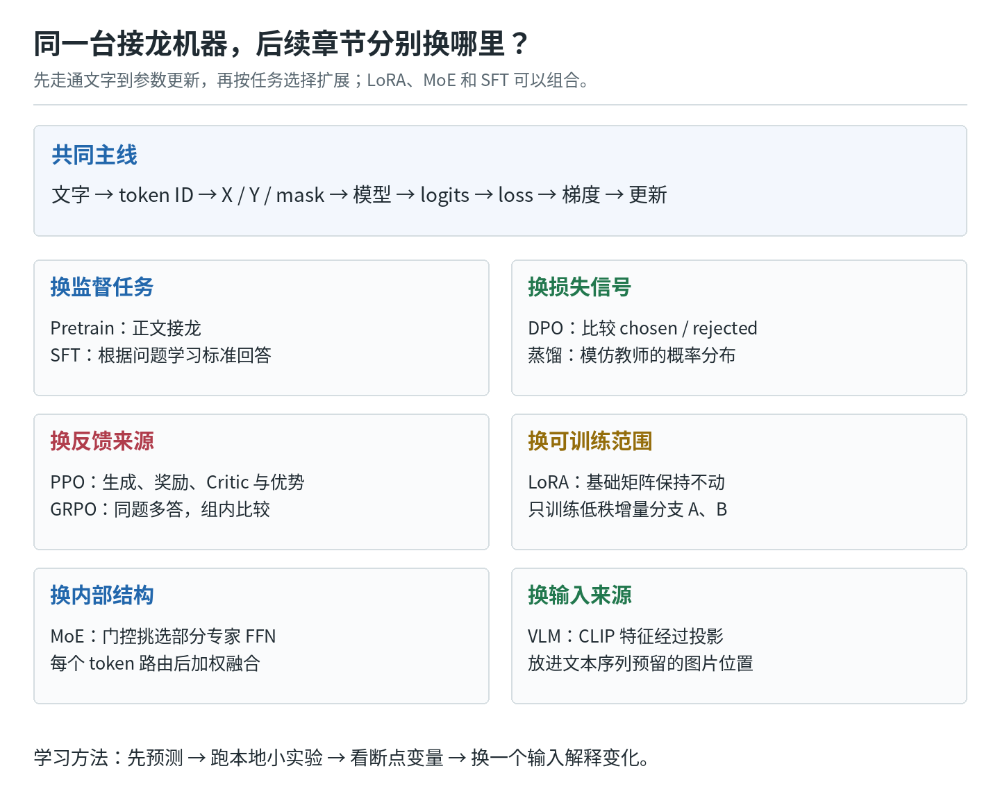
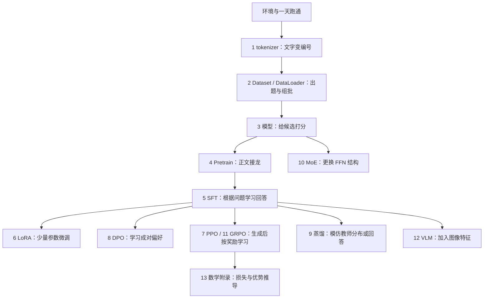

# 学习路线：从一段文字到不同训练方法

先把整个项目想成同一台“接龙机器”。tokenizer 决定把文字切成哪些零件；Dataset 准备题目和答案；模型给候选打分；loss 决定怎样计分；优化器根据梯度修改参数。后面的章节是在不同位置换零件，不是每章都重新造一台机器。

本课程用仓库实际实现讲解。所有命令从项目根目录执行，默认已有 `.venv`。环境未准备好时，先看 [环境搭建](0.环境搭建.md)；已经完成三批调试实验时，可以直接进入 [SFT](5.SFT.md)。

## 1. 一张图看懂章节关系





LoRA 是“更新哪些参数”的方法，SFT 是“用什么监督任务”的方法，可以组合。MoE 是模型结构，能配合预训练或 SFT；不是做完 DPO 后必须再训练的一关。PPO、DPO、GRPO 也是不同选择，不要求顺次全部执行。

## 2. 每章只带着一个问题进去

| 章节 | 本章要解决的问题 | 先做的实验 | 完成时留下什么证据 |
| --- | --- | --- | --- |
| [1 tokenizer](1.train_tokenizer.md) | `MiniMind` 怎样变成整数？ | `--lesson tokenizer` | 原文、切片、ID、解码结果 |
| [2 DataLoader](2.DataLoader.md) | 一段文本怎样变成 X/Y/mask？ | `--lesson data` | 单条 `[63]`、组批 `[2,63]` |
| [3 模型](3.模型构建.md) | 编号怎样变成 6400 个分数？ | `--lesson model` | 各模块形状与一处数值例子 |
| [FFN 矩阵精讲](3.1.FFN矩阵与梯度.md) | gate/up 的权重怎样学习，每步有几行几列？ | `scripts/inspect_ffn.py` | 真实 `63×128 → 63×384 → 63×128` 与权重梯度核对 |
| [Embedding 到 logits](3.2.Embedding到logits矩阵精讲.md) | 查表、K/V 的 32 维、输出的 6400 维怎样衔接？ | `scripts/inspect_model.py` | 真实查行、Q/K/V 投影、8/2 个头、最终词表点积 |
| [4 Pretrain](4.Pretrain.md) | 三批为什么只有两次更新？ | `--lesson pretrain` | batch=3、AdamW 更新=2 |
| [保存与恢复](0.预训练循环精讲.md) | 中断后是否真的从下一批接着学？ | `--lesson resume` | 恢复结果与连续训练的模型、AdamW 状态一致 |
| [5 SFT](5.SFT.md) | 问题可以读，为什么不为问题计分？ | `--lesson sft` | 解码被监督的 Y |
| [6 LoRA](6.LoRA.md) | 基础权重不动，输出怎样改变？ | `--lesson lora` | 基础 W 不变、B 已更新 |
| [8 DPO](8.DPO.md) | “更喜欢好回答”怎样写成 loss？ | `--lesson dpo` | 正反偏好的两组 loss、梯度符号 |
| [9 蒸馏](9.白盒蒸馏.md) | 除了标准答案，还能学什么？ | `--lesson distill` | 相同分布 loss≈0、学生有梯度 |
| [10 MoE](10.MoE.md) | 一个 token 怎样选专家？ | `--lesson moe` | 专家 1/2、权重 0.75/0.25 |
| [7 PPO](7.PPO.md) | 最后一刻的奖励怎样影响前面的 token？ | `--lesson ppo` | GAE 倒推表和裁剪算例 |
| [11 GRPO](11.GRPO.md) | 同一问题的多份回答怎样互相比？ | `--lesson grpo` | 组内优势的正负与 detach 梯度 |
| [12 VLM](12.minimind-v.md) | 图片怎样占据文本序列里的位置？ | `--lesson vlm` | `196×768 → 196×128` 的投影 |
| [13 数学附录](13.强化学习刨根问底.md) | 公式和当前实现有哪些区别？ | 重做 PPO / GRPO 实验 | 一组手算结果与代码对齐 |

上表的参数通过统一入口使用，例如：

```bash
.venv/bin/python scripts/lesson_lab.py --list
.venv/bin/python scripts/lesson_lab.py --lesson data
.venv/bin/python scripts/lesson_lab.py --lesson sft
```

全部做一遍：

```bash
.venv/bin/python scripts/lesson_lab.py --lesson all
```

13 个实验全部在 CPU 上使用本地资源。预训练与恢复实验调用真实入口，但把权重写到临时目录并自动清理。其他实验在内存中运行；不会覆盖已有 `out/` 模型，不会下载奖励模型、教师模型或 CLIP。

PPO/GRPO 实验验证奖励、优势和损失表达式，VLM 验证真实投影层与占位数量；这些检查不等于完整强化学习或图像问答训练已实测。历史截图只是当时实验的记录，不能替代当前环境下的验证。

## 3. 每次学习怎样操作

第一遍先读具体场景，能说清楚“输入是什么、要改变什么”。第二遍运行本章的小实验，对照预期结果。第三遍才打开源码设断点，一次只追一个变量。

例如读 SFT：

```text
先预测：用户提问对应的 mask 应为 0
再运行：打印参与计分的 Y
然后验证：解码结果包含回答和结束标记，不包含用户提问
最后解释：问题还在 X 中，能影响回答，只是不对问题的目标位置直接计分
```

不要一次改模型大小、学习率、数据和 tokenizer。保持其他设置不变，只改一个因素，才能解释输出为什么改变。

每章的学习记录可以只写四行：

```text
我预测会发生什么：
实际看到了什么：
对应哪段代码、哪一个变量：
换一个输入后，能否解释变化：
```

## 4. 当前推荐的下一课

已经读懂 `DATA → FORWARD → BACKWARD → UPDATE`、完成三批梯度累积后，下一课是 [SFT](5.SFT.md)：

1. 运行 `--lesson sft`，看真实模板和被监督的回答。
2. 在 VS Code 选择 `03 - Inspect SFT loss mask (CPU)` 看数据。
3. 再选 `06 - Follow SFT update (CPU)`，把同一份回答监督接到完整参数更新。
4. 能解释 mask 后，再进入 LoRA。LoRA 继续使用 SFT 数据，但更改可训练参数范围。

遇到陌生词，先查 [概念速查](0.概念速查.md)。要追完整训练入口，再回到 [预训练循环精讲](0.预训练循环精讲.md)；不需要每次从长文第一行重读。

实践时出现缺文件、形状不匹配或变量未定义，先看 [实践排错](0.实践排错.md)，按当前阶段定位问题。

本页和 SFT 的 PNG 图解已随文档保存，Markdown 预览可直接打开。生成脚本为 [render_learning_figures.py](../scripts/render_learning_figures.py)，使用本地 tokenizer 与示例数据。可用 `.venv/bin/python scripts/render_learning_figures.py` 重新生成；中文字体要求与 [预训练绘图脚本](../scripts/render_pretrain_figures.py) 相同。

## 5. 本次验证记录

2026-11-24，在当前项目 `.venv` 中完成 12 个 CPU 章节实验、18 项原有回归测试，并在临时目录运行了真实的“小模型预训练 → SFT → LoRA”入口及独立 tokenizer 训练。新 tokenizer 的目标大小为 512，六条 demo 实际得到 470 个词表项，编码解码往返相等。

预训练入口核对三批对应两次 AdamW 更新；SFT 第 0 条样本核对 21 个监督目标与 52 个非 padding 目标；LoRA 实验核对基础 W 不变、低秩 B 更新。PPO、GRPO 和 VLM 的验证范围仍是上述局部计算，没有加载外部奖励模型、教师权重或 CLIP。

后续增加 `resume` 实验，固定原训练设置，在 batch 2 完整保存后暂停、重新初始化并读取 checkpoint，只续训 batch 3；检查模型参数和 AdamW 状态与连续训练一致。实验只覆盖 CPU、float32、固定样本顺序与 dropout=0 的单卡配置。

## 6. 修改课程后怎么检查

```bash
.venv/bin/python scripts/check_course.py
.venv/bin/python -m unittest discover -s tests -v
```

第一条仅使用 Python 标准库，检查全部顶层教程的本地链接、代码围栏、Python 代码块语法，以及 VS Code 章节选项与 `LESSONS` 的一致性；不执行代码块，也不访问远程网址。第二条运行仓库回归测试，包含本次恢复与附件加载检查。

Pixi 用户可以运行 `pixi run check-course`。要验证课程计算本身，仍需运行 `lesson_lab.py --lesson all`，链接和语法通过不代表算法、命令前置条件或模型能力都已验证。
