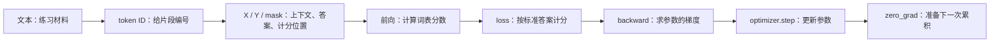

# 逐步调试：看懂一次参数更新

先在 [学习路线](0.学习路线.md) 找当前章节的位置；陌生变量名查 [概念速查](0.概念速查.md)。本篇专注断点观察，按章节运行的小实验统一放在 `scripts/lesson_lab.py`，可以在 [SFT](5.SFT.md) 等章节交叉验证。

本练习复用项目的 `PretrainDataset`、`SFTDataset` 和 `MiniMindForCausalLM`。先使用 CPU、float32、两层小模型、一个 batch，固定随机种子为 42。教学脚本只在内存中更新一次参数；原训练入口的练习会保存到独立的 `out/debug/` 和 `checkpoints/debug/`。

### 为什么一开始调用 `setup_seed(42)`

可以把随机种子想成“洗牌时使用的固定起点”。模型初始化、数据抽样、随机生成等操作都会从随机数生成器取数；如果每次起点不同，即使代码和输入完全相同，初始权重和输出也可能不同。`setup_seed(42)` 在创建模型之前设置固定起点，因此本练习每次都尽量从同一副“牌”开始。

`42` 没有特殊含义，只是一个约定俗成、方便复现实验的整数。函数会同时设置 Python、NumPy、PyTorch 和 CUDA 的随机数生成器，并在 CUDA 可用时要求 cuDNN 选择确定性算法。这样做的结果是：相同代码、输入、模型配置和设备下，初始权重、loss 和第一次参数更新通常可以复现。

随机种子控制实验的随机起点，不是模型通过梯度学习的权重。要比较学习率或某个代码改动，先保持 `setup_seed(42)` 不变，只改变一个因素。固定随机种子也不能保证所有硬件、驱动和并行算法都逐位一致，所以文档中的小数用于观察机制，不作为跨环境的硬性验收值。

在代码中要注意调用时机：

```python
setup_seed(42)  # 先固定随机起点
model = MiniMindForCausalLM(config)  # 再初始化随机权重
```

如果模型已经创建后才设置种子，已经生成的初始权重不会被重新洗牌；这就是 `debug_train_step.py` 把它放在模型创建之前的原因。

每一站都先预测，再查看变量，最后用一句话解释观察结果。第一遍把数据到更新的过程串起来，第二遍再进入 Attention 的内部。

可以先把一次训练想成一轮填空练习：准备题目、给候选答案打分、根据标准答案计算损失、求出参数调整方向、执行调整。下面的比喻用于建立直觉，最终要回到张量、公式和代码核对。



图中的“答案”指训练数据中的目标 token，“计分”指计算一个可微的数值目标。模型的优化目标由这些数据和损失定义；loss 下降本身不保证回答事实正确。

## 一次调试的完整路线

可以把 `scripts/debug_train_step.py` 看成一条固定的流水线。每一步都产生下一步需要的变量：

```text
启动脚本
  ↓
解析参数、检查设备
  ↓
setup_seed(42)
  ↓
加载 tokenizer 和 demo 数据
  ↓
Dataset 把文本变成 input_ids
  ↓
构造 X、Y、loss_mask
  ↓
初始化小型 MiniMind 和 AdamW
  ↓
前向传播：X → hidden states → logits
  ↓
交叉熵：logits + Y → per_token_loss
  ↓
loss_mask 汇总有效位置 → loss
  ↓
loss.backward() → gradients
  ↓
clip_grad_norm_() → 控制梯度大小
  ↓
optimizer.step() → 更新参数
  ↓
zero_grad() → 清空梯度，准备下一批
```

代码中最重要的变量可以按下面的关系阅读：

| 阶段 | 关键变量 | 形状或含义 | 需要回答的问题 |
| --- | --- | --- | --- |
| 环境 | `args`, `ROOT`, `tokenizer` | 运行参数、项目路径、词表 | 用的是哪套代码和 tokenizer？ |
| 数据 | `sample` | 原始文本或对话 | 模型实际要读什么？ |
| 对齐 | `X`, `Y` | `[B, T]` 的 token ID | 每个位置要预测哪个下一个 token？ |
| 计分范围 | `loss_mask` | `[B, T]` 的 0/1 标记 | 哪些目标位置参与 loss？ |
| 模型 | `model`, `optimizer` | 随机初始化的小模型和更新规则 | 参数从哪里来、由谁更新？ |
| 前向 | `shapes`, `logits` | `[B, T, H]` → `[B, T, V]` | 每个位置给哪些候选 token 打分？ |
| 损失 | `per_token_loss`, `loss` | 每位置损失 → 一个标量 | 正确答案的概率是否足够高？ |
| 反向 | `gradient`, `gradient_norm` | 参数的梯度 | 参数应该往哪个方向调整？ |
| 更新 | `weight_before`, `weight_delta` | 更新前后参数差异 | 参数是否真的改变了？ |

在 VS Code 中可以按四个停靠点理解这条路线：

```text
DATA     看 sample、X、Y、loss_mask
FORWARD  看 shapes、logits、per_token_loss、loss
BACKWARD 看 gradient、gradient_norm，确认权重还没变
UPDATE   看 weight_delta，确认 step 后权重改变且梯度被清空
```

### 四个停靠点具体看什么

**DATA：把一段文本变成训练题目。**

这一站还没有创建模型。Dataset 先把文本切成 token ID，再复制出两排错开一格的序列：

```text
X：      [M, in, i, M, ind, ...]
Y：      [in, i,  M, ind, is,  ...]
mask：   [1,  1,  1, 1,  1,   ...]
```

在 VS Code 的变量面板或调试控制台查看：

```python
sample
X.shape
Y.shape
loss_mask.sum().item()
tokenizer.decode([X[0, 0].item()])
tokenizer.decode([Y[0, 0].item()])
```

本练习通常会看到 `X.shape == Y.shape == loss_mask.shape == (1, 63)`，并看到第一个任务是 `M → in`。完成标准是能解释每个下标、知道哪些位置会计分，并确认 `X[:, 1:] == Y[:, :-1]`。

**FORWARD：让模型为每个位置的候选 token 打分。**

这一站创建随机初始化的小模型并执行 `result = model(X)`。数据经过 Embedding、Attention、FFN 和 `lm_head`，得到 `logits`：

```text
X       [1, 63]
hidden  [1, 63, 128]
logits  [1, 63, 6400]
```

在调试控制台查看：

```python
shapes
logits.shape
logits[0, 0].topk(5)
per_token_loss.shape
loss.item()
model.lm_head.weight.grad is None
```

这里 `logits[0, 0]` 是第一个预测位置对 6400 个候选 token 的分数；`per_token_loss` 仍然是每个位置一个数，`loss` 才是经过 `loss_mask` 汇总后的标量。完成标准是能说清楚 `logits` 不是概率，并确认此时梯度还不存在。

**BACKWARD：根据 loss 计算参数应该怎么调整。**

这一站执行 `loss.backward()`。计算图从 loss 反向经过 `lm_head`、Transformer 和 Embedding，为可训练参数写入 `.grad`；参数本身还没有被优化器修改。

在调试控制台查看：

```python
gradient
gradient_norm
weight_before
(model.lm_head.weight.detach() - weight_before).abs().max().item()
```

预期 `gradient_norm > 0`，而 `weight_delta_before_step == 0`。完成标准是能区分“产生梯度”和“修改参数”：`backward()` 只产生调整方向，不执行参数更新。

**UPDATE：使用梯度修改参数并清空梯度。**

这一站依次执行梯度裁剪、`optimizer.step()` 和 `optimizer.zero_grad()`：

```text
梯度裁剪：防止单次梯度过大
optimizer.step()：按学习率修改参数
zero_grad()：清掉本轮梯度
```

在调试控制台查看：

```python
weight_delta
model.lm_head.weight.grad
```

预期 `weight_delta > 0`，而 `model.lm_head.weight.grad is None`。最后一句“梯度为空”不是更新失败，而是说明梯度已经清理，刚才的参数更新仍然保留在模型中。本脚本只在内存中更新，不会覆盖 `out/` 下的权重文件。

这四站之间有一个必须记住的顺序：

```text
forward 只计算输出和 loss
backward 只根据 loss 产生 gradient
optimizer.step 才真正修改 parameter
zero_grad 只清除 gradient，不会撤销已经完成的更新
```

因此，调试时不要只看最后的 loss 数字，而要沿着“数据是否正确 → 输出形状是否正确 → loss 是否只计算有效位置 → 梯度是否存在 → 参数是否更新”的证据链检查。

本文统一使用以下记号：

| 记号 | 含义 | 本练习中的对应值或变量 |
| --- | --- | --- |
| B | 一个 batch 的样本数 | 1 |
| T | 预测位置数 | 默认 63 |
| H | 每个 token 的隐藏向量宽度 | 128 |
| V | 词表大小 | 6400 |
| L | 损失标量 | `loss` |
| θ | 模型的可训练参数集合 | `model.parameters()` |
| g | 损失对参数的梯度 | 参数的 `.grad` |
| η | 学习率 | `learning_rate` |

各节的“原理图解”先给直观例子，再说明代码实际上如何计算；教学数字与本机实测数字会明确区分。API 说明按本项目使用的 PyTorch 2.14 核对，参考资料见文末。

先按下面的顺序学习。每一步的“完成标准”是进入下一步前的自查依据；时间只是安排参考，遇到不理解的地方可以停下来重复观察。

| 步骤 | 学习核心 | 本步完成后应该能做什么 | 建议用时 |
| --- | --- | --- | --- |
| 1. 看一条数据 | token、序列、batch | 读懂输入和标签的每一列 | 20 分钟 |
| 2. 使用断点 | 执行位置和变量作用域 | 主动控制程序停下和继续 | 15 分钟 |
| 3. 核对标签 | 自回归移位、padding、loss mask | 解释每个位置在预测什么 | 25 分钟 |
| 4. 跟踪前向 | Embedding、Attention、logits、loss | 标注主要形状并解释监督信号 | 45 分钟 |
| 5. 检查反向 | 计算图、梯度 | 证明 backward 只产生梯度 | 25 分钟 |
| 6. 检查更新 | 优化器、梯度裁剪、清零 | 证明参数更新并解释清零时机 | 25 分钟 |
| 7. 使用 VS Code | 调试配置与变量观察 | 在编辑器中完成同一条观察链 | 15 分钟 |
| 8. 跟踪原训练入口 | 梯度累积、保存、恢复 | 数出真实更新次数并找到断点产物 | 45 分钟 |
| 9. 对照 SFT | 对话模板、回答监督 | 解释预训练与 SFT 的监督范围 | 30 分钟 |
| 10. 独立复现 | 用证据解释训练 | 脱离教程完成一次观察和复述 | 30 分钟 |

第 2 步的终端调试器和第 7 步的 VS Code 是两种观察方式。先熟悉一种，就可以继续学习模型；后面再补另一种。按这些时段完成一轮约需 4-5 小时，休息时间另计；它覆盖核心训练过程，后续再学习完整训练和进阶算法。

## 1. 先看一条数据

**核心内容**：文本先转换为 token ID，Dataset 生成单条序列，DataLoader 再把样本组织成 batch。一个 token 不一定等于一个字或一个完整单词。

**学习目标**：能在输出中找到原始文本、输入 X、目标 Y、loss mask，并分别说出它们的用途。

### 原理图解：给文本片段编零件号

想象你要把一段文字装成一列拼块。tokenizer 决定如何切分，并为每块查询一个编号。当前 tokenizer 对 `MiniMind` 的实际切分是：

```text
原文：       MiniMind
token：      M    in    i    M    ind
token ID：  47   261   75   47   807
```

因此，字符串的字符数、单词数和 token 数可能不同。相同编号表示同一个词表条目，编号本身没有“越大越重要”的含义，两个 ID 数值接近也不代表含义接近。

接下来需要把多条长短不同的序列组成一个矩形张量，就像把长短不同的作业放进相同格数的表格：

```text
示意样本 A： [a, b, c, pad, pad]
示意样本 B： [d, e, f,   g, pad]
             └──── T 个位置 ────┘
两行叠放后： [B, T]
```

这里的字母只是 token 的示意符号。padding 是补齐格子，truncation 是超长时按设置截断；它们影响张量长度，并不自动保证正文完整。`Dataset` 负责准备每份样本，`DataLoader` 负责取样和组批。本练习 `batch_size=1`，所以只叠一行。

**如何做到**：先预测输出会有哪些内容，再从仓库根目录执行：

```bash
.venv/bin/python scripts/debug_train_step.py --stop_after data
```

预期输出包含：

```text
X=(1, 63); Y=(1, 63); loss_mask=(1, 63)
supervised_tokens=19; X[:, 1:] == Y[:, :-1]: True
```

脚本随后逐行打印 X token、Y token 和参与 loss 的标记。默认显示前 16 行，传 `--token_rows 64` 可查看当前样本全部位置。

先回答：

1. 输入设置了 64 个 token，为什么 X 只有 63 个位置？
2. 第 0 行的 X 是 `M`，Y 是 `in`，这一位置训练模型预测什么？
3. 为什么 padding 位置的 loss mask 为 0？

对应源码为 `dataset/lm_dataset.py` 的 `PretrainDataset.__getitem__`。Dataset 返回单条长度为 63 的序列；DataLoader 添加 batch 维度，变为 `[1, 63]`。X 去掉原序列末尾，Y 去掉原序列开头，mask 也取 `[1:]`，与目标 Y 对齐。

**完成标准**：能在记录里写出“本批有 1 条样本，每条有 63 个预测位置”，并从输出中指出两个 token 对应的原文片段。`supervised_tokens=19` 是当前默认样本实际参与监督的位置数，区别于固定长度 63。

**动手检验**：加上 `--sample_index 1`，换一条样本，确认固定输入长度可以相同，但正文及有效监督数量可能改变。再改为 `--max_seq_len 32`，先预测形状，运行后核对是否为 `[1, 31]`。更短的长度也可能截掉正文，所以形状正确还不能说明数据完整。

## 2. 在四个阶段自动停住

**核心内容**：调试器暂停在某个执行位置，允许查看当时已经产生的变量。变量是在语句执行过程中逐渐产生的。

**学习目标**：能够主动停住程序、查看一个变量，再继续到下一阶段。

### 原理图解：暂停操作过程，查看当时的工作台

把程序看成按顺序进行的一组操作。断点是在某个位置暂停，变量窗口展示当时函数工作台上已经有的东西。

```python
a = 3
b = a * 2
c = b + 1
```

如果调试器的箭头指向 `c = b + 1`，前两行已经执行，通常能看到 `a=3`、`b=6`；当前这一行尚未执行，`c` 可能还不存在。教学脚本会在完成一站计算后调用 `breakpoint()`，所以该站结果已可查看。

进入子函数，相当于换到另一个工作台。调用栈记录“是谁调用了谁”，每一层栈帧有自己的局部变量。`where` 帮你确认所在位置，`p` 查看当前帧的变量，`s` 进入函数，`n` 跨过当前行的调用继续观察。

这个“暂停”比喻只用于理解当前 Python 执行位置；本练习采用单进程数据加载和 CPU 观察，便于按顺序追踪。它不表示整个操作系统或其他程序都暂停了。

**如何做到**：终端执行：

```bash
.venv/bin/python scripts/debug_train_step.py --breakpoints
```

脚本内置四个 `breakpoint()`，不需要先记行号。每次停住时，阶段计算已经完成，相关变量都在当前 `main` 函数中。

| 停靠点 | 可以查看的变量 | 本站要确认的事实 |
| --- | --- | --- |
| DATA | `sample`、`X`、`Y`、`loss_mask`、`tokenizer` | 文本已经变成训练样本 |
| FORWARD | 上述变量，以及 `model`、`logits`、`per_token_loss`、`loss`、`shapes` | 模型给每个位置输出词表分数 |
| BACKWARD | 上述变量，以及 `gradient`、`gradient_norm`、`weight_before` | 已有梯度，权重还没有更新 |
| UPDATE | 上述变量，以及 `weight_delta` | 参数更新完成，梯度已清空 |

在 `(Pdb)` 输入：

- `p 表达式`：打印变量或计算表达式。
- `n`：执行下一行。
- `s`：进入当前调用的函数。
- `c`：继续到下一个断点。
- `q`：退出本次练习。

本脚本的断点只有启用 `--breakpoints` 才生效。普通运行会直接输出四个阶段并退出。

**完成标准**：在 DATA 阶段打印 `X.shape`，继续到 FORWARD 阶段打印 `logits.shape`，最后正常退出。DATA 阶段还没有创建 `model` 和 `logits`；在那里访问它们出现未定义错误，是执行顺序造成的。

**动手检验**：在一次暂停时输入 `where`，查看调用栈并找到当前脚本的 `main`。能指出“当前停在什么函数、哪些语句已经执行”，再继续。

## 3. 第一站：确认输入和标签

**核心内容**：自回归训练让第 i 个位置使用当前及此前的输入，预测下一个 token。X/Y 的移位负责对齐预测目标，因果注意力负责限制可见的上下文。

**学习目标**：能逐位置说明“模型看到的上下文是什么、应该预测什么、这个预测是否计入 loss”。

### 原理图解：盖住后文做接龙

用下面的示意序列做一次接龙：

```text
原序列： [我, 爱, 学习, pad]
X：      [我, 爱, 学习]
Y：      [爱, 学习, pad]
mask：   [1,   1,    0]
```

三个位置分别提出三个预测任务：

| 预测位置 | 可以使用的上下文 | 目标 | 是否计分 |
| --- | --- | --- | --- |
| 0 | 我 | 爱 | 是 |
| 1 | 我、爱 | 学习 | 是 |
| 2 | 我、爱、学习 | pad | 否 |

“我、爱、学习”只是帮助理解的示意 token，真实切分以 tokenizer 输出为准。你看到的每个 Y 都来自原文后移一位的切片，训练无需额外人工标注每个下一个 token。

把本项目第一条 demo 文本的开头展开，就能看到同样的关系。tokenizer 没有把 `MiniMind` 当成一个完整单词，而是切成了多个 token：

```text
原始文本： MiniMind is a small ...
token：     M | in | i | M | ind |  is |  a |  small | ...
token ID： 47 |261 |75 | 47 |807 | 370 |260 | 2425 | ...
位置：       0    1   2    3    4    5    6     7
```

训练数据把这排 token 复制成两排，并把目标排向左移动一格：

```text
位置：  0      1      2      3       4       5       6
X：    M      in     i      M       ind      is      a
Y：    in     i      M      ind      is       a      small
任务： 预测 in  预测 i  预测 M  预测 ind  预测 is  预测 a  预测 small
```

这里 `X[0, 0].item()` 实际为整数 `47`，解码后才是 `"M"`：

- 第一个 `0` 是 batch 下标：当前只有第 0 条样本。
- 第二个 `0` 是序列位置下标：当前看第 0 个位置。
- 这个位置的输入 token 是 `M`，其 token ID 实际为 `47`。

`Y[0, 0].item()` 实际为整数 `261`，解码后是 `in`。它表示同一条样本、同一个预测位置的标准答案，因此第 0 个位置的训练任务就是“看到 `M` 后，预测下一个 token `in`”。

第 1 个位置同理：`X[0, 1]` 是 `in`，`Y[0, 1]` 是 `i`，任务是预测 `i`。虽然训练时整排 X 一次性送进模型，但因果注意力会遮住后面的 token：第 0 个位置只能使用 `M`，第 1 个位置可以使用 `M、in`，不能偷看 `i` 或更后面的内容。这样既能并行计算整排位置，又保持了从左到右预测的规则。

可以把它想成老师给出一排接龙题：

```text
题目： M   → ?      in  → ?      i   → ?      M   → ?
答案： in           i             M             ind
```

`X` 是左边的已知 token，`Y` 是每道题的标准答案。`logits[0, 0, :]` 就是模型在第一道题上给 6400 个候选 token 的打分；交叉熵只检查正确答案 `Y[0, 0]` 对应的那一项分数是否足够高。

有一个关键问题：训练一次传入整条 X，位置 0 会不会偷看位置 1 的“爱”？因果注意力限制每个位置可读取的输入范围：

```text
                         输入位置
                         0  1  2
当前预测位置 0：          1  0  0
当前预测位置 1：          1  1  0
当前预测位置 2：          1  1  1
```

1 表示可见，0 表示禁止读取。这让训练可以并行计算所有位置的预测，同时让每个预测只依赖当前位置及以前的输入。标准的从左到右生成则会不断把新生成的 token 接到输入末尾。

因果遮挡和 loss mask 分工不同：前者限制“计算当前预测时能读取哪些输入”，后者决定“哪些目标位置参与损失汇总”。本项目预训练读取样本时不会自动为正文添加结束标记，不能从示意图额外推断出自动追加 EOS 的行为。

**如何做到**：在 DATA 停住时执行：

```text
p X.shape
p tokenizer.decode(X[0].tolist())
p tokenizer.decode(Y[0].tolist())
p (X[:, 1:] == Y[:, :-1]).all().item()
p loss_mask[0].tolist()
```

观察正文和后面的 `<|endoftext|>` 填充位置。最后一个表达式里的 1 表示对应 Y 位置参与监督，0 表示忽略。

再查看前 5 个位置的具体 token：

```text
p [(i, tokenizer.decode([X[0, i].item()]), tokenizer.decode([Y[0, i].item()]), loss_mask[0, i].item()) for i in range(5)]
```

**完成标准**：能够解释以下三点：

1. `X[:, 1:] == Y[:, :-1]` 是移位关系的核对，不能据此判断模型已经学会预测。
2. 第 i 个预测可以利用 `X[0, :i+1]`，模型会在前向计算中通过因果注意力限制后续输入。
3. 某个 padding 目标位置即使有模型输出，mask 为 0 时，该位置的交叉熵也不计入最终 masked loss。

**动手检验**：假设原序列为 `[11, 22, 33, 0]`，最后的 0 为 padding，先手写 X、Y、mask，再核对答案：X 为 `[11, 22, 33]`，Y 为 `[22, 33, 0]`，目标 mask 为 `[1, 1, 0]`。这是用于理解移位的简化 ID 示例。

完成后输入 `c`。如果还不能解释任意一行，回到第 1 步的完整 token 表再看一遍。

## 4. 第二站：理解模型在预测什么

**核心内容**：Embedding 把整数 ID 转为可训练的向量；Transformer 结合上下文处理向量；lm_head 为每个位置输出词表分数；交叉熵用目标 token 评价这些分数。

**学习目标**：能解释 logits 的三个维度，并沿着一个位置追踪“输入 ID → 隐藏向量 → 词表分数 → loss”。

### 原理图解：先领向量卡片，再结合上下文打分

**Embedding：查一张可以调整的卡片。** 词表中的每个 ID 对应一行长度为 H 的向量。本练习的表有 `[6400, 128]` 个数，输入 `[1, 63]` 的 ID 后，查表得到 `[1, 63, 128]`。

你可以把一行想成一张有 128 个可调数值的卡片。这些数值起初由初始化决定，再由训练修改；卡片的第 1 格没有被预先指定为“语法分数”等人类概念。

**Attention：按当前需要，从可见上下文中汇总信息。** 类比查资料，Q 是当前的检索向量，K 是各位置的索引向量，V 是可被汇总的内容向量：

| 计算 | 直观理解 | 当前代码 |
| --- | --- | --- |
| 生成 Q/K/V | 用不同方式描述当前需求、索引和内容 | `q_proj`、`k_proj`、`v_proj` |
| Q 与 K 点积 | 计算各位置的匹配分数 | `Q @ K.transpose(...)` |
| 遮挡后做 softmax | 把可见位置的分数变成汇总权重 | 因果遮挡、`softmax` |
| 权重乘 V | 根据权重汇总内容 | 注意力权重与 V 相乘 |

简化写为：

$$
\operatorname{Attention}(Q,K,V)
=\operatorname{softmax}\left(\frac{QK^\top}{\sqrt d}+M\right)V
$$

d 是每个头的宽度，本练习为 16；缩放项控制点积分数的幅度。M 用 0 表示允许读取的位置，用负无穷表示被遮挡的位置，后者在 softmax 后得到 0 权重。公式中的 M 是加法表示，代码也可以用布尔 mask 交给 SDPA 实现相同的遮挡语义。

例如，某一头对三个可见位置的权重是 `[0.1, 0.8, 0.1]`，汇总结果就是 `0.1V₀ + 0.8V₁ + 0.1V₂`。这些都是向量运算。权重来自学习到的表示和当前上下文，不能直接当成事实可信度或完整的模型解释。

**GQA：多个检索头共用部分索引和内容。** 当前有 8 个 Q 头、2 个 KV 头，每个 KV 头供 4 个 Q 头使用。各个 Q 头仍然分别计算自己的注意力权重。调试时注意 KV 重复的是头维度，单个头的宽度仍为 16。

**位置与尺度：让前向计算知道顺序，并控制向量幅度。** 可以用下面三个问题理解这些组件：

| 组件 | 要解决的问题 | 代码机制 |
| --- | --- | --- |
| RoPE | 相同 token 出现在不同位置，如何影响匹配？ | 按位置旋转 Q/K 的成对分量，使点积包含位置信息 |
| RMSNorm | 向量幅度变化较大时，如何处理尺度？ | 沿隐藏维除以均方根，再乘可学习的缩放参数 |
| 残差相加 | 经过模块后，如何保留原表示并加入处理结果？ | 将模块输出加回原输入 |

RoPE 可以想成给 Q/K 的部分分量装上随位置旋转的指针；其数学机制是旋转向量，位置改变会影响匹配。RMSNorm 计算类似 `x / sqrt(mean(x²) + eps)`，并不减去向量均值。残差保留了信息和梯度传播的直接路径，也不保证任何配置下训练都稳定。

**FFN：对每个位置做同样的非线性加工。** Attention 汇总不同位置的信息，FFN 则在每个位置上使用同一组参数处理其隐藏向量。当前的门控前馈计算可以写成：

```text
x: 128 维
  ├─ gate_proj -> 384 维 -> SiLU ─┐
  └─ up_proj   -> 384 维 ─────────┤ 逐元素相乘
                                 └─ down_proj -> 128 维
```

这个“加工”不直接把不同序列位置混在一起，输出宽度仍是 128，方便与残差相加。

**lm_head：给词表中每个候选项打一个分数。** 一个位置的 128 维上下文向量被映射为 6400 个 logits，因此整体得到 `[B,T,V]`。本项目的 Embedding 和 lm_head 共享权重：输入时按 ID 取出卡片，输出时用同一张表与隐藏向量计算词表分数。可以在 FORWARD 断点检查：

```text
p model.model.embed_tokens.weight is model.lm_head.weight
```

预期为 True。

可以先把一个位置想成“下一词投票”。假设词表只有 4 个候选项，模型在某个位置输出：

```text
候选 token：  " is"   " a"   " small"   " model"
logits：       1.2     0.1      3.0        0.8
概率约：       0.124   0.041    0.751      0.083
```

这里的 `logits` 只是 4 个原始分数，数值本身没有单位；分数越大，softmax 后通常越可能被选中。`" small"` 的分数最高，所以模型当前最倾向于预测它。真实项目的候选项不是 4 个，而是 6400 个，因此一个位置对应长度为 6400 的向量。整条序列有 63 个位置，就得到 `[1, 63, 6400]`：每一行都是一次“下一词投票”。

假设正确答案是 `" is"`，这一位置交叉熵为它的概率取负对数。该概率由所有候选分数共同归一化得到，因此梯度会涉及不同候选项；不是只修改一个原始分数。训练目标倾向于提高正确项的相对概率，但共享参数更新不保证某一道题每次都改善。`argmax` 只是查看当前最高分候选，不等于训练目标。

**交叉熵：检查标准答案被分到了多少概率。** 以下用只有 3 个候选项的假想词表举例，标准答案是第 3 项：

| 经 softmax 后的概率 | 正确项概率 | 单位置 loss `-ln(p正确)` |
| --- | --- | --- |
| `[0.1, 0.2, 0.7]` | 0.7 | 约 0.357 |
| `[0.4, 0.4, 0.2]` | 0.2 | 约 1.609 |

loss 会惩罚给正确项分配较低概率的预测。PyTorch 的 `cross_entropy` 接收原始 logits，内部完成相应计算；这里画概率表是为了帮助理解，无需在调用它之前手动 softmax。

最后，mask 像一张计分位置清单，只汇总指定位置，并除以这些位置的数量：

$$
L=\frac{\sum_{b,t}m_{b,t}\ell_{b,t}}{\sum_{b,t}m_{b,t}}
$$

假设逐位置 loss 为 `[0.2, 0.6, 9.0, 9.0]`，mask 为 `[1,1,0,0]`，最终 loss 是 `(0.2+0.6)/2=0.4`。如果误除以包括 padding 在内的 4，就得到 0.2，改变了缩放比例。

**如何做到**：在 FORWARD 停住时执行：

```text
p logits.shape
p per_token_loss.shape
p loss.item()
p model.lm_head.weight.grad is None
p logits[0, 0].argmax().item()
p Y[0, 0].item()
```

预期形状分别是 `[1, 63, 6400]` 和 `[1, 63]`。6400 是词表大小，`logits[0, 0]` 是第一个预测位置对应的全部词表分数。`argmax()` 是当前最大分数对应的 token ID，Y 是训练希望模型预测的 token ID；随机初始化时两者不必相等。

注意 `logits` 还没有经过 softmax；这里的 `cross_entropy` 直接接收 logits。

为了只看一个位置的“投票结果”，可以在 VS Code 的调试控制台输入：

```python
pos = 0
top_ids = logits[0, pos].topk(5).indices.tolist()
[(i, tokenizer.decode([i]), logits[0, pos, i].item()) for i in top_ids]
```

这会列出第 0 个位置分数最高的 5 个 token。再输入下面两行，对照模型最高分和正确答案：

```python
tokenizer.decode([logits[0, pos].argmax().item()])
tokenizer.decode([Y[0, pos].item()])
```

第一行是模型当前最想预测的 token，第二行是训练数据中的正确 token。两者不同并不代表代码出错；随机初始化或训练早期经常如此。

本次 CPU 实测的 masked loss 约为 8.943。它只用于说明输出有限且计算链路正确，换设备或版本后不要求逐位一致。

脚本通过 forward hook 记录第一层主要模块的形状：

| 模块 | 输出形状 |
| --- | --- |
| Embedding | `[1, 63, 128]` |
| Q 投影 | `[1, 63, 128]` |
| K/V 投影 | 各 `[1, 63, 32]` |
| Attention | `[1, 63, 128]` |
| FFN | `[1, 63, 128]` |
| lm_head | `[1, 63, 6400]` |

小模型使用 8 个 Q 头、2 个 KV 头，每个头 16 维。因此 K/V 投影宽度为 `2 × 16 = 32`，随后通过分组查询注意力配合 8 个 Q 头使用。

要理解 loss 如何汇总，再查看：

```text
p per_token_loss[0, :5]
p loss_mask.sum().item()
p ((per_token_loss * loss_mask).sum() / loss_mask.sum()).item()
p (X.requires_grad, model.model.embed_tokens.weight.requires_grad)
```

当前练习没有启用 MoE，辅助损失为 0；上面手动汇总的数值应与 `loss.item()` 一致。X 是整数 ID，不需要对 ID 求梯度；Embedding 的权重参与训练。

第二遍学习模型时，在 `model/model_minimind.py` 的 `Attention.forward` 内设置断点。观察 Q/K/V 在投影、分头、RoPE、KV 重复、注意力计算后的形状，先跟一层即可。

需要每一步对应的真实权重行列和实际数值时，阅读 [Embedding 到 logits 矩阵精讲](3.2.Embedding到logits矩阵精讲.md)，运行 `.venv/bin/python scripts/inspect_model.py`，或选择下面第 9 项调试配置。

**完成标准**：能标注 `B=1`、`T=63`、`H=128`、`V=6400`，解释 `[B,T] → [B,T,H] → [B,T,V]`，并指出每个预测位置只有一个目标 token ID。还要能解释 `model.lm_head.weight.grad is None`：前向已构建计算图，本次还没有执行反向传播。

**动手检验**：只观察当前图，不修改正在使用的张量。先预测 `logits.argmax(dim=-1).shape`，再执行表达式验证它是 `[1, 63]`。最后画一条包含 4 个节点的流程：Embedding、Transformer、lm_head、masked loss。

完成后输入 `c`。第一轮能理解各模块的输入输出即可；第二轮再细看 RMSNorm、RoPE 和注意力内部计算。

## 5. 第三站：区分梯度与权重

**核心内容**：autograd 沿前向构建的计算图，把 loss 对参数的导数累积到参数的 `.grad` 中。

**学习目标**：能用数值证明“反向传播已经计算出梯度，而参数仍未更新”。

### 原理图解：沿计算记录回溯每个参数的影响

把前向计算想成一串相互连接的计算记录：一个结果由哪些输入算来，每个操作的局部导数是什么。反向传播从 loss 出发，利用链式法则把这些局部关系连接起来，求出 loss 对各参数的导数。

用一个能手算的例子看清楚，设 `x=3`，参数 `w=2`，目标为 9：

$$
\hat y=wx=6,\qquad L=(\hat y-9)^2=9
$$

$$
\frac{\partial L}{\partial w}
=\frac{\partial L}{\partial\hat y}
 \frac{\partial\hat y}{\partial w}
=2(6-9)\times3=-18
$$

负梯度意味着在当前点附近，微小增大 w 会让这个 loss 降低。梯度描述的是局部变化率，有限步长的效果还与步长和后续计算有关。

这个独立小实验可以直接在终端运行：

```bash
.venv/bin/python - <<'PY'
import torch
w = torch.tensor(2.0, requires_grad=True)
x = torch.tensor(3.0)
loss = (w * x - 9.0).square()
loss.backward()
print("loss:", loss.item(), "gradient:", w.grad.item(), "weight:", w.item())
PY
```

预期为 `loss: 9.0 gradient: -18.0 weight: 2.0`。`backward()` 填入了梯度，w 仍是 2，参数更新还未执行。

在真实模型中，参数可能通过多条路径影响 loss，autograd 会把各条贡献累积起来；例如本项目输入 Embedding 与输出 lm_head 共用一份参数，反向时这份参数会接收相关路径的贡献。

调试脚本用 `weight.detach().clone()` 保存更新前的快照：`detach()` 让这份快照不参与梯度追踪，`clone()` 创建独立的数据副本。若只保留同一块权重存储的引用，参数更新后“旧照片”也可能跟着变，无法正确比较。

**如何做到**：在 BACKWARD 停住时执行：

```text
p gradient.shape
p gradient_norm
p delta_before_step
p (model.lm_head.weight.detach() - weight_before).abs().max().item()
```

预期梯度存在且有限，后两个值为 0。`loss.backward()` 为参数计算梯度，实际更新由优化器执行。梯度表示当前 loss 对参数的局部变化率。

此时尝试用自己的话解释：如果有梯度，但程序从未调用 `optimizer.step()`，模型权重会怎样？

**完成标准**：提供两条观察证据：`gradient_norm` 大于 0，`delta_before_step` 等于 0；能说清 `.grad` 存放梯度、`.weight` 存放参数，它们承担不同作用。

**动手检验**：重新运行一次，添加 `--stop_after backward`。程序应输出反向传播阶段后结束，不出现 UPDATE 阶段。说明为什么这次运行没有完成参数学习；不要用随机生成文本好坏来替代这个判断。

完成后输入 `c`。本练习是 float32，后续回到原训练脚本时再观察 GradScaler 是否启用及其位置。

## 6. 第四站：确认参数真的更新

**核心内容**：优化器读取梯度和自身状态更新参数；梯度裁剪控制本次梯度的整体大小；`zero_grad` 为下一批准备新的梯度累积。

**学习目标**：能通过参数差值证明更新发生，并说明为什么下一次反向传播前要清理已使用的梯度。

### 原理图解：收到调整方向，再决定怎么调整

梯度给出局部变化率，优化器决定如何使用它。先用普通梯度下降建立直觉：

$$
w_{\text{new}}=w-\eta g
$$

继续上一节的标量例子，w 为 2、梯度为 -18。若学习率为 0.01，则新权重为 `2 - 0.01 × (-18) = 2.18`。代入原 loss 得到 `(2.18 × 3 - 9)² = 6.0516`，小于原来的 9。这个例子只演示一次普通梯度下降。

**本项目实际用 AdamW。** 它会维护梯度的历史信息：

| 状态或参数 | 可以怎样理解 | 实际作用 |
| --- | --- | --- |
| 一阶矩 m | 近期方向记录 | 对梯度做指数滑动平均 |
| 二阶矩 v | 近期幅度记录 | 对梯度平方做指数滑动平均 |
| 学习率 η | 本轮整体调整尺度 | 控制更新的尺度 |
| weight decay | 对参数大小的额外约束 | 执行独立的权重衰减 |

默认配置下，用 g 表示传给优化器的梯度，标准更新的主要部分为：

$$
m_t=\beta_1m_{t-1}+(1-\beta_1)g_t,\quad
v_t=\beta_2v_{t-1}+(1-\beta_2)g_t^2
$$

$$
\hat m_t=\frac{m_t}{1-\beta_1^t},\quad
\hat v_t=\frac{v_t}{1-\beta_2^t},\quad
\theta_t=(1-\eta\lambda)\theta_{t-1}
          -\eta\frac{\hat m_t}{\sqrt{\hat v_t}+\epsilon}
$$

帽子表示对初始滑动平均偏差的修正，λ 是权重衰减系数，ε 是稳定分母的小数。第一次读先理解“更新还依赖历史状态”，第二次再对照优化器状态看公式。不能直接把 AdamW 的参数变化当成 `学习率 × 当前原始梯度`。

**梯度裁剪像限制一整组调整信号的幅度。** 当前使用全局范数裁剪，可以简化理解为：

$$
g_{\text{clip}}=g\cdot\min\left(1,\frac{C}{\lVert g\rVert+\epsilon}\right)
$$

将参与裁剪的参数梯度合在一起计算范数。若总范数为 10、阈值 C 为 1，就把各部分约乘 0.1；它不是把每个梯度元素分别夹到 `[-1,1]`。

**清零像清空本次计算草稿。** PyTorch 的 backward 会累积梯度，因此完成一次预定更新后要清理，避免下一组误用上一组的梯度：

| 时刻 | 权重 | 参数 `.grad` |
| --- | --- | --- |
| 初始 | θ₀ | None |
| 前向后 | θ₀ | None |
| backward 后 | θ₀ | 本组梯度 g |
| step 后 | θ₁ | 仍保留刚使用的梯度 |
| `zero_grad(set_to_none=True)` 后 | θ₁ | None |

这里 θ₀/θ₁ 表示更新前后状态；AdamW 的历史矩状态也会保留到下一次更新。清零 `.grad` 不会把权重或优化器历史一并重置。None 表示当前没有存储梯度，数值为 0 的梯度张量则表示该存储存在但值为 0。

**如何做到**：在 UPDATE 停住时执行：

```text
p weight_delta
p (model.lm_head.weight.detach() - weight_before).abs().max().item()
p model.lm_head.weight.grad is None
```

本次 CPU 实测最大权重变化约为 `0.00050044`，大于 0。最后一个结果应为 True，因为已经执行 `zero_grad(set_to_none=True)`，给下一次训练准备干净的梯度状态。

这条链路是：

```text
文本 -> X/Y/mask -> logits -> loss -> backward -> optimizer.step -> zero_grad
```

输入 `c` 后脚本正常退出；这里直接执行脚本，结束后不会像 `python -m pdb` 那样自动重新启动。

**完成标准**：同时看到 `weight_delta > 0` 和 `model.lm_head.weight.grad is None`，并解释“梯度已清空”不会撤销刚才的参数更新。`weight_delta` 是选定权重矩阵的最大绝对变化，不是 loss，也不是准确率。

**动手检验**：不带断点，分别执行两次：

```bash
.venv/bin/python scripts/debug_train_step.py --learning_rate 0.0005 --token_rows 0
.venv/bin/python scripts/debug_train_step.py --learning_rate 0.0001 --token_rows 0
```

两次均从相同随机种子重新初始化，输入相同。先核对更新前的 loss，再比较 `weight_delta_after_step`。当前首次更新实验中，更小的学习率应带来更小的参数变化。这个实验只解释学习率在一步更新中的作用，不能据此认定哪个值有更好的长期训练效果。

本机 CPU 的对照结果如下，先自行预测再核对：

| 学习率 | 更新前 loss | 最大权重变化 |
| --- | --- | --- |
| 0.0005 | 约 8.94325 | 约 0.00050044 |
| 0.0001 | 约 8.94325 | 约 0.00010009 |

优化器是在前向之后才使用学习率更新参数，所以两次相同初始化、相同输入的首次前向 loss 一致。具体小数不作为跨设备或跨版本的验收要求。

## 7. 使用 VS Code

**核心内容**：调试配置把解释器、入口、参数和工作目录固定下来；变量窗口和调试控制台展示当前暂停帧的状态。

**学习目标**：能够在编辑器中重现前面四站的观察，确认启动的是项目 `.venv` 和指定脚本。

### 原理图解：把实验地址和旋钮写在同一张单子上

调试结果受入口与参数影响。可以把配置看成一张实验设置单：

| 配置项 | 类比 | 实际决定什么 |
| --- | --- | --- |
| `python` | 使用哪套计算工具 | 解释器及其安装的依赖 |
| `cwd` | 在哪个工作间找材料 | 当前工作目录 |
| `program` 或 `module` | 从哪道工序开始 | 启动的 Python 入口 |
| `args` | 本次旋钮位置 | 数据、模型、长度、阶段等命令行参数 |

配置把这些条件固定下来，便于重复实验。在编辑器里看到变量仍然依赖当前暂停帧：选错调用栈帧，就可能看不到你想找的局部变量。

VS Code 提供图形化观察界面，pdb 提供终端命令，两者都让你检查程序状态。调用同一个 `breakpoint()` 时，实际停靠方式由正在使用的调试环境处理。

**如何做到**：仓库已加入 `.vscode/launch.json`。在 VS Code 中以本项目目录为工作区，安装 Python 调试扩展，在“运行和调试”中依次选择：

1. `01 - Inspect pretrain data (CPU)`：只观察数据。
2. `02 - Follow one training update (CPU)`：在四个阶段自动停住。
3. `03 - Inspect SFT loss mask (CPU)`：查看完整的对话 token 和 mask。
4. `04 - Debug original pretrain loop (CPU)`：进入项目原始预训练入口。
5. `05 - Inspect gradient accumulation (CPU)`：处理 3 个 batch，观察 2 次参数更新。
6. `06 - Follow SFT update (CPU)`：在同样四站跟踪一次回答监督的更新。
7. `07 - Run chapter exercise (CPU)`：从列表选择章节小实验，在入口停住后逐步执行。
8. `08 - Inspect FFN matrices (CPU)`：用真实批次逐步核对 gate/up/down 的矩阵形状、梯度和参数更新，细节见 [FFN 矩阵与梯度](3.1.FFN矩阵与梯度.md)。
9. `09 - Inspect Embedding to logits (CPU)`：观察同一批数据的查表、Q/K/V 与多头计算、最终 6400 个候选分数，细节见 [Embedding 到 logits](3.2.Embedding到logits矩阵精讲.md)。

配置固定使用项目 `.venv/bin/python`，工作目录为仓库根目录。第 1～3、6 项使用教学脚本里的断点；第 4、5 项在入口停住，需要按下一节设置原训练循环的断点；第 7 项用于章节实验，不会默认启动外部模型训练；第 8 项在 FFN 的前向、反向和更新完成后分别停住；第 9 项先完成真实前向，再分三个阅读停点核对保存的中间量，不执行参数更新。

Python 调试器扩展标识为 `ms-python.debugpy`。本次验证了配置文件能解析、解释器及脚本路径存在，以及对应 Python 流程；没有操作 VS Code 图形界面验证。

**完成标准**：选择 `02 - Follow one training update (CPU)`，在四站分别找到 X、logits、gradient_norm、weight_delta；能在配置文件中指出解释器、工作目录、入口三个字段。

在已经打开本项目的 VS Code 中，直接按 `Ctrl+Shift+D` 打开“运行和调试”，选择 `02 - Follow one training update (CPU)`，再按 `F5` 即可。程序停住后：

1. 在左侧“变量”面板展开 `Locals`，先看 `X`、`Y`、`loss_mask`。
2. 点击继续按钮或按 `F5` 到 FORWARD 停点，查看 `logits` 和 `loss`。
3. 在“调试控制台”执行 `logits.shape`、`logits[0, 0].topk(5)` 和 `Y[0, 0]`。
4. 继续到 BACKWARD，查看 `gradient_norm`；继续到 UPDATE，查看 `weight_delta`。

如果 VS Code 没有自动使用项目环境，在命令面板执行 `Python: Select Interpreter`，选择 `${workspaceFolder}/.venv/bin/python`，然后重新启动该配置。

**动手检验**：启动第 1 项配置，确认只观察 DATA 后就结束；再启动第 2 项配置，确认会进入模型前向。两次不同表现应能通过 `args` 参数解释。

## 8. 回到原训练循环

三批实验完成后，继续阅读 [预训练循环精讲](0.预训练循环精讲.md)。专题按实际执行顺序讲解 `train_pretrain.py` 与 `train_epoch()`，对照三行日志说明采样、loss、学习率、梯度累积、保存和恢复，并区分代码机制与当前实现的局限。

**核心内容**：一个 batch 的反向传播和一次优化器更新可以有不同的频率；原训练入口还管理多批数据、学习率、AMP、保存和恢复。

**学习目标**：能够数出“处理了几个 batch、更新了几次参数”，并找到完整续训状态保存在哪里。

### 原理图解：收集几份计算结果，再统一调整一次

把每个 batch 想成一份练习，backward 算出这份练习的梯度。开启梯度累积后，会先保留这些梯度，到规定边界才更新参数。

若两批分别产生 loss L₁、L₂，把它们各除以 2，再反向累积，在更新前得到：

$$
\nabla_\theta\frac{L_1}{2}+\nabla_\theta\frac{L_2}{2}
=\frac{g_1+g_2}{2}
$$

在两批反向之间，参数保持不变。处理 3 批、每 2 批累积的完整过程如下：

| batch | 当前 loss 除数 | 更新前累计梯度 | 是否更新 | 更新后是否清零 |
| --- | --- | --- | --- | --- |
| 1 | 2 | g₁/2 | 否 | 否 |
| 2 | 2 | (g₁+g₂)/2 | 是 | 是 |
| 3 | 1 | g₃ | 是 | 是 |

最后只剩一批，就按实际的一批缩放。这正是 `accumulation_divisor` 要处理的尾组。梯度累积可以分批构建一组梯度，让每次前向处理较少样本；所需模型和优化器状态仍然存在。

这里的 g₁/g₂/g₃ 是各批自身平均 loss 的梯度。本项目先按每批有效 token 求均值，再按累积组求均值；各批有效 token 数不同时，这与把全部 token 合并后统一求均值不一定相同。比较“大 batch 等价性”时，还要检查 dropout 等会受执行方式影响的条件。

**AMP：计算精度和梯度缩放是两件配合的事。** 本练习使用 float32，先观察完整计算顺序。原入口启用相应混合精度时，由 autocast 选择算子的计算精度；本仓库仅在 CUDA float16 时启用 GradScaler，反向前放大 loss，在裁剪和更新前还原梯度尺度。bfloat16 不会走本仓库启用梯度缩放的条件。

**Checkpoint：记录当前参数，也记录接着怎么训练。** 类比保存一份练习进度，模型权重是当前已经调整好的参数，优化器状态是刚才提到的方向和幅度记录，epoch/step 则指明进度。

| 保存内容 | 为恢复提供什么 |
| --- | --- |
| model | 当前参数值 |
| optimizer | AdamW 的历史矩、参数组等状态 |
| scaler | 启用缩放时的相关状态 |
| epoch、step | 训练到哪个 epoch、处理到哪个 batch |

仅加载权重再新建优化器，能够继续进行训练计算，但其优化轨迹可能与恢复完整状态不同。这个仓库的 resume 文件没有保存所有随机数和 DataLoader worker 状态，因此应按已有实现的范围理解“恢复”，不要推断为任意环境下逐位相同的复现。

**如何做到**：先在原入口重现一批训练，再只改变梯度累积和 batch 上限。

教学脚本采用单次 float32 更新，原训练循环还包含学习率调度、AMP、梯度累积、checkpoint 和续训。理解四站后，选择第 4 项配置，依次在 `trainer/train_pretrain.py` 的以下语句附近设断点：

| 语句 | 查看内容 |
| --- | --- |
| `X = X.to(args.device)` | X、Y、loss_mask |
| `loss = (loss * loss_mask).sum() / ...` | 逐 token loss 与 logits |
| `if step % args.accumulation_steps == 0 ...` | 反向传播后的梯度 |
| `scaler.update()` | 优化器执行后的参数 |
| `torch.save(state_dict, ckp)` | 输出权重路径及字典内容 |

第一次使用第 4 项配置中的单步参数。然后选择 `05 - Inspect gradient accumulation (CPU)`，其中已经设置 `--accumulation_steps 2` 和 `--max_steps 3`。先预测再验证：前两批累积后更新一次，最后一批单独更新一次，总共两次。第 5 项将结果保存到 `out/debug_accum/` 和 `checkpoints/debug_accum/`。

把断点设在 `scaler.step(optimizer)` 语句上，记录每次暂停时的 `step` 和 `divisor`。预期在第 2、3 个 batch 暂停，分别对应完整的两批累积组和最后的一批。`divisor` 用实际累积组大小缩放 loss，尾组不会把一批 loss 错当成两批平均。

继续运行到结束，检查训练产物：

```bash
.venv/bin/python - <<'PY'
from trainer.train_utils import torch_load
checkpoint = torch_load("checkpoints/debug_accum/pretrain_128_resume.pth")
print("epoch:", checkpoint["epoch"], "completed batches:", checkpoint["step"])
print("saved fields:", sorted(checkpoint))
print("optimizer updates:", sorted({
    int(state["step"].item())
    for state in checkpoint["optimizer"]["state"].values()
}))
PY
```

先完成第 5 项的 3 batch 实验，再运行检查命令，预期 `step` 为 3，`optimizer updates` 为 `[2]`。`out/debug_accum/pretrain_128.pth` 是推理用的模型权重；`checkpoints/debug_accum/pretrain_128_resume.pth` 还包含优化器、scaler 和训练进度。学习恢复时要保持模型结构、数据和 batch 等设置一致，具体操作见“一天跑通教程”的恢复说明。

教学脚本和原训练入口分别初始化模型及数据采样，且原入口包含调度逻辑。两次实验重点核对状态变化及张量形状，loss 数字不需要相同。

**完成标准**：提交一张 3 行的小表，逐批记录“batch 编号、是否更新、累计几批”，以及保存后的 `step=3`。能说明当前 `step` 记录的是已处理的 batch 数，并解释为什么恢复要跳过这些 batch。

本次也实际运行了这组参数：resume 文件中的 `step` 为 3，AdamW 参数状态中的更新计数为 2。它们分别记录 batch 进度和优化器更新进度。

### 本课实操：像老师一样，收两份作业再调整一次

教学脚本只处理一批，所以“交一份作业、计算一次梯度、修改一次参数”刚好重合。现在把规则改为“每收两份作业，合并反馈后再修改参数”：

```text
第 1 批：前向 -> loss / 2 -> backward -> 保留梯度，参数不动
第 2 批：前向 -> loss / 2 -> backward -> 累加梯度 -> 更新 -> 清零
第 3 批：前向 -> loss / 1 -> backward -> 最后一批单独更新 -> 清零
```

本课 `batch_size=1`，因此每批只有一条样本。`max_steps=3` 表示本轮最多处理 3 批；`accumulation_steps=2` 表示通常每两批合并一次梯度。这里日志中的 `step` 数 batch，AdamW 状态中的 `step` 数参数更新；同名变量属于不同对象，需要分清。

打开 `trainer/train_pretrain.py`，点击行号左侧，在下面三处设置红色断点，然后选择第 5 项配置并按 F5：

| 断点语句 | 停住时已完成什么 | 在调试控制台观察什么 |
| --- | --- | --- |
| `if step % args.accumulation_steps == 0 or step == iters:` | 当前批的 backward 已完成，尚未判断是否更新 | `step`、`iters`、`divisor`、`model.lm_head.weight.grad.norm().item()` |
| `scaler.step(optimizer)` | 已完成梯度裁剪，当前更新尚未执行 | `step`，应只在 2、3 时停住 |
| `optimizer.zero_grad(set_to_none=True)` | 当前更新已完成，梯度尚未清空 | `next(iter(optimizer.state.values()))["step"].item()` |

断点箭头指向的语句尚未执行。第一个断点会停三次，`divisor` 分别为 `2、2、1`；第二个断点会停两次；第三个断点处的优化器计数分别为 `1、2`。在第三个断点按 F10 执行清零，再查看 `model.lm_head.weight.grad is None`，应为 `True`。

这里使用 CPU、float32，仓库的 GradScaler 未启用缩放，所以 `scaler.step(optimizer)` 会调用优化器完成本次更新。先把“何时更新”观察清楚，再学习 CUDA 混合精度。

本课通过标准是独立解释三件事：为什么第 1 批之后参数不更新，为什么第 3 批的 loss 除以 1，以及为什么 checkpoint 中处理批数为 3、优化器更新数为 2。

**动手检验**：读 `trainer/train_utils.py` 的 `get_lr`，把原训练日志中的一个学习率值代入公式核对。当前函数实现余弦变化及常数下限项，没有实现线性 warmup；以源码为准学习其实际行为。

## 9. 下一课：SFT mask

**核心内容**：预训练和 SFT 都执行下一个 token 预测，SFT 的对话模板和监督范围体现了任务差异。此项目用 loss mask 选择回答相关的目标位置。

### `PretrainDataset` 和 `SFTDataset` 的区别

`SFT` 是 **Supervised Fine-Tuning** 的缩写，中文通常叫“监督微调”或“有监督指令微调”：

- `Supervised`：有明确的目标答案，训练时用真实回答计算 loss。
- `Fine-Tuning`：在预训练模型已有参数的基础上继续训练，使它适应特定任务。
- 在本项目中，特定任务就是根据用户问题生成 assistant 回复。

两者最后都返回同一种训练接口：

```text
X, Y, loss_mask
```

区别在于“拿什么文本训练”和“哪些目标算分”：

| 项目 | `PretrainDataset` | `SFTDataset` |
| --- | --- | --- |
| 数据字段 | 一行 `{"text": "..."}` | 一行 `{"conversations": [...]}` |
| 文本内容 | 普通连续文本 | system/user/assistant 对话 |
| 文本构造 | 直接 tokenizer 编码 `text` | 先用 chat template 加入角色标记，再 tokenizer |
| 训练目标 | 文本中每个非 padding 的下一个 token | 主要是 assistant 回复和相关结束标记 |
| `loss_mask` | 非 padding 位置为 1 | 用户问题、系统提示和 padding 通常为 0，回答位置为 1 |
| 学到的能力 | 语言续写、语法和知识分布 | 按指令理解问题并生成回答 |

可以用两种练习来区分：

```text
PretrainDataset：
题目：MiniMind is a small ...
计分：几乎每个正文 token 的“下一个 token”都计分

SFTDataset：
题目：用户：What is MiniMind?
答案：助手：MiniMind is a small language model project ...
计分：主要只给助手答案部分计分
```

SFT 并不是把用户问题从输入中删除。用户问题仍然放在 `X` 中，模型可以利用它理解上下文；只是对应的 `Y` 位置 `loss_mask=0`，不会要求模型把用户问题本身当成回答目标。可以把它理解成“题干可以阅读，但只给作答部分打分”。

在代码中，`PretrainDataset.__getitem__` 直接读取 `sample['text']`，对整段 token 做一位错位；`SFTDataset.__getitem__` 先调用 `_create_chat_prompt()`，再由 `_generate_loss_mask()` 根据 assistant 起止标记选择监督范围。因此二者的模型前向接口相同，监督信号不同。

**学习目标**：能在同一张 token 表里指出系统消息、用户消息、assistant 引导头、回答和填充，并判断对应目标位置是否参与 loss。

### 原理图解：题干可以阅读，作答部分参与计分

把一条指令样本看成一份带题干和标准作答的练习。系统提示和用户提问构成上下文，assistant 回复是要学习输出的部分。对话模板用角色标记和换行明确这些边界。

下面的模板仅作结构示意：

```text
system：    你是一位助手
user：      1 + 1 等于多少？
assistant： 2
```

训练在预测 assistant 的“2”时，可以使用此前的系统提示、问题和角色标记。loss mask 选择回答相关的目标位置计算监督损失：

$$
L_{\text{SFT}}
=\frac{\sum_t m_t[-\log p_\theta(y_t\mid X_{\le t})]}
        {\sum_t m_t}
$$

当用户目标位置的 m 为 0 时，那一位置的直接 loss 不参与汇总，但用户输入仍参与后续回答的前向计算，回答 loss 也可以沿相关计算路径影响模型参数。因此“不给题干单独计分”不等于“模型没读题”。

本项目根据 assistant 起始片段和结束标记生成 mask，实际监督边界还包含相应的结束标记与换行。调试时要把选中的 Y 解码出来核对，不能仅凭“看起来像答案”的字符范围判断。

这也解释了为什么模板必须和 tokenizer、训练及推理约定一致：角色标记承担边界作用，边界错位时，监督范围或生成提示都会改变。

**如何做到**：先单独输出 SFT 数据：

```bash
.venv/bin/python scripts/debug_train_step.py \
  --task sft --max_seq_len 128 --token_rows 128 --stop_after data
```

再加 `--breakpoints`，检查对话模板与 `loss_mask`，解释为什么用户提问、系统消息和 padding 不应作为 assistant 回答的训练目标。以打印的真实 token 为准，特别注意换行和结束标记。

`--task sft` 在这个脚本中切换的是数据处理方式，模型仍为随机初始化的小模型。完整的“加载预训练权重再做 SFT”请使用 `trainer/train_full_sft.py` 和“一天跑通教程”中的命令。

**完成标准**：选出一行用户目标 token 和一行回答目标 token，记录它们的 mask，解释为什么分别为 0 和 1。再找到回答结束附近的换行与特殊标记，对照 `SFTDataset._generate_loss_mask` 的实际切片范围核对。

**动手检验**：在 DATA 断点执行：

```text
p tokenizer.decode(Y[0][loss_mask[0].bool()].tolist())
p (loss_mask[0].sum().item(), (Y[0] != tokenizer.pad_token_id).sum().item())
```

第一个表达式把被监督的目标 token 拼回文本，第二个比较监督位置数和非 padding 目标位置数。解释为什么 SFT 中两者通常不同，并说明 `loss_mask=0` 不会把对应 token 从模型输入中删除：这些上下文仍可影响后续回答的预测。

当前默认第 0 条 SFT 样本、长度 128 的实测结果是：监督位置数 21，非 padding 目标位置数 52；监督文本包含 assistant 的回答、`<|im_end|>` 和紧接的换行。对照这几个真实边界，再解释模板和 mask 的配合。

## 10. 复现检查

**核心内容**：用重复运行、状态检查和受控改动确认理解。测试通过是实现层面的检查，学习还需要能预测并解释观察结果。

**学习目标**：能够不照着调试命令清单，独立跟踪一个 batch 从数据到更新的过程，并指出出现异常时先查哪里。

### 原理图解：带着预测做一场受控的小实验

可以把每次调试记录看成一张“预测与结果”的对照表。先固定输入、随机种子和模型配置，预测哪一项会改变，再动一个旋钮，观察是否符合机制。

| 本次只改什么 | 可以先作出的预测 | 用什么证据核对 |
| --- | --- | --- |
| `max_seq_len: 64 → 32` | 输入预测位置数变成 31 | `X.shape`、`Y.shape` |
| `sample_index: 0 → 1` | 文本变化，固定形状可以保持相同 | 原文、token 表、有效监督数 |
| 学习率 `0.0005 → 0.0001` | 相同初始化的首次前向 loss 相同，更新幅度改变 | loss、weight_delta |
| 在 backward 阶段提前结束 | 有梯度，尚未执行参数更新 | gradient_norm、delta_before_step |

同一设备和版本下固定种子有助于重复观察；它不是跨设备、跨版本逐位一致的承诺。遇到变化时，先核对真正修改了哪些条件。

自动化测试则像把已核对过的观察写成检查清单，例如“首次生成保留完整 prompt”“尾批确实更新”“缓存结果与完整前向一致”。它能发现这些检查范围内的回归，也不代表所有算法、数据和模型能力都已得到证明。

学习成果是能够从现象返回机制：某个变量为何存在、形状为何如此、状态何时变化，并能设计一个小实验验证自己的解释。

**如何做到**：完成前面的练习后执行：

```bash
.venv/bin/python -m unittest discover -s tests -v
.venv/bin/python scripts/debug_train_step.py --device cuda
```

第一个命令包含四项新增的教学脚本回归检查，覆盖数据阶段停止、SFT mask、前向阶段停止及梯度到更新的顺序。第二个命令在本机 GB10 上执行相同的四阶段练习。

**完成标准**：关闭本页，独立回答并实际验证以下五项：

1. 输入文本变成 token ID 后，X 和 Y 如何对应？
2. logits 中的 B、T、V 各表示什么，loss 如何从 `[B,T]` 汇总成标量？
3. 什么时刻开始有梯度，什么时刻权重才发生变化？
4. 累积 2 批、总共处理 3 批时，发生几次参数更新，尾组除数是多少？
5. SFT 的用户输入不参与回答 loss，为什么仍然能影响模型的回答？

为每项保存一句自己的解释和一条观察结果，例如形状、token 表中的一行、参数差值或更新次数。遇到问题按下面的入口返回检查：

| 现象 | 先看哪里 |
| --- | --- |
| X/Y 形状不符，或正文被截断 | tokenizer、max_seq_len、Dataset 切片 |
| `supervised_tokens=0` | 对话长度、assistant 起始标记、loss mask |
| loss 非有限值 | logits、有效监督数、dtype 和学习率 |
| 反向后没有预期的参数梯度 | 参数是否可训练、是否断开计算图、是否在零梯度之后检查 |
| 本该更新时权重没有变化 | 是否执行 step、当前是否仍在累积、是否检查了正确的参数 |
| 恢复后重复或漏掉数据 | checkpoint 的 step、sampler 顺序、batch 和数据设置 |

**动手检验**：换一条 `--sample_index`，先写下你预测不会变的形状、可能变化的有效监督数和 loss，再运行核对。能够解释差异后，再进入 SFT 和 LoRA 的完整训练。

## 学习记录模板

每完成一步填写一份，优先记录自己的预测与证据：

```text
步骤：
本步核心概念：
运行前的预测：
执行的命令或查看的变量：
实际观察结果：
与预测不一致的地方：
我现在能解释什么：
下一次需要核对的源码：
```

## 原理与 API 参考

本文的张量形状、参数共享、mask 范围、累计步数与文件字段，以本仓库源码和配套小实验为准：

- [教学脚本](../scripts/debug_train_step.py)：四个阶段和具体观察变量。
- [数据处理](../dataset/lm_dataset.py)：X/Y 移位和 SFT mask。
- [模型实现](../model/model_minimind.py)：Embedding、RoPE、RMSNorm、GQA、FFN 和共享权重。
- [原训练入口](../trainer/train_pretrain.py)及[训练工具](../trainer/train_utils.py)：AMP、累积、保存及恢复。

进一步核对 API 时使用与本机主要版本对应的 PyTorch 2.14 文档：

- 自动求导与链式法则：`https://docs.pytorch.org/docs/2.14/notes/autograd.html`
- logits 与交叉熵输入：`https://docs.pytorch.org/docs/2.14/generated/torch.nn.functional.cross_entropy.html`
- 缩放点积注意力：`https://docs.pytorch.org/docs/2.14/generated/torch.nn.functional.scaled_dot_product_attention.html`
- AdamW 状态及更新：`https://docs.pytorch.org/docs/2.14/generated/torch.optim.AdamW.html`
