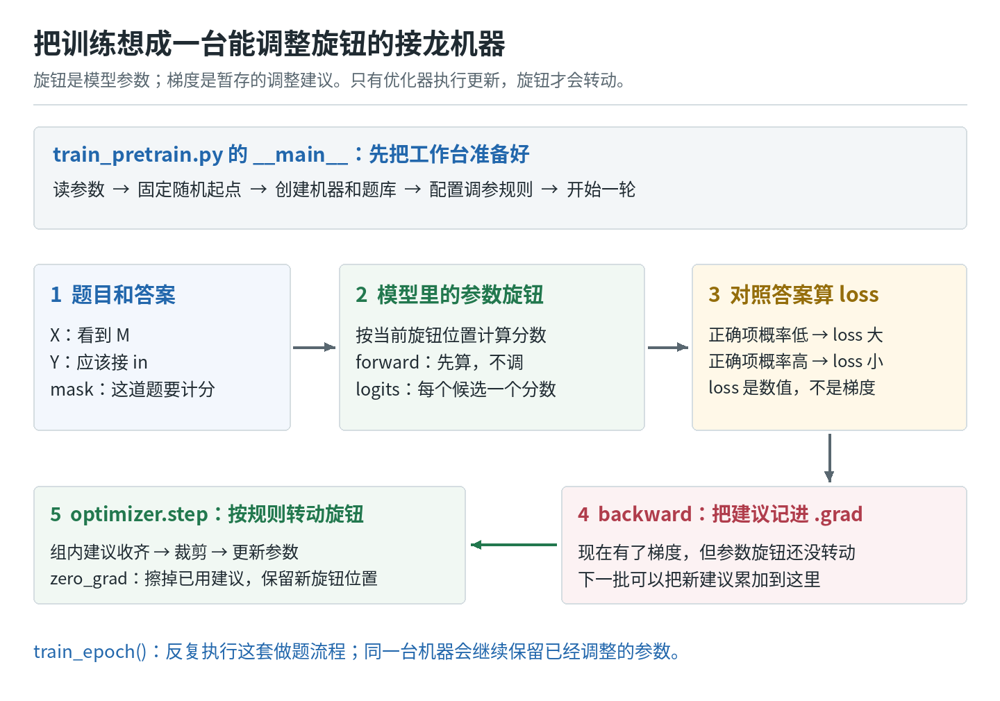
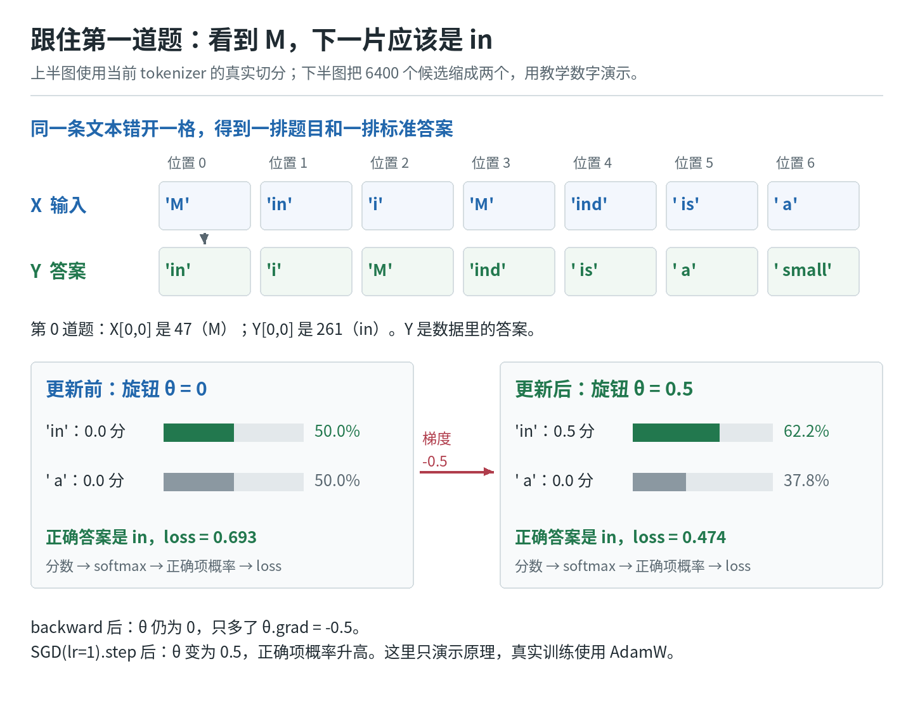
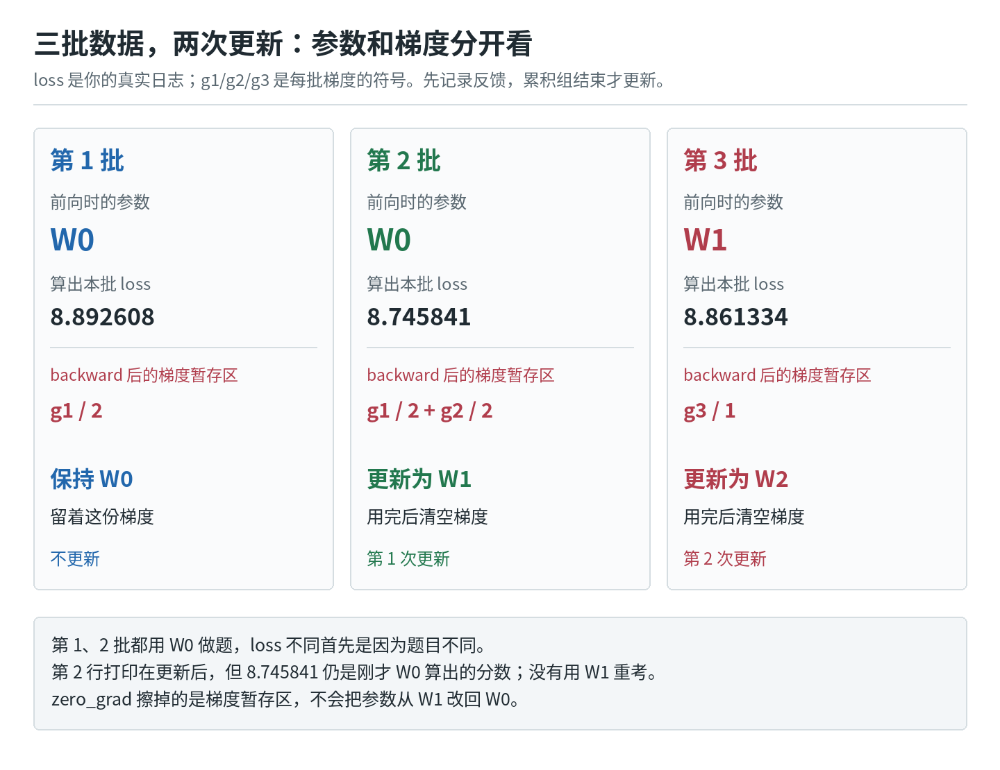
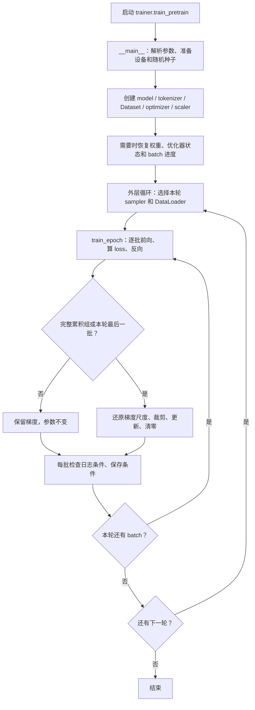

# 预训练循环精讲：从 train_pretrain 到 train_epoch

本专题围绕项目当前实现和 VS Code 的 `05 - Inspect gradient accumulation (CPU)` 配置展开。先沿着下面的图解走完一次“接龙机器做题”，再从第 1 节起逐段对照源码。配套源码是 [train_pretrain.py](../trainer/train_pretrain.py)，辅助函数在 [train_utils.py](../trainer/train_utils.py)。如果要专门研究 `.pth` 文件、内存加载、AdamW 状态和恢复优化，请配合 [Checkpoint 精讲](0.Checkpoint精讲.md)。

在 [学习路线](0.学习路线.md) 中，本篇承接 tokenizer、数据和模型，完成后进入 [SFT](5.SFT.md)。只想先验证三批更新的结果，可运行 `.venv/bin/python scripts/lesson_lab.py --lesson pretrain`；它调用真实入口并自动清理临时权重，持久化调试产物仍使用 VS Code 第 5 项配置。

## 图解：先在脑中放一张训练工作台

把模型想成一台接龙机器：放进一段开头，它给下一片文字的各种候选打分。机器里面有很多可以调整的“旋钮”，这些旋钮就是参数矩阵里的数。

模型最初不会答题。训练不是把整篇文章塞进一个存储抽屉，而是反复让它计算、对照答案，再调整内部数值。这个比喻只帮助理解对象分工；真实模型仍然进行向量、矩阵和自动求导运算。



先认识工作台上的两样东西：

```text
模型参数 parameter：机器里当前的旋钮位置，决定这次怎么算。
参数梯度 parameter.grad：暂时记下的调整建议，尚未用于修改旋钮。
```

所以，一次运行中完全可能出现“有梯度，但参数还没变”。这正是 `backward()` 后、`step()` 前的状态。

### 场景一：先布置工作台，才开始做题

`train_pretrain.py` 底部的 `__main__` 做准备工作：

| 真实代码 | 工作台上发生什么 | 本次具体值 |
| --- | --- | --- |
| `parser.parse_args()` | 读本次实验的设置单 | 一次一条样本，最多三批 |
| `setup_seed(42)` | 固定机器初始旋钮的随机起点 | 方便重复同一实验 |
| `init_model(...)` | 创建接龙机器和 token 编号表 | 小模型，1,196,672 个可训练数值 |
| `PretrainDataset(...)` | 准备原始文本题库 | 六条 demo 文本 |
| `DistributedSampler(...)` | 排本轮取题顺序 | `[0,3,2,4,1,5]` |
| `DataLoader(...)` | 按顺序取题、组织成一批 | `batch_size=1` |
| `AdamW(model.parameters(), ...)` | 绑定要调整的旋钮与调整规则 | 后面才能根据梯度改参数 |
| `train_epoch(...)` | 开始一轮做题 | 实际只处理前三批 |

注意“绑定”：优化器拿到的是模型现有参数对象，并不是复制出另一台模型。后面 `optimizer.step()` 改的就是 `model` 下一次前向会使用的那批参数。

这也解释了为什么模型创建放在循环外：

```text
正确的本课流程：
准备一台机器 -> 做第 1 批 -> 做第 2 批 -> 做第 3 批

如果每批重新创建模型：
新机器 -> 做第 1 批 -> 扔掉
新机器 -> 做第 2 批 -> 扔掉
前一批对参数的调整就无法带到下一批。
```

### 场景二：一条句子怎么拆成一排接龙题

第 1 批拿到第 0 条文本：

```text
MiniMind is a small language model project for learning how pretraining works.
```

tokenizer 的真实切分开头为：

```text
原文片段     M    in    i    M    ind     is     a     small
token ID    47   261   75   47   807    370   260     2425
```

表中 `is`、`a`、`small` 对应的 token 实际带前导空格，图中用引号保留。`MiniMind` 被切成五片，不是直接变成一个完整词。

将同一排 token 错开一格：

```text
原排：  [47, 261, 75, 47, 807, 370, 260, 2425, ...]
X：     [47, 261, 75, 47, 807, 370, 260, ...]
Y：     [261, 75, 47, 807, 370, 260, 2425, ...]
```

第 0 道题：看到 `M`，应该接 `in`；第 1 道题：看到 `M、in`，应该接 `i`。`Y` 是文本本身提供的标准答案，不是模型刚刚猜出来的结果。



这里模型虽然一次收到整排 X，但因果注意力会遮住后文。第 0 道题只能读 `M`，不能因为 `in` 已经放在 X 的下一个位置，就偷看它。

64 个 token 位置为什么只剩 63 道题？因为每道题都需要“当前输入”和“它后面的一片”组成一对：

```text
用 4 个位置缩小看：
原排： A B C D
题目： A B C
答案： B C D

原排有 4 个位置，只能形成 3 对相邻预测。
本课同理：64 个位置 -> 63 对 -> X/Y 都是 [1,63]。
```

### 场景三：logits 是候选打分表，不是模型选出的答案

先把真实的 6400 个候选临时缩成两个：`in` 和 ` a`。这是教学示意，不是本机小模型的实测分数。

让一个可调数值 θ 直接决定 `in` 的分数，另一个候选保持 0 分：

| 候选 | 初始原始分数 | softmax 后概率 | 标准答案 |
| --- | --- | --- | --- |
| `in` | θ = 0 | 50% | 是 |
| ` a` | 0 | 50% | 否 |

此时原始分数向量 `[0,0]` 就是这道简化题的 logits。概率相等，表示两者当前同样被看好；不表示模型已经知道正确答案是 `in`。

真实模型在同一个位置输出的是 6400 个分数：

```text
logits[0,0,:]
       | | |
       | | +-- 这一道题的全部 6400 个候选分数
       | +---- 第 0 个预测位置
       +------ 第 0 条样本
```

`argmax()` 才是从中取最高分候选的操作。训练计算交叉熵时，并不需要先把它变成一个离散“猜测答案”，因为还需要保留全部分数间的相对关系。

### 场景四：loss 是“这次答得有多差”，梯度是“怎么调才可能改善”

简化题的答案是 `in`，它当前得到 50% 概率：

```text
单题 loss = -ln(0.5) ≈ 0.693
```

如果把 θ 从 0 调到 0.5，`in` 得到更高的分数：

```text
分数：[0,0]         -> [0.5,0]
正确项概率：50%    -> 62.25%
这道题的 loss：0.693 -> 0.474
```

这说明在这个简化例子里，提高 θ 可以降低 loss。自动求导算出的 `θ.grad=-0.5` 表达的是当前位置附近 loss 对 θ 的变化率。负号意味着稍微增大 θ 会让 loss 降低；它不是“loss 等于 -0.5”。

现在按四个动作观察同一个旋钮：

| 执行动作 | θ 旋钮位置 | θ.grad 暂存区 | 发生了什么 |
| --- | --- | --- | --- |
| 前向、算 loss | 0 | `None` | 得到预测分数与 loss，还没有求梯度 |
| `loss.backward()` | **仍是 0** | `-0.5` | 产生建议，尚未修改参数 |
| `SGD(lr=1).step()` | **变为 0.5** | 仍是 `-0.5` | 按 `0 - 1×(-0.5)` 修改参数 |
| `zero_grad(set_to_none=True)` | **仍是 0.5** | `None` | 清掉已用建议，不撤销参数变化 |

这段最小例子可以独立验证：

```python
import torch

theta = torch.tensor(0.0, requires_grad=True)
optimizer = torch.optim.SGD([theta], lr=1.0)
scores = torch.stack([theta, torch.tensor(0.0)])
loss = torch.nn.functional.cross_entropy(scores[None, :], torch.tensor([0]))

loss.backward()
print(theta.item(), theta.grad.item())  # 0.0, -0.5

optimizer.step()
print(theta.item())                    # 0.5

optimizer.zero_grad(set_to_none=True)
print(theta.item(), theta.grad)        # 0.5, None
```

这里特意用单参数、两个候选、SGD，让每个数字能手算。真实 MiniMind 使用许多参数和 AdamW，参数通过整条计算图影响分数，不能把这段简化打分器当成它的内部实现，也不能拿 SGD 的更新量直接核对真实权重变化。

为什么你的 loss 约为 8.9，而这里是 0.693？因为这里仅有两个候选。如果 6400 个候选都获得相同概率，单题 loss 就是 `-ln(1/6400)≈8.764`。候选数和概率分布不同，数值尺度就不同，不能只凭某个绝对数判断训练好坏。

### 场景五：从一题扩展到一整批，哪些题才算分

本课第一批产生 63 个预测位置，但只有 19 个目标 token 有效。其余目标为 padding，只是为了让张量长度整齐。

可以把 `loss_mask` 看成每道题旁边的“是否算分”勾选框：

```text
题号          0    1    2    3
逐题 loss     2    4   100  100
是否算分      是   是   否   否
mask          1    1    0    0

有效总损失 = 2 + 4
有效题数   = 2
平均 loss  = 3
```

所以代码先保留逐题 loss，再用 mask 选择，最后求平均。如果直接把四道都平均，就变成 51.5，大量补齐位置会主导目标。

`view(-1,6400)` 相当于把“一条样本里的 63 道题”排成 63 行答题记录；每行仍保留 6400 个候选分数。它只调整形状，不会重新分词、挑选答案或改变参数。

第一批把这 19 个有效目标的损失平均后，才得到真实日志中的 `8.892608`。它不是只对 `M → in` 这一题的损失。

### 场景六：第 1 批做完，机器究竟留下什么

本次设置“收两批反馈，再统一调整一次”。因此第一批的真实过程是：

```text
取第 0 条文本
-> 用当前参数 W0 算 63 个位置的 logits
-> 按 mask 汇总 19 个有效目标，loss≈8.892608
-> loss / 2，得到反向使用的标量≈4.446304
-> backward，把本批梯度的一半留在各参数的 .grad
-> 尚未凑齐两批，不执行 optimizer.step
```

此时工作台状态为：

```text
机器里的参数：W0，完全没更新
梯度暂存区：  g1 / 2，留着等下一批
日志：        8.892608，乘回除数后记录原本的 batch loss
```

`g1` 代表第一批 loss 对全部参数的梯度。它是许多与参数形状对应的数组，不是数字 `8.892608`，也不是 `4.446304`。

这时如果继续运行，X 会换成下一条样本，模型对象却不会重建；它仍然保留 W0 和第一批写下的梯度。

### 场景七：第 2 批并没有换一台机器

第二批拿第 3 条文本，包含 15 个有效目标。它仍用 W0 前向，得到 `loss≈8.745841`：

```text
进入第 2 批前：
参数 W0；梯度 g1 / 2

第 2 批 backward：
把新梯度 g2 / 2 加到已有梯度上

进入更新分支前：
参数仍是 W0；梯度变成 g1 / 2 + g2 / 2
```

不是用第二批覆盖第一批，而是加上去。这就是 `.grad` 的累积行为。

现在才达到两批边界，代码依次还原适用的缩放、裁剪梯度、调用 AdamW 更新。第一次更新实际使用第二批设置的学习率 `0.000175`。把更新后的参数统称 W1，随后清空这组已经用过的梯度。

第二行日志仍显示 `8.745841`，因为代码没有让 W1 对刚才的第二批重新考一次。打印顺序靠后，不代表数值的计算时间也靠后。



### 场景八：第 3 批是尾组，为什么不用等到第 4 批

本次 `max_steps=3`，不会有第四批参与训练。因此第三批单独构成最后一组：

```text
拿第 2 条文本
-> 使用第一次更新后的 W1 前向
-> 按 19 个有效目标得到 loss≈8.861334
-> 这组只有一批，loss / 1
-> backward 留下 g3
-> 即使没凑够两批，本轮最后一批也要更新
-> 用 lr=0.000050 得到 W2，再清空梯度
```

为什么必须除以 1？例如最后只有一份反馈，内容是“调整量 0.8”，却仍按两份求平均，就会被缩成 0.4；并不存在另一份反馈来补上缺失的那一半。

真实更新还要经过裁剪和 AdamW，上面的“0.8 / 2”只说明梯度缩放，并不承诺真实参数更新量恰好减半。

### 场景九：三批结束，哪些东西保留，哪些被换掉

| 对象 | 第 1 批后 | 第 2 批后 | 第 3 批后 |
| --- | --- | --- | --- |
| 模型参数 | W0 | W1 | W2 |
| 参数 `.grad` | `g1/2` | `None` | `None` |
| AdamW 历史状态 | 尚未完成更新 | 记录第一次更新 | 保留并推进到第二次更新 |
| 已处理 batch 数 | 1 | 2 | 3 |
| 已完成参数更新数 | 0 | 1 | 2 |
| X、Y 和 mask | 当前第一条样本 | 换成第二条样本 | 换成第三条样本 |

清空的是梯度暂存区，模型参数和 AdamW 历史状态都会继续保留。`train_epoch()` 不需要 `return model` 才能让修改生效，因为它操作的是外层创建的同一模型对象。

保存时可以把模型权重想成“旋钮位置的照片”，resume 文件还带上“调节历史和已做题目的编号”。当前保存点放在更新、清零之后，不会遗留一组还没使用但又没保存的累积梯度。

### 场景十：删掉一步，具体会坏在哪里

| 假设改动 | 会观察到什么 | 为什么 |
| --- | --- | --- |
| 新模型第一次只 forward，不 backward | 有 logits 和 loss，但 `.grad` 还是 `None` | 还没有求损失对参数的梯度 |
| 只 backward，不 step | `.grad` 有值，但参数一直是 W0 | 写下建议没有执行调整 |
| 每一批开始都 zero_grad | 第二批只剩自己的贡献 | 把等着累积的第一批建议擦掉了 |
| 更新后始终不 zero_grad | 下一组还带着上一组已用过的梯度 | 老建议被重复计入 |
| 更新条件只判断整除，不判断最后一批 | 第三批的梯度留在内存，未用于本轮更新 | 尾组没有触发更新 |
| 在第 1 批后保存并恢复跳过它，但不保存累积梯度 | 恢复时只剩 W0，丢了第一批反馈 | 这时参数还没包含第一批的贡献 |
| 直接平均包含 padding 的全部位置 | 补齐位置会改变训练目标及缩放 | 把没有意义的填充题也算进了成绩 |

现在再回到源码时，先问当前语句在做哪一种动作：**换题、计算分数、计算损失、累加建议、修改参数，还是保存状态？** 能分清动作，再学习张量形状和 API 会更容易。

下面第 1～15 节作为源码对照：具体参数看第 1～5 节，前向和损失看第 7～8 节，累积和更新看第 9～10 节，日志与恢复看第 11～14 节。

### 四个词放回同一条时间线

```text
AMP：每次前向和反向采用什么数值精度
DDP：哪些进程/GPU 各自处理哪些数据，并怎样同步梯度
梯度累积：多少个 batch 的梯度合并后才调用 step
Checkpoint：中断后从哪个参数、哪个优化器历史和哪个 batch 继续
```

以当前三批实验为例：

```text
AMP：CPU/float32，因此没有真正启用混合精度
DDP：单进程 CPU，因此没有多卡梯度同步
梯度累积：2 批一更新，因此三批更新两次
Checkpoint：保存 step=3，恢复时跳过前 3 批或在中断点跳过前 2 批
```

最后一行要结合具体保存时刻理解：如果 batch 2 后中断，`step=2`，恢复只跳过前两批；如果整轮三批已经完成，`step=3`，恢复不会凭空再次处理这三批，除非你明确开启下一轮或改变训练计划。

## 1. 先把这次实验说清楚

你实际看到的日志是：

```text
所加载Model可训练参数：1.197 百万
Epoch:[1/1](1/3) loss:8.892608 lr:0.000425000000 epoch_Time:1.0min:
Epoch:[1/1](2/3) loss:8.745841 lr:0.000175000000 epoch_Time:0.0min:
Epoch:[1/1](3/3) loss:8.861334 lr:0.000050000000 epoch_Time:0.0min:
```

这次实验使用随机初始化的两层小模型、CPU 和 float32。处理三条样本、完成两次参数更新，最后保存训练进度。`1.197 百万` 是四舍五入后的可训练参数量；本配置的精确值是 **1,196,672**。

`init_model()` 的打印统一写着“所加载”，但这次 `from_weight=none`，实际是创建新模型，并没有读取预训练权重。小模型与之前 25.83M 模型使用相同的训练流程，只是宽度和层数不同。

| 设置 | 本次值 | 为什么这样设 |
| --- | --- | --- |
| `device` / `dtype` | `cpu` / `float32` | 先观察普通精度下的完整执行顺序 |
| `hidden_size` / `num_hidden_layers` | `128` / `2` | 缩小模型，方便快速调试 |
| `max_seq_len` | `64` | token 序列补齐或截断到 64，移位后有 63 个预测位置 |
| `batch_size` | `1` | 每批只看一条样本，容易追踪 |
| `num_workers` | `0` | 在当前进程加载数据，方便进入 Dataset 调试 |
| `epochs` | `1` | 只执行一轮外层循环 |
| `max_steps` | `3` | 本轮最多处理三批，而不是完整读取六条 demo 数据 |
| `accumulation_steps` | `2` | 通常累积两批梯度再更新参数 |
| `learning_rate` | 默认 `0.0005` | 作为当前余弦调度公式的基准值 |
| `from_weight` / `from_resume` | `none` / `0` | 从随机权重开始，不恢复以前进度 |
| `log_interval` / `save_interval` | `1` / `2` | 每批打印，在合适的更新边界保存 |
| 输出目录 | `out/debug_accum/`、`checkpoints/debug_accum/` | 保存本课权重和续训文件 |

其中 `max_seq_len` 在当前入口传给 Dataset。它没有直接覆盖 `MiniMindConfig.max_position_embeddings`，后者仍使用模型配置的默认值；“本批读取多长”和“模型预计算的位置表有多长”是两个设置。

## 2. train_pretrain 和 train_epoch 是什么关系

`train_pretrain.py` 是文件和训练入口，`train_epoch()` 是这个文件里定义的函数。这里没有另一个名叫 `train_pretrain()` 的函数。

把它想成一场课程：入口负责准备教材、学生、规则和记录本；`train_epoch()` 负责按这些条件完成一轮练习。



阅读 Python 文件时容易误以为“最先看到函数定义，就会先执行函数体”。实际上：

```python
def train_epoch(epoch, loader, iters, start_step=0, wandb=None):
    ...  # 先定义，暂不执行

if __name__ == "__main__":
    ...  # 直接启动脚本或使用 python -m 时，从这里准备训练
    train_epoch(epoch, loader, iters)  # 准备好对象后，调用才进入函数体
```

因此，第一遍阅读应先到文件底部，再跟着调用进入函数。普通 `import trainer.train_pretrain` 不会启动 `__main__` 中的训练。

## 3. 外层为什么先准备这些对象

| 对象 | 负责什么 | 为什么不能省略 |
| --- | --- | --- |
| `args` | 命令行参数 | 确定本次实验的长度、batch、学习率、路径等 |
| `lm_config` | 模型结构 | 决定参数矩阵的大小和层数 |
| `tokenizer` | 文本与 token ID 转换 | 模型接收整数 ID，不能直接计算字符串 |
| `model` | 使用参数计算预测分数 | 这是实际要训练的对象 |
| `train_ds` | 按索引生成一条 `X/Y/mask` | 把语料加工成训练样本 |
| `train_sampler` | 决定本轮样本顺序 | 让打乱与恢复都能对应到确定顺序 |
| `loader` | 读取样本并组织成 batch | 给训练循环提供统一张量形状 |
| `optimizer` | 根据梯度及历史状态修改参数 | 梯度本身不会自动更新权重 |
| `autocast_ctx` | 管理前向计算精度 | 当前 CPU 配置是空上下文，保留普通精度 |
| `scaler` | 在启用时管理梯度缩放 | 本仓库仅 CUDA float16 启用，当前不缩放 |

初始化顺序也有原因：

```text
先确定参数和设备
-> 固定随机种子
-> 按 config 创建模型
-> 创建绑定模型参数的 optimizer
-> 如需续训，加载模型和 optimizer 的历史状态
-> 开始逐轮训练
```

模型和优化器都创建在 epoch 循环外，因此第二轮沿用第一轮的权重及 AdamW 历史状态。如果每轮都重新初始化模型，上一轮的学习结果就丢失了。

`train_epoch()` 使用的 `args`、`model`、`lm_config`、`optimizer`、`scaler`、`autocast_ctx` 是这个模块里的全局变量。它们虽然没有列在函数参数里，仍然是函数的实际依赖；这是当前脚本的组织方式。测试中会注入这些变量后单独调用函数。

本课直接用 Python 启动，没有初始化分布式进程组，因此不会进入 DDP 包装分支。多卡分支先认识用途即可，本课没有验证多卡运行。

## 4. 数据为什么按第 0、3、2 条读取

`PretrainDataset` 保存六条原始 demo 文本。创建它时先读取 JSONL；真正调用 `dataset[index]` 时，才为该条样本进行 tokenizer 编码和 `X/Y/mask` 构造。

本入口即使单卡也使用一个副本的 `DistributedSampler`：

```python
DistributedSampler(train_ds, num_replicas=1, rank=0, seed=42)
train_sampler.set_epoch(epoch)
```

它没有把单卡训练变成多卡训练，而是提供按 `seed + epoch` 打乱的样本索引顺序。本配置第 0 轮的顺序实测为：

```text
[0, 3, 2, 4, 1, 5]
```

因为 `batch_size=1`、`max_steps=3`，所以本轮只训练其中前三条：

| 日志中的 batch | 原始样本索引 | 文本开头 | 有效目标 token 数 |
| --- | --- | --- | --- |
| 1 | 0 | `MiniMind is a small ...` | 19 |
| 2 | 3 | `The model can later ...` | 15 |
| 3 | 2 | `Clean experiments start ...` | 19 |

第二行日志不是又拿第一条文本考了一次。它换了样本，所以即使参数完全不变，loss 也可以不同。

`set_epoch(epoch)` 让不同轮使用不同的打乱顺序。同一轮恢复时使用相同 seed、epoch 和数据，再跳过已处理批次，才能继续到正确位置。

DataLoader 为样本加上 batch 维：

```text
原 token 序列：64 个位置（正文不足时包含 padding）
Dataset 返回：X / Y / mask 各 [63]
DataLoader：  X / Y / mask 各 [1, 63]
```

`num_workers` 是数据加载子进程数；设为 0 时，在当前进程调用 Dataset，VS Code 比较容易跟进。

## 5. train_epoch 的五个参数如何理解

```python
train_epoch(epoch, loader, iters, start_step=0, wandb=None)
```

| 参数 | 本课开始时 | 实际含义 |
| --- | --- | --- |
| `epoch` | `0` | 当前轮的内部编号，打印时加 1 |
| `loader` | 可读取六批 | 返回本次要处理的 `X/Y/loss_mask` |
| `iters` | 传入 `6`，函数内限制为 `3` | 本轮 batch 编号的结束范围 |
| `start_step` | `0` | 本轮已经完成多少个 batch |
| `wandb` | `None` | 可选记录对象；当前项目启用时实际使用 SwanLab |

第一句先限制范围：

```python
iters = min(iters, args.max_steps) if args.max_steps else iters
```

`max_steps=3` 时，六批只做三批；`0` 表示不限制。严格说，这是一轮被限步的训练，并没有完整遍历六条数据。

随后：

```python
for step, (X, Y, loss_mask) in enumerate(loader, start=start_step + 1):
    ...  # 每批计算、反向与更新，后文逐段展开
```

本次 `step` 依次为 1、2、3。这里记录的是 batch 编号，不是参数更新次数。恢复时 `start` 只改变编号；真正跳过数据依靠外层的 `SkipBatchSampler`，不能只改 `enumerate` 就当作恢复。

把 `X`、`Y`、mask 移到模型所在设备，是为了让前向和损失计算使用同一设备。它们仍然是整数 token ID 和标记，启用混合精度也不会把 token ID 变成小数。

## 6. 学习率为什么恰好是这三个数

当前项目的公式为：

```python
lr / 10 + 0.5 * lr * (1 + cos(pi * current_step / total_steps))
```

本课基准 `lr=0.0005`、总进度 `total_steps=epochs*iters=3`：

| batch 进度 | 余弦值 | 本批写入优化器的学习率 |
| --- | --- | --- |
| 1/3 | `cos(pi/3) = 0.5` | `0.00005 + 0.000375 = 0.000425` |
| 2/3 | `cos(2*pi/3) = -0.5` | `0.00005 + 0.000125 = 0.000175` |
| 3/3 | `cos(pi) = -1` | `0.00005` |

更新的是优化器参数组的设置：

```python
for param_group in optimizer.param_groups:
    param_group["lr"] = lr
```

设置学习率不会立即修改模型参数，只有调用优化器更新时才会用到它。因此本次：

```text
batch 1：设置 0.000425，但不更新
batch 2：设置 0.000175，第一次更新使用它
batch 3：设置 0.000050，第二次更新使用它
```

调度基于处理过的 batch 数，不是优化器更新数。改变梯度累积次数时，需要同时理解这个调度基准。

当前公式没有 warmup；`current_step=0` 时数学上是基准值的 1.1 倍，不过本课首次传入 1，所以日志不出现这个值。不要把别的项目里“从初始学习率开始衰减”的描述直接套在这里。

## 7. 前向为什么一次算出 63 道题

```python
with autocast_ctx:
    res = model(X)
```

这个调用会进入模型的 `forward()`。当前 `X` 是 `[1,63]` 的 token ID，经模型处理后得到：

```text
X                  [1, 63]          整数编号
Embedding          [1, 63, 128]     每个 token 查到一个向量
Transformer        [1, 63, 128]     结合此前上下文
lm_head / logits   [1, 63, 6400]    每个位置为 6400 个候选打分
```

例如第 0 个位置用 `M` 预测 `in`，第 1 个位置用 `M、in` 预测 `i`。训练时虽然把全部 X 一次传入，因果注意力仍然限制每个位置读取当前位置及以前的信息，所以可以并行计算这些预测。

`Y` 没有传入当前模型调用，而是在模型外用于计算 loss。模型并不是在前向时直接拿到一份答案表来查正确项。

模型输出的是结构化对象，`res.logits` 是原始分数；`res.aux_loss` 是可选辅助损失。本课使用稠密模型，辅助损失为 0。这里不需要调用 `generate()`，因为目标是同时评价所有训练位置，而不是逐个采样生成新文本。

## 8. loss 为什么要先展开、再还原、再做 mask

关键代码是：

```python
loss = loss_fct(
    res.logits.view(-1, res.logits.size(-1)),
    Y.view(-1),
).view(Y.size())
```

先保留每道题的候选维度，把样本和位置合并：

```text
logits：[1, 63, 6400] -> [63, 6400]
Y：     [1, 63]       -> [63]
```

可以把 `[63,6400]` 想成 63 道选择题，每题有 6400 个选项；Y 提供每道题正确选项的编号。`-1` 表示根据元素总数自动计算这一维。

`CrossEntropyLoss(reduction="none")` 返回每道题自己的损失，所以先得到 `[63]`，再恢复成 `[1,63]`，方便和 mask 一一对应。若一开始直接求总平均，padding 位置就会一起混入，难以按当前方式筛选。

一个位置的交叉熵可以理解为：

```text
原始分数 -> softmax 概率 -> 取正确答案的概率 -> -ln(该概率)
```

正确答案得到的概率越低，损失越大。正确项概率也取决于其他候选项的分数，因此不是只看正确项的原始分数大小。PyTorch 在交叉熵内部完成相应计算，调用前不要手动再做 softmax。

之后：

```python
loss = (loss * loss_mask).sum() / loss_mask.sum().clamp_min(1)
loss += res.aux_loss
```

例如：

```text
逐位置 loss： [2, 4, 100, 100]
loss_mask：   [1, 1,   0,   0]
乘 mask 后：  [2, 4,   0,   0]
最终均值：    (2 + 4) / 2 = 3
```

用有效目标数作分母，避免同一段正文仅因补齐长度不同而改变损失缩放。`clamp_min(1)` 只防止零作分母；如果一批完全没有有效监督，仍应检查数据，不能把不报错当作有用的训练。

`loss_mask` 决定哪些目标计分，因果注意力决定能读取哪些输入；两者分工不同。忽略一个目标位置的 loss，不等于从 X 中删除那个位置。

## 9. 为什么 loss 要除以 2，最后又除以 1

用“收两份作业后统一调整”来理解：

```text
第 1 批：算出反馈，先记下来
第 2 批：算出反馈，与上一批合并、取平均，再改参数
第 3 批：本轮结束了，只有一份反馈，就用这一份
```

对应代码：

```python
divisor = accumulation_divisor(step, iters, args.accumulation_steps)
loss = loss / divisor
scaler.scale(loss).backward()
```

设前三批各自的平均损失为 L1、L2、L3，对参数的梯度为 g1、g2、g3。前两批更新前的参数相同，于是：

```text
第 1 批 backward 后：.grad = g1 / 2
第 2 批 backward 后：.grad = g1 / 2 + g2 / 2
第一次更新后清零
第 3 批 backward 后：.grad = g3 / 1
第二次更新后清零
```

不除以 2，就相当于把两批梯度求和而非取平均，随累积批数改变梯度尺度。最后若还除以 2，就把只有一批的尾组少算了一半。

为什么不先把所有 loss 加起来、最后才 backward？本实现每批立即反向，可以释放该批用于反向的计算图中间量，只把参数的梯度累计留下，避免一直保留多批前向图。后续每批会新建自己的计算图，不需要 `retain_graph=True`。

还有一个本课能直接看见的细节：前两批有效 token 数为 19、15。当前算法是“每批先求 token 均值，再对两批求平均”，不是把 34 个 token 合并后统一求平均：

```text
当前：0.5 * L1 + 0.5 * L2
按全部有效 token 平均：(19 * L1 + 15 * L2) / 34
```

因此要谨慎理解“等价于更大 batch”。梯度累积降低一次前向要处理的样本量，但不会消除模型参数、优化器状态和梯度本身的内存占用。

## 10. 为什么必须按这个顺序更新

只有满足条件时，才进入更新分支：

```python
if step % args.accumulation_steps == 0 or step == iters:
    ...  # 满足完整累积组或本轮最后一批时，执行下表中的操作
```

前半句表示完整累积组，后半句表示本轮最后一批，即使组没有凑满也要更新。

| 次序 | 调用 | 原因 |
| --- | --- | --- |
| 1 | `scaler.unscale_(optimizer)` | 缩放启用时先还原梯度，裁剪才使用真实尺度 |
| 2 | `clip_grad_norm_(..., grad_clip)` | 对完整累积组的梯度控制总范数 |
| 3 | `scaler.step(optimizer)` | 在适用条件下调用优化器修改参数 |
| 4 | `scaler.update()` | 缩放启用时更新缩放因子 |
| 5 | `optimizer.zero_grad(set_to_none=True)` | 清除这一组已经用过的梯度 |

当前 CPU/float32 下 scaler 未启用缩放，所以 `scale(loss)` 不放大 loss，`unscale_` 和 `update` 不做缩放处理，`scaler.step` 调用普通优化器更新。这个统一接口是为了与 CUDA float16 的流程共用代码。

启用 float16 缩放时，检测到非有限梯度可能跳过一次优化器更新。因此“每次进入更新分支都一定修改参数”的说法需要限定实验条件；本次实际核对了两次 AdamW 更新。

梯度裁剪控制的是所有相关参数梯度合起来的范数，不是把每个元素都硬限制到 `[-1,1]`。例如总范数为 10、上限为 1 时，会把整组梯度按约 0.1 的比例缩小。

AdamW 会使用梯度的一阶、二阶历史估计和权重衰减，不能把实际更新完全理解成简单的 `参数 -= 学习率 * 当前梯度`。这个简单公式适合先建立 SGD 直觉，不能直接用来逐元素核对本次 AdamW 更新。

若每个 batch 开头都清零，就丢掉第 1 批留给第 2 批的梯度；若更新后一直不清零，又会把已经用过的梯度带入下一组。因此清零的位置属于训练逻辑的一部分。

当前入口还调用 `torch.cuda.empty_cache()`。它释放的是未占用的 CUDA 缓存，不会清掉仍被模型使用的张量；本课 CPU 运行不需要它，也不能把它当成解决模型超出显存容量的办法。

## 11. 三行日志必须放到同一条时间线上

设随机初始化权重为 W0，第一次更新后为 W1，第二次更新后为 W2：

| batch | 前向时的权重 | 打印 loss | 累积除数 | 本批结束时更新 | 更新使用的学习率 |
| --- | --- | --- | --- | --- | --- |
| 1 | W0 | 8.892608 | 2 | 否，仍为 W0 | 未执行更新 |
| 2 | W0 | 8.745841 | 2 | 第一次，得到 W1 | 0.000175 |
| 3 | W1 | 8.861334 | 1 | 第二次，得到 W2 | 0.000050 |

所以，**前两行 loss 都来自 W0，只是样本不同**。第二行比第一行低，不能单独解释为“第一批已经让模型学好了”，因为第一批之后没有更新参数。

打印发生在更新分支之后，但 `loss` 仍然是刚才前向保存的数值。第二行不是 W1 对第二批的重测结果，第三行也不是 W2 的重测结果。若想观察一次更新是否降低同一道题的 loss，需要使用相同输入，分别在更新前后重新前向，并控制随机性。

内部为了累积先除过 divisor，日志再乘回来：

```python
current_loss = loss.item() * divisor
```

例如第 1 批反向使用约 `8.892608 / 2`，日志恢复显示 `8.892608`。日志记录当前 batch 的损失，不是本轮累计平均，也不是准确率。

`epoch_Time:1.0min` 同样不能解释成“第一批算了一分钟”。计时使用 `time.time()`，包含断点暂停、数据加载和已经发生的其他工作。原 ETA 公式为：

```python
spend_time / (step + 1) * iters // 60 - spend_time // 60
```

它还存在计数与取整偏差：step 已经从 1 开始，却又加 1；两个值分别向下取整，也会损失精度。例如第 1 批累计墙钟时间为 100 秒时，该式得到 `150 // 60 - 100 // 60 = 1.0`。这只是说明公式如何得到 1.0，并不是反推你实际暂停了 100 秒。

恢复时公式也没有扣除已跳过批数，部分情况下可能出现负值。当前保留原算法并标明局限；不要用这个字段比较训练吞吐，做性能测量时应退出调试器并单独计时。

## 12. 为什么更新完成后才保存

本课 `save_interval=2`、`accumulation_steps=2`，会在第 2、3 批结束后保存：第 2 批是间隔和更新边界，第 3 批是本轮最后一批。

如果第 1 批就保存、恢复时又跳过它，但 checkpoint 没有保存这批未更新的 `.grad`，第一批的贡献就会丢失。因此当前保存条件把周期保存限制在完整累积组边界，并在最后一批完成尾组更新后再次保存。

`save_interval` 不是无条件“每隔几批都保存”。例如设为 3、累积为 2，周期条件同时满足的批次是 6、12 等，另有本轮最后一批的保存。

本课保存三个文件：

| 文件 | 内容和用途 |
| --- | --- |
| `out/debug_accum/pretrain_128.pth` | 半精度模型状态，供加载推理使用 |
| `checkpoints/debug_accum/pretrain_128.pth` | checkpoint 目录中的半精度模型状态副本 |
| `checkpoints/debug_accum/pretrain_128_resume.pth` | 当前精度的模型状态、优化器、scaler、epoch/batch 进度等，供续训使用 |

文件名相同会覆盖旧版本，因此本轮结束后这些路径保留的是最后一次保存的结果，不会自动保留第 2 批的历史版本。

`state_dict()` 收集模型参数和持久 buffer。将待保存字典中的张量 `.half()`，不等于把内存中的训练模型变成 float16；本课续训文件中的模型张量仍为 float32。

保存前的 `model.eval()` 是原脚本的模式切换习惯。它影响 Dropout 等模块的前向行为，不会禁止自动求导；单纯保存 `state_dict` 本身也不要求先调用它。保存后 `model.train()` 恢复训练模式。

当前 resume 文件的字段实测为：

```text
epoch, model, optimizer, scaler, step, wandb_id, world_size
```

它没有自动保存模型 config、完整随机数状态、DataLoader worker 状态或未更新的累积梯度。本课保持结构和数据配置一致，不能把它解释为任意环境下逐位一致的完整快照。

## 13. 恢复时，为什么不只加载一个 pth

外层恢复的主要对象是：

```python
model.load_state_dict(ckp_data["model"])
optimizer.load_state_dict(ckp_data["optimizer"])
scaler.load_state_dict(ckp_data["scaler"])
start_epoch = ckp_data["epoch"]
start_step = ckp_data["step"]
```

模型状态表示“目前学到了什么”；AdamW 状态保留更新历史；epoch 和 step 表示“哪些作业已经做过”。只加载模型再新建优化器可以继续训练，但与恢复已有 AdamW 状态不是同一条优化轨迹。

本课完成后的值是：

```text
epoch = 0              内部轮号，打印时为第 1 轮
step = 3               已处理三批
AdamW 参数状态 step = 2 已更新两次
scaler = {}            本课没有启用梯度缩放
```

恢复时先复现该轮的采样顺序，再跳过已完成三批。剩余 loader 的长度加上 `start_step`，才是本轮原有范围；这就是调用时传 `len(loader) + start_step` 的原因。

如果维持 `epochs=1`、`max_steps=3`，本轮已经做完，恢复后不会凭空再多训练三批。要继续下一轮，可以设 `epochs=2`，但当前学习率调度的总步数也会变成 `epochs * iters`，不能声称这与一开始就计划两轮的学习率轨迹完全一致。

`from_weight` 表示先从某份模型权重初始化，`from_resume` 表示是否再读取续训文件。当前入口先执行 `init_model`，之后才加载 resume 内容；两者同时设置时，要注意初始化需要的基础权重也必须能找到。

可以用恢复对照实验验证这条路线：

```bash
.venv/bin/python scripts/lesson_lab.py --lesson resume
```

```text
基准：    batch 1 -> batch 2 -> batch 3 -> 最终状态 A
中断分支：batch 1 -> batch 2 -> 完整保存 -> 暂停
恢复分支：读取 checkpoint -> 跳过前两批 -> batch 3 -> 最终状态 B
检查：    A 与 B 的模型、AdamW 状态逐项一致
```

这三次启动都保留 `max_steps=3`、`epochs=1`、相同结构与采样顺序。第二批暂停发生在完整 checkpoint 写入后，使用教学异常模拟；不把总步数改成 2 来“假装中断”，因为那样会先改变学习率计划。

实验限定 CPU、float32、dropout=0，并在临时目录运行。本仓库没有保存完整随机状态，不能把此处相同推断到任意设备、随机增强和多进程数据处理。VS Code 第 7 项也可以选择 `resume`，在实验函数里跟踪两个分支。

## 14. 在 VS Code 中把证据串起来

继续选择第 5 项配置，按下面的语句设置断点。箭头指向的语句尚未执行，变量是否已更新要看它位于哪一行。

| 断点语句 | 观察表达式 | 本课重点 |
| --- | --- | --- |
| `train_epoch(epoch, loader, len(loader), 0, wandb)` | `len(train_ds)`、`len(loader)`、`args.max_steps` | 数据共有六批，函数内限为三批 |
| `lr = get_lr(...)` | `epoch`、`step`、`iters` | 调度按 batch 进度计算 |
| `res = model(X)` | `X.shape`、`Y.shape`、`loss_mask.sum().item()` | 三批监督数 19、15、19 |
| 交叉熵赋值语句 | `res.logits.shape`、`Y.shape` | 候选分数与目标位置对应 |
| `loss = loss / divisor` | `loss.item()`、`divisor` | 先看缩放前的 loss |
| `if step % ...` 更新条件 | `step`、`model.lm_head.weight.grad.norm().item()` | 三批都产生梯度 |
| `scaler.step(optimizer)` | `step`、`optimizer.param_groups[0]["lr"]` | 只停在批 2、3 |
| `optimizer.zero_grad(...)` | `next(iter(optimizer.state.values()))["step"].item()` | 参数已更新，计数依次为 1、2 |
| `lm_checkpoint(...)` | `epoch`、`step`、`args.checkpoint_dir` | 保存当前轮号和 batch 进度 |

在 `optimizer.zero_grad(...)` 处按 F10 执行清零，再看 `model.lm_head.weight.grad is None`。在第一次更新以前，AdamW 参数状态可能还没初始化，不要提前对空状态执行 `next(...)`。

运行结束后可只读检查：

```bash
.venv/bin/python - <<'PY'
from trainer.train_utils import torch_load

checkpoint = torch_load("checkpoints/debug_accum/pretrain_128_resume.pth")
print("epoch:", checkpoint["epoch"])
print("completed batches:", checkpoint["step"])
print("optimizer update counts:", sorted({
    int(state["step"].item())
    for state in checkpoint["optimizer"]["state"].values()
}))
print("scaler state:", checkpoint["scaler"])
PY
```

应看到轮号 0、完成批数 3、更新计数 `[2]` 和空 scaler 状态。

本专题完成后，应该能够脱离代码复述：入口准备了什么，Dataset 如何出题，模型如何给分，loss 如何选择计分范围，三批梯度如何分组，AdamW 何时修改权重，以及 checkpoint 为什么同时记录参数、历史状态和进度。

## 15. 反例：平均的是 batch，还是 token

当前先对每批有效 token 求均值，再按累积批数平均。若 batch A 只有一个有效目标、均值 1，batch B 有三个有效目标、均值 3：

```text
当前两批平均：(1+3)/2 = 2
统一 token 平均：(1×1 + 3×3)/(1+3) = 2.5
```

两者权重不同。“梯度累积模拟大 batch”需要同时说明汇总方式；监督长度差异大时不能忽略这个条件。

### 直接核对尾组除数与恢复

```python
# doc-example: accumulation-and-resume
from trainer.train_utils import accumulation_divisor
from scripts.lesson_lab import lesson_resume

assert [accumulation_divisor(s, 3, 2) for s in (1, 2, 3)] == [2, 2, 1]
assert [accumulation_divisor(s, 5, 3) for s in range(1, 6)] == [3, 3, 3, 2, 2]
lesson_resume()
print("尾组大小与真实恢复入口已核对")
```

五批、每三批更新时，第二组只有两批，都除以 2；不是到最后一批才单独改除数。整组贡献的尺度必须一致。

### 未更新时保存会缺什么

只处理第一批时，参数还是 W0，但 `.grad` 已有 g1/2。若只保存 W0 和 step=1，恢复后跳过第一批就丢失这份累计梯度。

当前主入口因此限制保存到更新边界。一个 step 数字不会重建没保存的图与梯度。描述现场时同时说出参数版本、已完成批数、累积组、更新数与未使用梯度。

## 16. 对照源码与官方 API

本专题的具体数字、路径、调度方式和保存条件以仓库实现及本机检查为准。通用 API 行为对照 PyTorch 2.14 官方文档：

- [训练入口](../trainer/train_pretrain.py)
- [学习率、AMP、恢复与 sampler 辅助函数](../trainer/train_utils.py)
- [X/Y/mask 的生成](../dataset/lm_dataset.py)
- [模型前向及权重共享](../model/model_minimind.py)
- [VS Code 配置](../.vscode/launch.json)
- [CrossEntropyLoss](https://docs.pytorch.org/docs/2.14/generated/torch.nn.CrossEntropyLoss.html)
- [数据加载与 DistributedSampler](https://docs.pytorch.org/docs/2.14/data.html)
- [AMP、梯度累积与裁剪顺序](https://docs.pytorch.org/docs/2.14/notes/amp_examples.html)
- [AdamW](https://docs.pytorch.org/docs/2.14/generated/torch.optim.AdamW.html)
- [梯度范数裁剪](https://docs.pytorch.org/docs/2.14/generated/torch.nn.utils.clip_grad_norm_.html)
- [CUDA 缓存释放](https://docs.pytorch.org/docs/2.14/generated/torch.cuda.memory.empty_cache.html)

图解由 [render_pretrain_figures.py](../scripts/render_pretrain_figures.py) 生成，PNG 已放在文档目录中，可直接预览。需要重新生成时运行：

```bash
.venv/bin/python scripts/render_pretrain_figures.py
```

脚本使用当前 tokenizer 核对 token ID，并实际运行两候选、单参数的 SGD 示例检查梯度和更新值；不会改动训练权重。渲染中文需要系统已有的 `NotoSansCJK-Regular.ttc` 和 `NotoSansCJK-Bold.ttc` 字体，默认目录为 `/usr/share/fonts/opentype/noto/`。
