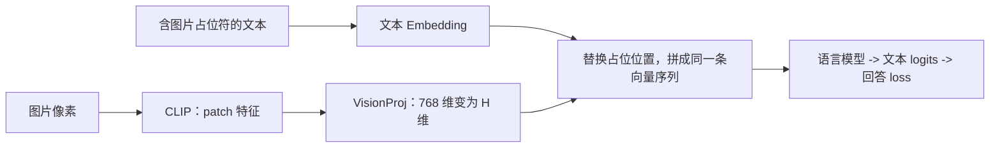

# 12. MiniMind-V：给文本序列留出图片的位置

前置：[模型向量与 Attention](3.模型构建.md)、[SFT](5.SFT.md)。本章对照 [model_vlm.py](../model/model_vlm.py) 与两个 VLM 训练入口。小实验不下载图片编码器，完整图像训练另需本地 CLIP 权重与图文数据。

## 本章实践卡

```bash
.venv/bin/python scripts/lesson_lab.py --lesson vlm
```

用随机 patch 特征先验证三件事：196 个占位位置、`768 → H` 的 VisionProj、图文向量拼接后的总长度。这个实验不加载 CLIP，也不会产生图像语义；它只帮助你先看懂形状和梯度。

完成标准：能回答“图片在哪个阶段进入语言模型”“为什么图片占位符必须和 patch 数一致”“为什么冻结视觉塔仍能训练投影层”。


## 1. 把图片当成一段向量序列接进机器

语言模型原来读取文本 Embedding。VLM 在文本中先预留若干位置，再用图像向量替换这些位置的 Embedding：



不是把图片转成一个整数 token，也不是把图像像素直接拼进 token ID。它们相遇的位置在 Embedding 之后。

### 图片的编号位置与图片内容分别来自哪里

占位 token 告诉模型“这里预留一段视觉位置”；CLIP 输出才提供图片内容。若只把 196 个 `@` 放进文本、没有替换成视觉特征，模型读到的仍是普通占位字符的 Embedding。

像给电影院预留 196 个座位：座位编号约定了摆放位置，真正坐进来的视觉向量才带来内容。替换发生在 Embedding 之后，语言模型之后照常运行 Attention、FFN 和 lm_head。

## 2. 先用“座位”数清形状

当前默认 CLIP ViT-Base/16 输入 224×224 图片，14×14=196 个 patch，加 CLS 后是 197 个位置。去掉 CLS 后保留 196 个视觉位置，再投影到语言模型的 H 维。

用本课 H=128 示意：

```text
视觉特征：           [1,196,768]
VisionProj：          [1,196,128]

文本前段 20 个位置： [1,20,128]
图像预留 196 位置：  [1,196,128]
文本后段 10 个位置： [1,10,128]
拼接后：              [1,226,128]
```

真实代码为方便不同 batch/图片数会 squeeze、stack，局部张量不一定一直保留上图所有维度；跟踪时要记录当前语句的实际值，不能只背示意形状。


### VisionProj 的每一步 m×n

当前是带 bias 的 Linear，权重 `[128,768]`，bias `[128]`：

```text
196 个 patch，每个 768 项：
(196×768) @ W.T(768×128) + bias(128)
-> 196×128 -> [1,196,128]

参数数：128×768 + 128 = 98,432
```

这里没有把 patch 数从 196 压成 128；改变的是每个 patch 的特征宽度。768 是当前视觉塔输出宽度，不是图片像素边长。

```python
# doc-example: vision-projector
import torch
from model.model_vlm import VisionProj

torch.manual_seed(42)
projector = VisionProj(ve_hidden_size=768, hidden_size=128)
patches = torch.randn(1, 196, 768)
projected = projector(patches)
linear = projector.vision_proj[0]
torch.testing.assert_close(projected, patches @ linear.weight.T + linear.bias)
assert sum(p.numel() for p in projector.parameters()) == 98_432
projected.square().mean().backward()
assert patches.grad is None and linear.weight.grad.norm().item() > 0
print(projected.shape, linear.weight.shape, linear.bias.shape)
```

patches 没有 requires_grad，但投影参数仍有梯度；这就是固定视觉特征也能训练映射的直接例子。

## 3. 占位符必须真的对应 196 个位置

当前 `VLMConfig` 使用 `'@'*196` 和 `[34]*196` 作为约定。`count_vision_proj()` 在 token 序列里寻找相应片段，再用投影后的图像特征替换。

```text
替换前：文本向量 | 196 个占位 token 的普通 Embedding | 文本向量
替换后：文本向量 | 196 个投影后的图像特征          | 文本向量
```

总长度应保持一致。换 tokenizer 后，196 个 `@` 不一定仍编码成预期的 196 个 ID；换视觉编码器后，patch 数量也可能不同。必须同时检查编码、占位长度、图片数量和被截断位置。

本课实验会用当前 tokenizer 实际断言占位 ID。若图像预留段被 max_seq_len 截断，形状看似可堆叠也可能没有成功放入视觉信息。

### 对当前替换函数做一次本地验证

不用 CLIP，也能调用真实替换方法；这里的 patch 是人工特征，只检查位置与数据流。

```python
# doc-example: vision-replacement
from types import SimpleNamespace
from transformers import AutoTokenizer
from model.model_vlm import MiniMindVLM, VLMConfig

tok = AutoTokenizer.from_pretrained("model")
config = VLMConfig(hidden_size=128)
image_ids = tok(config.image_special_token, add_special_tokens=False).input_ids
assert image_ids == [34] * 196
tokens = torch.tensor([[47] * 20 + image_ids + [261] * 10])
text_h = torch.randn(1, 226, 128)
holder = SimpleNamespace(config=config, vision_proj=projector)
with torch.no_grad():
    combined = MiniMindVLM.count_vision_proj(
        holder, tokens, text_h, patches, seqlen=226,
    )
torch.testing.assert_close(combined[:, :20], text_h[:, :20])
torch.testing.assert_close(combined[:, 20:216], projector(patches))
torch.testing.assert_close(combined[:, 216:], text_h[:, 216:])
assert tuple(combined.shape) == (1, 226, 128)
print("196 个位置被视觉向量替换，前后文本保持")
```

这验证实际替换函数，不验证真实图片编码、语义或多图边界。若换 tokenizer、patch 数或占位段，需重新对齐这些条件。

## 4. 冻结视觉编码器，为什么还能训练投影层

视觉塔提供已经训练好的 patch 特征，`VisionProj` 把它们映射到 H 维。将视觉特征当作固定输入，仍然可以对投影矩阵求导。

```text
阶段 1：CLIP 冻结 + LLM 冻结 + VisionProj 可训练
阶段 2：CLIP 冻结 + 新建实例中 LLM/Proj 可训练
```

阶段 1 对齐图像特征与语言输入；阶段 2 用图文对话训练回答。`freeze_llm=False` 当前只是跳过冻结分支，不是对已经冻结过的同一个实例执行“解冻所有参数”，需分清对象的原状态。

投影到相同宽度不代表语义已经对齐，仍然需要训练。类似把插头尺寸改对后，还要学习各针脚对应的意义。

## 5. 回答监督和文本 SFT 有什么相同

VLM Dataset 额外返回 pixel_values，仍有 `X/Y/loss_mask`。模型输出词表 logits，loss 对回答相关的文本目标计分。

图像位置参与上下文，不意味着要为每个 patch 单独设置“图像类别答案”。训练目标依然是回答的下一个 token，不能把 logits 说成“未归一化的概率”——它是原始分数。

当前训练更新条件是 `step % accumulation_steps == 0 or step == iters`。VLM 入口仍按固定 accumulation_steps 除 loss，尾组不足时与主预训练入口的实际尾组除数不同；不要把预训练验证结果自动扩展到所有训练脚本。

### 图像位置有上下文作用，但没有新增词表答案

语言模型仍输出 `[B,T,6400]` 的文本词表分数。视觉输入是浮点向量，不是新增了 196 个候选 token。回答位置的 loss 可通过 Attention 返回到 VisionProj，而 CLIP 在 no_grad 下提供固定特征。

当前依然是因果序列：要让回答利用图片，视觉位置必须放在回答可见的前文中。将图片放在回答后面，不能靠增加 loss mask 让前面的回答偷看未来。

## 6. 先跑投影实验，避免一开始下载大模型

```bash
.venv/bin/python scripts/lesson_lab.py --lesson vlm
```

实验使用仓库真实 `VisionProj`，输入为人工构造的随机 patch 特征，预期：

```text
占位 token 数: 196
(1,196,768) -> (1,196,128)
拼接后 (1,226,128)
投影层有非零梯度
PASS vlm
```

没有执行 CLIP 图像编码、真实图片替换或完整问答。随机特征只用于核对矩阵、位置和梯度，不代表图片语义。

动手：将前段从 20 改为 5，先算新总长 `5+196+10=211` 再核对。若把 patch 数改成 195，讨论为什么当前 196 个占位符约定必须随之检查。

## 7. 完整训练前查什么，保存时又保留什么

源码默认视觉模型路径为 `model/vision_model/clip-vit-base-patch16`，不存在时，执行图像处理会给出明确提示。完整训练还需图片文件、与文本匹配的图像顺序、足够序列长度，以及兼容的基础语言模型权重。

推理用模型状态会过滤 `vision_encoder.` 参数，加载时重新挂载同一视觉模型；当前 resume 保存逻辑仍使用完整模型状态，不能说所有 checkpoint 都排除了 CLIP。

`strict=False` 允许缺失或多余键，不会自动忽略同名参数的形状冲突，也不会证明权重完整加载。检查 missing/unexpected keys 和结构兼容性，不要把这个参数当万能修复。

完成标准：不用图片编码器也能画出像素→patch→投影→替换文本 Embedding→语言模型的路线，并解释 196、768、H 分别是什么。

### 源码阅读时记录四个长度

记录图片数量、每图 patch 数、占位段实际 token 数、截断后序列长度。三种“196”看似一样，却分别来自视觉结构、文本约定与实际编码，不能只验证其中一种。

`pixel_values` 是像素输入，`vision_tensors` 是 CLIP patch 特征，`vision_proj(...)` 是语言宽度的向量。名字都与图片有关，但它们处在不同计算阶段。

## 8. 让文本 loss 穿过冻结语言模型，回到 VisionProj

冻结 LLM 参数不等于禁止 loss 对其输入求导。可以把 LLM 看成固定的可微函数：内部配方不改，仍能告诉投影层“输入向量怎样变化会影响回答”。

下面用固定张量代替视觉塔，调用真实 `MiniMindVLM.forward`，验证 196 个视觉位置进入两层语言模型后，文本目标的 loss 能返回投影层。它不编码真实图片，不需要 CLIP 下载。

```python
# doc-example: vlm-language-loss-gradient
from unittest.mock import patch
from types import SimpleNamespace
import torch.nn as nn
import torch.nn.functional as F

class FixedVision(nn.Module):
    def __init__(self):
        super().__init__()
        self.register_buffer("features", torch.randn(1, 197, 768))

    def vision_model(self, pixel_values):
        return SimpleNamespace(last_hidden_state=self.features)

config = VLMConfig(hidden_size=128, intermediate_size=384,
                   num_hidden_layers=2, max_position_embeddings=256)
with patch.object(MiniMindVLM, "get_vision_encoder",
                  return_value=(FixedVision(), None)):
    vlm = MiniMindVLM(config)
vlm.requires_grad_(False)
vlm.vision_proj.requires_grad_(True)
tokens = torch.tensor([[47] * 20 + [34] * 196 + [261] * 10])
pixels = torch.zeros(1, 1, 3, 224, 224)
output = vlm(tokens, pixel_values=pixels)
assert tuple(output.logits.shape) == (1, 226, 6400)
# 位置 215～224 的 logits 预测图像后十个文本位置 216～225。
answer_scores = output.logits[:, 215:225]
answer_labels = tokens[:, 216:226]
loss = F.cross_entropy(answer_scores.reshape(-1, 6400), answer_labels.reshape(-1))
loss.backward()
assert vlm.vision_proj.vision_proj[0].weight.grad.norm().item() > 0
assert all(p.grad is None for name, p in vlm.named_parameters()
           if not name.startswith("vision_proj."))
print("真实 VLM 文本 loss：", loss.item(), "只有 VisionProj 参数获得梯度")
```

从固定视觉特征到投影再到 LLM 之间不能整个包进 no_grad，否则会切断投影学习路径。实际实现只在视觉塔编码处使用 no_grad，投影与语言模型这段仍按需要记录图。

本段人工文本布局没有完整聊天模板，只隔离验证视觉替换与文本监督的梯度路径。正式样本仍需用 Dataset 生成真实对话与回答 mask。

### 对两阶段训练各问一个问题

| 阶段 | 可训练部分 | 应观察的证据 |
| --- | --- | --- |
| 对齐阶段 | VisionProj | 回答 loss 返回投影，LLM/视觉塔无参数梯度 |
| 图文 SFT 阶段 | 新实例中的 LLM 与投影 | 回答 mask、基础权重和视觉特征仍对齐 |

仅仅 shape 相同不代表视觉语义对齐；仅仅梯度存在不代表问答质量可用。这两类证据与真实图片任务的评估分别记录。

## 历史实验图与参考


参考：[CLIP 原论文](https://arxiv.org/abs/2103.00020)。
