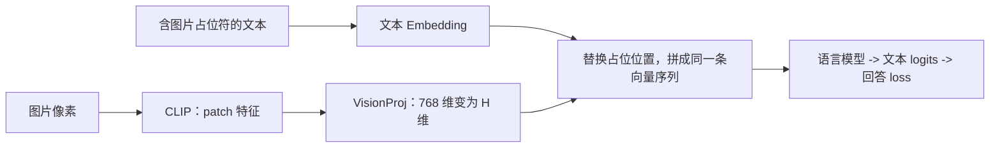

# 12. MiniMind-V：给文本序列留出图片的位置

前置：[模型向量与 Attention](3.模型构建.md)、[SFT](5.SFT.md)。本章对照 [model_vlm.py](../model/model_vlm.py) 与两个 VLM 训练入口。小实验不下载图片编码器，完整图像训练另需本地 CLIP 权重与图文数据。


## 1. 把图片当成一段向量序列接进机器

语言模型原来读取文本 Embedding。VLM 在文本中先预留若干位置，再用图像向量替换这些位置的 Embedding：



不是把图片转成一个整数 token，也不是把图像像素直接拼进 token ID。它们相遇的位置在 Embedding 之后。

## 2. 先用“座位”数清形状

当前默认 CLIP ViT-Base/16 输入 224×224 图片，14×14=196 个 patch，加 CLS 后是 197 个位置。去掉 CLS 后保留 196 个视觉位置，再投影到语言模型的 H 维。

用本课 H=128 示意：

```text
视觉特征：           [1,196,768]
VisionProj：          [1,196,128]

文本前段 20 个位置： [1,20,128]
图像预留 196 位置：  [1,196,128]
文本后段 10 个位置： [1,10,128]
拼接后：              [1,226,128]
```

真实代码为方便不同 batch/图片数会 squeeze、stack，局部张量不一定一直保留上图所有维度；跟踪时要记录当前语句的实际值，不能只背示意形状。


## 3. 占位符必须真的对应 196 个位置

当前 `VLMConfig` 使用 `'@'*196` 和 `[34]*196` 作为约定。`count_vision_proj()` 在 token 序列里寻找相应片段，再用投影后的图像特征替换。

```text
替换前：文本向量 | 196 个占位 token 的普通 Embedding | 文本向量
替换后：文本向量 | 196 个投影后的图像特征          | 文本向量
```

总长度应保持一致。换 tokenizer 后，196 个 `@` 不一定仍编码成预期的 196 个 ID；换视觉编码器后，patch 数量也可能不同。必须同时检查编码、占位长度、图片数量和被截断位置。

本课实验会用当前 tokenizer 实际断言占位 ID。若图像预留段被 max_seq_len 截断，形状看似可堆叠也可能没有成功放入视觉信息。

## 4. 冻结视觉编码器，为什么还能训练投影层

视觉塔提供已经训练好的 patch 特征，`VisionProj` 把它们映射到 H 维。将视觉特征当作固定输入，仍然可以对投影矩阵求导。

```text
阶段 1：CLIP 冻结 + LLM 冻结 + VisionProj 可训练
阶段 2：CLIP 冻结 + 新建实例中 LLM/Proj 可训练
```

阶段 1 对齐图像特征与语言输入；阶段 2 用图文对话训练回答。`freeze_llm=False` 当前只是跳过冻结分支，不是对已经冻结过的同一个实例执行“解冻所有参数”，需分清对象的原状态。

投影到相同宽度不代表语义已经对齐，仍然需要训练。类似把插头尺寸改对后，还要学习各针脚对应的意义。

## 5. 回答监督和文本 SFT 有什么相同

VLM Dataset 额外返回 pixel_values，仍有 `X/Y/loss_mask`。模型输出词表 logits，loss 对回答相关的文本目标计分。

图像位置参与上下文，不意味着要为每个 patch 单独设置“图像类别答案”。训练目标依然是回答的下一个 token，不能把 logits 说成“未归一化的概率”——它是原始分数。

当前训练更新条件是 `step % accumulation_steps == 0 or step == iters`。VLM 入口仍按固定 accumulation_steps 除 loss，尾组不足时与主预训练入口的实际尾组除数不同；不要把预训练验证结果自动扩展到所有训练脚本。

## 6. 先跑投影实验，避免一开始下载大模型

```bash
.venv/bin/python scripts/lesson_lab.py --lesson vlm
```

实验使用仓库真实 `VisionProj`，输入为人工构造的随机 patch 特征，预期：

```text
占位 token 数: 196
(1,196,768) -> (1,196,128)
拼接后 (1,226,128)
投影层有非零梯度
PASS vlm
```

没有执行 CLIP 图像编码、真实图片替换或完整问答。随机特征只用于核对矩阵、位置和梯度，不代表图片语义。

动手：将前段从 20 改为 5，先算新总长 `5+196+10=211` 再核对。若把 patch 数改成 195，讨论为什么当前 196 个占位符约定必须随之检查。

## 7. 完整训练前查什么，保存时又保留什么

源码默认视觉模型路径为 `model/vision_model/clip-vit-base-patch16`，不存在时，执行图像处理会给出明确提示。完整训练还需图片文件、与文本匹配的图像顺序、足够序列长度，以及兼容的基础语言模型权重。

推理用模型状态会过滤 `vision_encoder.` 参数，加载时重新挂载同一视觉模型；当前 resume 保存逻辑仍使用完整模型状态，不能说所有 checkpoint 都排除了 CLIP。

`strict=False` 允许缺失或多余键，不会自动忽略同名参数的形状冲突，也不会证明权重完整加载。检查 missing/unexpected keys 和结构兼容性，不要把这个参数当万能修复。

完成标准：不用图片编码器也能画出像素→patch→投影→替换文本 Embedding→语言模型的路线，并解释 196、768、H 分别是什么。

## 历史实验图与参考


参考：[CLIP 原论文](https://arxiv.org/abs/2103.00020)。
