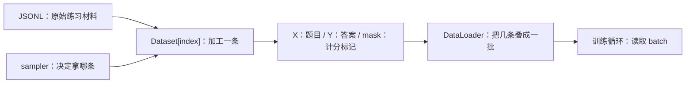

# 2. Dataset 与 DataLoader：把文本做成训练题

前置：[tokenizer](1.train_tokenizer.md)。本章只回答“数据怎么进模型”，先不研究模型内部公式。源码是 [lm_dataset.py](../dataset/lm_dataset.py)。

## 1. 想象把练习纸整理成一叠



Dataset 像按索引取出并加工一张练习纸；sampler 决定取纸顺序；DataLoader 把几张叠起来，并选择在哪个进程加载。它们不负责修改模型参数。

| 调用 | 实际发生什么 |
| --- | --- |
| `PretrainDataset(path, tokenizer)` | 把 JSONL 读进 `samples`，还没有一次编码所有样本 |
| `len(dataset)` | 返回样本条数 |
| `dataset[0]` | 调用 `__getitem__(0)`，为该条文本构造 X/Y/mask |
| `iter(loader)` / 取下一批 | 按采样顺序读取样本并组批 |

## 2. 用真实样本对齐 X 和 Y

第 0 条 demo 开头是 `MiniMind is a small ...`：

```text
原 token ID：47  261  75  47  807  370  260  2425 ...
原文本片段： M   in   i   M   ind   is    a    small ...

X：          47  261  75  47  807  370  260 ...
Y：         261   75  47 807  370  260 2425 ...
```

对应代码：

```python
X = input_ids[:-1].clone().long()
Y = input_ids[1:].clone().long()
loss_mask = loss_mask[1:].long()
```

第一列是“给 M，预测 in”；第二列是“给 M、in，预测 i”。Y 直接来自语料的下一个位置。`X[1:] == Y[:-1]` 核对的是切片关系，不是判断模型已经预测正确。

原序列补齐到 64 个 token 后，X 和 Y 各为 63 个位置，因为相邻预测配对少一个。第 0 条只有 19 个有效目标，剩下的 padding 目标不参与 loss。

## 3. 两张练习纸怎么叠起来

```text
dataset[0] 的 X：[63]
dataset[1] 的 X：[63]
                  ↓ DataLoader(batch_size=2)
本批 X：         [2,63]
本批 Y：         [2,63]
本批 loss_mask： [2,63]
```

第一个维度现在可以选样本，第二个维度选预测位置：

```python
X[0, 0]  # 第 0 条样本，第 0 个位置：整数 47
X[1, 0]  # 第 1 条样本的开头，不一定也是 47
```

padding 让每行长度一致，方便堆叠成矩形张量；truncation 把超长内容截断。长度整齐不等于正文完整，需要同时观察有效目标数和解码内容。

## 4. PretrainDataset 与 SFTDataset 的接口相同，计分范围不同

| 数据集 | 原始字段 | 文本加工 | loss mask |
| --- | --- | --- | --- |
| `PretrainDataset` | `text` | 直接分词 | 主要为非 padding 的目标计分 |
| `SFTDataset` | `conversations` | 先套聊天模板 | 主要为 assistant 回答与相关结束标记计分 |

两者都返回 `X, Y, loss_mask`，因此可以复用相似的前向、交叉熵和更新流程。SFT 仍然把用户问题放进输入，只是不直接为问题的目标位置计分，下一章 [SFT](5.SFT.md) 会逐格展开。

## 5. sampler 与 batch_sampler 各自决定什么

把索引当成练习纸编号：

```text
sampler 给顺序：[0,3,2,4,1,5]
batch_size=2 后：[[0,3], [2,4], [1,5]]
跳过前 1 批后：          [[2,4], [1,5]]
```

一般新训可以：

```python
loader = DataLoader(dataset, batch_size=2, shuffle=True, num_workers=0)
```

如果提供 sampler，就由 sampler 决定顺序，不能再同时让 `shuffle=True`：

```python
loader = DataLoader(dataset, sampler=sampler, batch_size=2, num_workers=0)
```

本项目恢复时使用 `SkipBatchSampler`，由它直接给出一整批索引：

```python
batch_sampler = SkipBatchSampler(sampler, batch_size=2, skip_batches=start_step)
loader = DataLoader(dataset, batch_sampler=batch_sampler, num_workers=0)
```

显式设置 `batch_sampler` 时不要再设置冲突的 `batch_size`、`shuffle`、`sampler`、`drop_last`，不兼容的组合会报错，而不是“静默忽略”。也不存在所有大模型都必须用 batch_sampler 的规则；这里选它是为了按批跳过。

本仓库 checkpoint 的 step 已经是 batch 数，恢复时不再乘 `accumulation_steps`。`num_workers=0` 在主进程加载，适合调试；增大子进程数是否更快需要测量。`pin_memory` 面向 CPU 到 CUDA 的传输，不是 CPU 教学必须打开的选项。

## 6. DataLoader 默认怎样把单条结果叠成一批

`PretrainDataset.__getitem__()` 返回一个三元组：

```python
(
    tensor([63]),  # X
    tensor([63]),  # Y
    tensor([63]),  # loss_mask
)
```

没有显式传 `collate_fn` 时，PyTorch 默认会对 tuple 的每个位置分别堆叠：

```text
第 0 条 X：[63] ┐
第 1 条 X：[63] ├─ torch.stack → [2,63]
第 2 条 X：[63] ┘
```

因此训练循环仍能写成：

```python
for X, Y, loss_mask in loader:
    ...
```

这要求同一批样本的返回张量形状一致。当前 Dataset 先用 `padding='max_length'` 统一长度；如果改成动态长度，就需要自己写 padding collate。collate 只负责装订，不重新 tokenizer，也不修改模型参数。

## 7. 单卡为什么仍然使用 DistributedSampler

当前预训练入口在单卡路径也创建：

```python
DistributedSampler(train_ds, num_replicas=1, rank=0, seed=42)
```

它不是在单卡上启动分布式进程，而是复用同一种按 `seed + epoch` 产生确定索引顺序的接口。`set_epoch(epoch)` 让不同轮的顺序不同但可复现：

```text
epoch 0： [0,3,2,4,1,5]
epoch 1： 另一种由 seed+epoch 决定的顺序
```

训练入口把顺序交给 sampler，因此不再同时传 `shuffle=True`。普通单卡教学用 `shuffle=True` 也可以；本项目采用统一 sampler 是为了和恢复、多卡路径共用逻辑。

多卡时每个 rank 只拿自己的一部分索引。`DistributedSampler` 默认 `drop_last=False`，为了让各 rank 数量相等可能补齐少量索引；大规模训练要根据是否允许重复样本决定采样设置。

## 8. SkipBatchSampler：把已完成的练习纸整批丢掉

底层 sampler 给出单个索引，`SkipBatchSampler` 先组 batch，再跳过前 N 个完整 batch：

```text
底层顺序： [0,3,2,4,1,5]
batch_size=2：
  [0,3] [2,4] [1,5]

skip_batches=1：
        丢掉 [0,3]
              ↓
  输出 [2,4] [1,5]
```

它不会把“第一个 batch”理解成第一个样本；`skip_batches` 的单位是批。当前实现会保留最后不足一个 batch 的索引，不自动丢弃。

恢复时要同时保持：

```text
sampler 顺序 + batch_size + 数据集内容 + checkpoint step
```

如果中途改变 batch size，原来哪些索引属于同一批就变了，跳过相同数量的 batch 也不再对应原来的进度。

可以直接观察索引：

```bash
.venv/bin/python - <<'PY'
from torch.utils.data import DistributedSampler
from trainer.train_utils import SkipBatchSampler
from dataset.lm_dataset import PretrainDataset
from transformers import AutoTokenizer

tokenizer = AutoTokenizer.from_pretrained("model")
dataset = PretrainDataset("dataset/demo_pretrain.jsonl", tokenizer, max_length=64)
sampler = DistributedSampler(dataset, num_replicas=1, rank=0, seed=42)
sampler.set_epoch(0)
print("原始索引:", list(sampler))
sampler.set_epoch(0)
print("跳过一批:", list(SkipBatchSampler(sampler, batch_size=2, skip_batches=1)))
PY
```

预期原始索引为 `[0, 3, 2, 4, 1, 5]`，跳过一批后剩 `[[2,4],[1,5]]`。

## 9. `num_workers` 与 `pin_memory`

```text
num_workers=0：
主训练进程 -> __getitem__ -> collate -> train_epoch

num_workers=2：
主进程分派索引 -> worker 进程调用 __getitem__
                 -> 主进程组 batch -> train_epoch
```

`num_workers` 通常对应 DataLoader worker 进程。增大它可能提升 CPU 预处理吞吐，也会增加进程、内存和调试复杂度。本课程用 0，方便断点进入 Dataset；大数据训练要测量后再调。

`pin_memory=True` 只面向 CPU 到 CUDA 的传输。当前代码没有统一使用 `non_blocking=True`，所以不能直接承诺异步传输收益；CPU 教学不需要 pin memory，它也不能解决模型本身超出显存。

## 10. 动手：先预测形状，再运行

```bash
.venv/bin/python scripts/lesson_lab.py --lesson data
```

预期能看到：

```text
单条样本形状: (63,)
两条组批形状: (2, 63)
0 'M' -> 'in' mask=1
第 0 条有效目标数: 19
PASS data
```

再用现有教学脚本只改变一个设置：

```bash
.venv/bin/python scripts/debug_train_step.py \
  --max_seq_len 32 --stop_after data --token_rows 6
```

先预测 X 应该是 `[1,31]`，运行后核对。然后换 `--sample_index 1`，观察固定形状仍然相同，但内容和监督数量会变。

VS Code 可选 `01 - Inspect pretrain data (CPU)`。在 DATA 停点查看 `sample`、`X.shape`、`Y.shape` 和 `loss_mask.sum()`；用 F11 进入 Dataset 时，关注的是文本与切片，不是优化器。

## 11. 常见错误与排查

| 现象 | 常见原因 | 先检查 |
| --- | --- | --- |
| `shuffle` 与 `sampler` 冲突 | 两套对象同时决定顺序 | 只保留一种 |
| `batch_sampler` 与 `batch_size` 冲突 | 已由 batch sampler 组批 | 删除冲突参数 |
| 组批时报 shape mismatch | 样本长度没有统一 | Dataset 输出 shape、padding、collate |
| 恢复后重复或漏样本 | sampler、batch size 或数据改了 | seed、`set_epoch`、checkpoint step |
| worker 断点不进 | `num_workers>0` | 调试时改成 0 |
| CPU 打开 pin memory 没变快 | 它只帮助 CPU→CUDA 搬运 | 设备、拷贝方式和吞吐测量 |

## 12. 自查与下一步

回答三个问题：为什么 64 变成 63？为什么单条 `[63]` 变成组批 `[2,63]`？为什么正文不足时还能看到 63 个模型输出？

答案分别是相邻移位配对、DataLoader 堆叠、padding 仍有张量位置但目标 mask 可以为 0。能从真实输出指出这三件事后，再进入 [模型构建](3.模型构建.md)。

官方接口对照：[PyTorch DataLoader 与 sampler](https://docs.pytorch.org/docs/2.14/data.html)。
