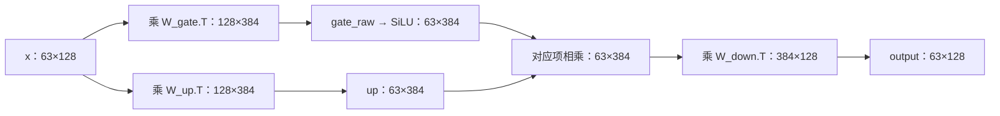

# FFN 矩阵与梯度：按当前 128 → 384 → 128 模型逐步核对

本页承接 [模型构建的 FFN 一节](3.模型构建.md)。全部采用当前教学模型：CPU、float32、seed=42、两层、H=128、中间维=384，第一条 demo 文本经过 padding 和移位后，X 的形状为 `[1,63]`。重点观察第一层的 `model.model.layers[0].mlp`。

与 [debug_train_step.py](../scripts/debug_train_step.py) 使用相同的创建顺序，输入和激活从真实前向取得；不是给 FFN 随机编一份输入。三批训练入口的初始化与取样顺序不同，所以不能要求它与本页所有小数一致。

## 1. 先把“矩阵”与“行列式”分清

`m × n` 表示矩阵有 m 行、n 列。行列式 `det(A)` 则是由方阵计算出的一个标量。本页只讨论矩阵和张量的形状，不计算行列式。

三个维度的 `[B,T,H]` 是张量，不能把它称为一个 m×n 矩阵。为方便核对线性层，我们把 batch 和 token 位置合为 N 行：

```text
B = 1 条样本
T = 63 个预测位置
H = 128 个隐藏特征
I = 384 个 FFN 中间特征
N = B × T = 63 行

原始 x：       1 × 63 × 128
观察为矩阵：       63 × 128
```

每一行对应一个 token 位置的隐藏表示，128 列是这个位置的 128 个浮点特征。reshape 只是方便看计算，不把不同 token 的内容混在一起；`nn.Linear` 本身可以直接接收三维输入，不需要先手动展平。

## 2. 这里的 x 已经不是 token ID

```text
训练输入 X：整数，1 × 63
  ↓ Embedding
隐藏表示：浮点，1 × 63 × 128
  ↓ 第一层 Attention、残差相加、RMSNorm
FFN 输入 x：浮点，1 × 63 × 128
```

`X[0,0]` 可以是 ID 47，对应 `M`。但 FFN 的 `x[0,0,:]` 已经是这个位置经过上下文处理后的 128 个数，不能再解释为 128 个 token ID。

先运行真实观察脚本：

```bash
.venv/bin/python scripts/inspect_ffn.py
```

它会取得这些真实中间量、逐项核对矩阵计算，然后用整条语言模型的实际 next-token loss 做反向与更新。只在内存中运行，不覆盖已保存的模型。

## 3. 三张可训练权重，哪些行、哪些列

当前源码：

```python
self.gate_proj = nn.Linear(128, 384, bias=False)
self.up_proj = nn.Linear(128, 384, bias=False)
self.down_proj = nn.Linear(384, 128, bias=False)
```

PyTorch 保存 Linear 的权重时使用 `[out_features,in_features]`：

| 权重 | 保存形状（行×列） | 每一行负责什么 | 参数数量 |
| --- | --- | --- | --- |
| `gate_proj.weight` / W_gate | `384 × 128` | 一个 gate 输出通道的 128 个输入系数 | 49,152 |
| `up_proj.weight` / W_up | `384 × 128` | 一个 up 输出通道的 128 个输入系数 | 49,152 |
| `down_proj.weight` / W_down | `128 × 384` | 一个输出特征的 384 个混合系数 | 49,152 |
| 第一层 FFN 合计 | 三张独立矩阵 | 不含 Attention、Embedding 和 Norm | 147,456 |

三层都没有 bias；SiLU 没有可训练参数；本配置 dropout=0，也没有 dropout 权重。

如果创建 config 时没有显式传中间维，当前代码先取 `int(128*8/3)=341`，再向上对齐到 64 的倍数，得到 384。本页直接沿用这个宽度；128→384 不是把每个数简单复制三遍，而是通过不同权重组合产生 384 个特征。

可以把 W_gate 的 384 行想成 384 份不同配方，每份配方把 128 个输入特征加权求和。W_up 是另一套配方，形状相同但数值独立。它们接收同一份 x，不是分别读取 x 的前半和后半。

### 权重和计算结果不是一回事

| 对象 | 保存或输出什么 | 什么时候变 |
| --- | --- | --- |
| `gate_proj.weight` | `384×128` 权重 | 创建或加载时确定，优化器更新时改变 |
| `gate_proj(x)` | `1×63×384` 激活 | 输入或参数变化时，可以得到不同结果 |
| `up_proj.weight` | 独立的 `384×128` 权重 | 与 gate 权重分别学习 |
| `up_proj(x)` | 另一份 `1×63×384` 激活 | 当前输入经过 up 权重的计算结果 |

前向不会根据 x 临时“造一张新权重”。x 参与计算的是结果，权重是模型保存的参数对象。

## 4. 为什么乘的是权重转置

本页把输入向量排成行，PyTorch Linear 的计算等价于：

```text
输出 = 输入 @ 权重.T

通用：
(m × n) @ (n × p) = (m × p)
        内侧 n 对齐     外侧 m、p 留下
```

因此不是 `x @ W_gate`：

```text
x：       63 × 128
W_gate： 384 × 128    内侧 128 与 384 不匹配
```

而是：

```text
x：         63 × 128
W_gate.T： 128 × 384
结果：      63 × 384
```

若其他书把 x 写成列向量，它会写 `W_gate @ x`，即 `(384×128) @ (128×1)`。那是另一种记号约定，与本页“样本排成行”的写法对应，不是两种不同的网络。

## 5. 逐步核对完整前向的 m×n 变化

先把源码长表达式拆开：

```python
gate_raw = ffn.gate_proj(x)
gated = ffn.act_fn(gate_raw)
up = ffn.up_proj(x)
mixed = gated * up
output = ffn.down_proj(mixed)
```

`ffn` 指第一层的实际模块，`x` 是实际 FFN 输入。以下矩阵视图都令 N=63：

| 步骤 | 运算及 m×n 对齐 | 矩阵结果 | 模型里的张量形状 |
| --- | --- | --- | --- |
| gate 投影 | `(63×128) @ (128×384)` | `63×384` | `[1,63,384]` |
| SiLU | 每个数分别应用 SiLU | `63×384` | `[1,63,384]` |
| up 投影 | 同一个 x，`(63×128) @ (128×384)` | `63×384` | `[1,63,384]` |
| 门控融合 | `(63×384) * (63×384)`，逐元素 | `63×384` | `[1,63,384]` |
| down 投影 | `(63×384) @ (384×128)` | `63×128` | `[1,63,128]` |
| dropout | 本配置概率为 0 | `63×128` | `[1,63,128]` |
| 外层残差 | 两份 `[1,63,128]` 对应位置相加 | `63×128` | `[1,63,128]` |

两次升维共享同一输入，不共享权重。`*` 和 `@` 是两种不同操作，不能相互替代。



### 把镜头缩到第 0 个 token，仍用真实 128 / 384 维

保留行维度：

```python
x0 = x[0, 0:1, :]  # 1 × 128
```

它的计算是：

```text
gate0_raw = (1 × 128) @ (128 × 384) = 1 × 384
gated0 = SiLU(gate0_raw)                     1 × 384
up0 =       (1 × 128) @ (128 × 384) = 1 × 384
mixed0 =    (1 × 384) * (1 × 384)   = 1 × 384
output0 =   (1 × 384) @ (384 × 128) = 1 × 128
```

其余 62 行使用相同的三张权重。FFN 不在这些行之间求和，跨位置的信息汇总由此前的 Attention 完成。

## 6. 每个数具体怎样算

第 0 个 token 的 gate 第 0 个通道，是 128 项加权求和：

```text
gate_raw[0,0,0]
= x[0,0,0]   × W_gate[0,0]
+ x[0,0,1]   × W_gate[0,1]
+ ...
+ x[0,0,127] × W_gate[0,127]
```

注意取的是权重的第 0 行；这一行存放第 0 个输出通道的全部输入系数。第 1 个通道使用 W_gate 的第 1 行，直到第 383 行。

本机运行脚本时，第 0 个 token 输入的前五项约为：

```text
x[0,0,:5]：
[-0.011271, -0.117317, -0.548572, -0.596094, -0.034837]

W_gate[0,:5]：
[0.029252, -0.004875, 0.059470, -0.050174, -0.003506]
```

完整 128 项求和后，`gate_raw[0,0,0]≈1.095438`。上面只展示前五项，不是仅用这五项就能算出该结果。脚本同时用矩阵乘法和单行点积核对，浮点求和顺序可能导致最后几位不同。

SiLU 对每项分别计算 `a*sigmoid(a)`，不把 384 项求和，也不会把它们变成总和为 1 的概率。up 支路用自己的 W_up 再算出 384 项。

融合时第 j 个通道：

```text
mixed[0,0,j] = gated[0,0,j] × up[0,0,j]
```

384 对数得到 384 个结果，既不是拼接成 768 个数，也不是点积变成一个标量。系数可以缩小、放大或改变符号，所以“gate 是 0～1 的开关”并不准确。

最后输出第 0 个特征是：

```text
output[0,0,0]
= mixed[0,0,0]   × W_down[0,0]
+ mixed[0,0,1]   × W_down[0,1]
+ ...
+ mixed[0,0,383] × W_down[0,383]
```

down 的每一行都混合 384 个通道，而不是把后面 256 项删掉。第 0 个输入特征和第 0 个输出特征也不保证具有人类预先指定的同一种语义。

本机从同一次真实前向中取得的几个数如下，全部保留 `[0,0,0]` 这一索引：

| 变量 | 实测值约为 | 从哪里来 |
| --- | --- | --- |
| `gate_raw` | 1.095438 | 该 token 的 128 项输入与 W_gate 第 0 行点积 |
| `gated` | 0.820926 | 对上项做 SiLU |
| `up` | 0.047213 | 同一输入与 W_up 第 0 行点积 |
| `mixed` | 0.038758 | `0.820926 × 0.047213`，此处仅核对一个通道 |
| `output` | 0.218396 | 全部 384 个 mixed 通道与 W_down 第 0 行点积 |

所以最后的 0.218396 不能只从 0.038758 一个数推出来，还用到了另外 383 个通道。脚本会打印这些真实值，具体末位小数可能随数值实现变化；形状和计算规则才是本课核对重点。

## 7. 三张权重如何从同一个 loss 学出来

当前从头训练时，三张权重由 `nn.Linear` 分别初始化为小随机数，seed=42 固定随机起点；加载模型时则用 checkpoint 数值覆盖相应参数。

权重不是由 x 直接解一个方程得到的。真实训练过程为：

```text
当前权重 + x -> 第一层 FFN 输出
-> 残差与后续 Transformer 层
-> lm_head 的词表分数
-> 与 Y 对照、按 loss_mask 汇总 next-token loss
-> backward 分别求三张权重的梯度
-> AdamW 按各自梯度与历史状态更新三张权重
```

三条投影没有各自的人工标准答案；它们共同参与最终预测，所以同一个 loss 可以通过计算图分别影响它们。gate/up 分工是共同任务训练出来的，并不预先指定哪个通道负责某个语法概念。

本批实际 masked loss 约为 `8.943250`，包含 19 个有效目标。它不是只对第 0 个 token 的 loss，也没有为了 FFN 练习改用“输出平方”等另外一种训练目标。

## 8. 反向也能逐项核对 m×n

下面 `d_某个量` 表示“loss 对这个量的梯度”。它的形状和这个量本身相同。所有式子都在同一个前向的权重尚未更新时计算。

| 步骤 | 反向运算 | 梯度形状 |
| --- | --- | --- |
| 上游反馈 | d_output | `63×128` |
| down 权重梯度 | `d_output.T @ mixed`：`(128×63) @ (63×384)` | `128×384` |
| 返回 mixed 的梯度 | `d_output @ W_down`：`(63×128) @ (128×384)` | `63×384` |
| 返回 gated 的梯度 | `d_mixed * up`，逐元素 | `63×384` |
| 返回 up 的梯度 | `d_mixed * gated`，逐元素 | `63×384` |
| 穿过 SiLU | `d_gate_raw = d_gated * SiLU'(gate_raw)` | `63×384` |
| gate 权重梯度 | `d_gate_raw.T @ x`：`(384×63) @ (63×128)` | `384×128` |
| up 权重梯度 | `d_up.T @ x`：`(384×63) @ (63×128)` | `384×128` |
| 返回输入的梯度 | `d_gate_raw @ W_gate + d_up @ W_up` | `63×128` |

最后一行两条支路都使用 `(63×384) @ (384×128)`，各自返回一份 `63×128`，再逐元素相加。这解释了同一个 x 为什么会收到两条路径的反馈。

以 gate 权重中的一个数为例：

```text
W_gate.grad[j,k]
= Σ 第 i 个位置的 d_gate_raw[i,j] × x[i,k]
  i 从 0 到 62
```

权重在各位置共享，所以同一个权重的梯度会汇总不同位置的贡献。mask=0 的目标没有直接 loss；某个早期位置仍可能通过后文 Attention 影响有效回答预测，不能据此断言那一位置在任何内部张量上的梯度都为 0。

观察脚本通过 hooks 保存真实中间激活，并用 `retain_grad()` 查看非叶张量的梯度。普通训练没有保留这些中间 `.grad` 的必要；这里是为了逐项核对上表。权重 `.grad` 仍由真实语言模型 loss 的 backward 产生。

## 9. backward、step、zero_grad 后分别留下什么

| 时刻 | W_gate 形状 | W_gate 数值 | W_gate.grad |
| --- | --- | --- | --- |
| 前向结束 | `384×128` | 初始值未变 | `None` |
| backward 后 | `384×128` | 仍未变 | 一张 `384×128` 梯度矩阵 |
| 裁剪梯度、AdamW step 后 | `384×128` | 已按优化器规则改变 | 使用过的梯度仍在 |
| zero_grad 后 | `384×128` | 保留更新结果 | `None` |

W_up 同理；W_down 及其梯度均为 `128×384`。训练改变数值，不在每次更新时改变层的宽度。

脚本会先验证 backward 没有修改权重，再对三张参数分别检查 step 后的最大变化大于 0，并用矩阵公式重算梯度与 autograd 对照。它使用 AdamW 和梯度裁剪，不把真实参数变化简单写成 SGD 的 `lr*grad`。

## 10. 在 VS Code 里对应每一步

选择 `08 - Inspect FFN matrices (CPU)`，按 F5，在三个阶段停住：

| 阶段 | 可查看变量 | 本步确认什么 |
| --- | --- | --- |
| FORWARD | `x`、`W_gate`、`W_up`、`W_down`、`gate_raw`、`gated`、`up`、`mixed`、`output`、`loss` | 所有前向形状和第一项数值 |
| BACKWARD | 上述变量及其 `.grad` | 三张权重梯度与对应矩阵形状一致，权重未变 |
| UPDATE | `before`、权重、清零后的 `.grad` | 更新保留、梯度清空，维度保持不变 |

在 FORWARD 停点可以输入：

```python
x.shape
W_gate.shape, W_gate.T.shape
x0 = x[0, 0:1, :]
x0.shape
(x0 @ W_gate.T).shape
torch.allclose(x0 @ W_gate.T, gate_raw[0, 0:1, :])
```

预期最后一项为 `True`，中间形状分别为 `1×128`、`128×384`、`1×384`。然后看：

```python
torch.allclose(gated * up, mixed)
torch.allclose(mixed @ W_down.T, output)
```

应都为 True。在 UPDATE 停点，中间激活是之前那次前向保存的结果，不能拿更新后的权重去要求它们仍匹配；要验证新权重下输出，需要重新做前向。

完成标准：不看答案，写出三张参数矩阵、两个投影乘法、一次逐元素乘法、一次 down 乘法及三张权重梯度的形状，并解释 `.T`、`*`、`@` 分别做什么。

源码：[FFN 真实计算](../model/model_minimind.py)、[实际批次观察与梯度核对脚本](../scripts/inspect_ffn.py)。接口参考：[Linear](https://docs.pytorch.org/docs/2.14/generated/torch.nn.Linear.html)、[SiLU](https://docs.pytorch.org/docs/2.14/generated/torch.nn.SiLU.html)。
