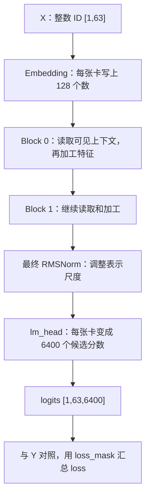

# 3. 模型构建：编号怎样变成候选分数

前置：[Dataset 与 DataLoader](2.DataLoader.md)。本章沿着同一条真实文本、同一批 `[1,63]` 输入，读懂 [model_minimind.py](../model/model_minimind.py) 的 11 个环节。

先抓住这件事：**模型为每个输入位置准备一份“下一 token 候选打分表”。** 中间的 Embedding、Attention、FFN 等模块，都在为这份打分表加工信息。

本章使用 H=128、两层、8 个 Q 头、2 个 KV 头的小模型。它与前面的一步训练实验一致；最初 smoke test 的 25.83M 模型使用了不同规模，不能直接套用本章全部参数数量。

## 本章实践卡

先看一遍实际形状：

```bash
.venv/bin/python scripts/lesson_lab.py --lesson model
```

然后分两条线理解计算与学习，再接回训练：

| 目标 | 实践入口 | 能看到什么 |
| --- | --- | --- |
| 查表、投影、分头、词表打分 | `.venv/bin/python scripts/inspect_model.py` | 真实中间量与逐步矩阵核对 |
| FFN 如何计算并学习 | `.venv/bin/python scripts/inspect_ffn.py` | gate/up/down、梯度、参数更新 |
| 把模型接回训练 | `.venv/bin/python scripts/debug_train_step.py` | DATA → FORWARD → BACKWARD → UPDATE |

第一遍按 1～3 节认清“数据与参数”；第二遍按 4～9 节拆开一个 Block；第三遍按 10～11 节连上预测、缓存和调试。暂时不打开 MoE 和位置外推。

两篇配套精讲用于进一步核对：[FFN 矩阵与梯度](3.1.FFN矩阵与梯度.md)、[Embedding 到 logits 矩阵精讲](3.2.Embedding到logits矩阵精讲.md)。本页先把各环节的原因、代码与练习连起来。


### 固定实验：后面的 Python 块共用这一份数据和模型

在项目根目录启动 `.venv/bin/python`，先执行下面这一段，再按章节顺序执行后面的 Python 块。也可以在 VS Code 的 Python 交互窗口中按顺序运行，工作目录保持为项目根目录。

```python
from pathlib import Path
import math

import torch
import torch.nn.functional as F
from torch.utils.data import DataLoader, Subset
from transformers import AutoTokenizer

from dataset.lm_dataset import PretrainDataset
from model.model_minimind import (
    MiniMindConfig, MiniMindForCausalLM, apply_rotary_pos_emb, repeat_kv,
)
from trainer.train_utils import setup_seed

ROOT = Path.cwd()
torch.set_num_threads(2)
setup_seed(42)

tokenizer = AutoTokenizer.from_pretrained(ROOT / "model")
dataset = PretrainDataset(
    ROOT / "dataset/demo_pretrain.jsonl", tokenizer, max_length=64,
)
loader = DataLoader(Subset(dataset, [0]), batch_size=1, num_workers=0)
X, Y, loss_mask = next(iter(loader))

# 先取 batch，再创建模型，保持与两个 inspect 脚本相同的随机数使用顺序。
config = MiniMindConfig(
    vocab_size=len(tokenizer), hidden_size=128, intermediate_size=384,
    num_hidden_layers=2, max_position_embeddings=64,
)
model = MiniMindForCausalLM(config).train()
block = model.model.layers[0]
attn = block.self_attn

# 本章先观察前向；训练中的 backward 和更新在 FFN 精讲及下一章实践。
with torch.no_grad():
    result = model(X)
    embedding = model.model.embed_tokens(X)

E = model.model.embed_tokens.weight
h = result.last_hidden_state
logits = result.logits
T = X.size(1)
position_embeddings = (
    model.model.freqs_cos[:T], model.model.freqs_sin[:T],
)
print(X.shape, embedding.shape, logits.shape)
```

预期依次是 `[1,63]`、`[1,63,128]`、`[1,63,6400]`。

这里加载的是 `model/` 的 6400 词表，不是之前练习训练出的 `out/tokenizer_lesson`。创建的是随机初始化模型，没有读取训练后的 checkpoint；因此预测不通顺很正常。

当前 dropout=0，下面才能把模块分开重算并与同一次前向核对。若以后启用训练态 dropout，两次调用可能使用不同随机掩码，不能再直接要求结果相同。

## 1. 先看整条加工路线

### 1.1 模型实际在回答什么问题

原文是：

```text
MiniMind is a small language model project for learning how pretraining works.
```

`model/` 的 tokenizer 把 `MiniMind` 切成五个片段：

```text
片段：M    in    i    M    ind
ID：  47   261   75   47   807
```

Dataset 把序列补齐到 64，再移位成 63 个输入位置与 63 个目标位置。前两道接龙题是：

| 预测位置 | 这个位置输入什么 | 允许参考哪些输入 | 希望接什么 |
| --- | --- | --- | --- |
| 0 | `"M"`，ID 47 | 位置 0 的 `"M"` | `"in"`，ID 261 |
| 1 | `"in"`，ID 261 | 位置 0～1 的 `"M" + "in"` | `"i"`，ID 75 |

位置 1 不只是拿孤立的 `"in"` 猜答案，Attention 允许它参考此前的 `"M"`。每个位置有自己的已知前缀和目标；模型不是读完整句话后只交一个答案。

本批只有 19 个有效目标，其余为 padding 目标，计分时由 `loss_mask` 排除。张量仍有 63 个位置，所以中间形状一直保留 T=63。

### 1.2 把每个位置想成一张资料卡



一条样本有 63 张卡片。Embedding 给编号配上浮点向量；Attention 让卡片按需要读取允许参考的其他卡片；FFN 加工每张卡片上的特征；lm_head 用最后的表示给所有候选打分。

“卡片”帮助理解位置和数据流。128 个特征没有预先指定成“主语”“地点”等标签，Attention 权重也不是事实可信度。

### 1.3 三个容易混淆的数字

| 数字 | 是什么 | 不要混成什么 |
| --- | --- | --- |
| 63 | 当前输入有多少个位置 T | 不是词表大小或模型层数 |
| 128 | 每个位置的内部表示宽度 H | 不是当前文本有多少个 token |
| 6400 | 词表候选数 | 不是一次生成 6400 个 token |

本章的 `[1,63,128]` 是三维张量。为了看清线性层，可以把前两维合为 `N=B×T=63` 行，按 `63×128` 矩阵理解；每行仍对应一个位置。

### 1.4 从哪几个类开始读源码

| 类 | 管什么 | 本课重点 |
| --- | --- | --- |
| `MiniMindConfig` | 结构参数 | 宽度、层数、头数、词表大小 |
| `MiniMindForCausalLM` | 包住基础模型并做词表打分 | `self.model`、`self.lm_head` |
| `MiniMindModel` | Embedding、多个 Block、最终 Norm | 整条前向顺序 |
| `MiniMindBlock` | 一层 Attention 与 FFN | 两次 Norm、两次残差 |
| `Attention` | 查询、匹配、汇总上下文 | Q/K/V、RoPE、遮挡、合头 |
| `FeedForward` | 逐位置加工特征 | gate/up/down |

**本节自查**：`model`、`model.model`、`model.model.layers[0]` 是三层对象关系，不是三次训练，也不是三个不同模型文件。

## 2. config 是结构蓝图，不是训练数据

### 2.1 先决定机器长什么样，再给它输入

可以把 config 想成造机器前的图纸：每张卡片多宽、内部几道工序、每道工序开几个头，都先由图纸决定。

`MiniMindConfig(...)` 本身保存配置。执行 `MiniMindForCausalLM(config)` 时，各个 `nn.Embedding`、`nn.Linear` 等模块才按这些数字创建参数。

| 参数 | 本课值 | 直接影响什么 |
| --- | --- | --- |
| `vocab_size` | 6400 | Embedding 行数、logits 最后一维 |
| `hidden_size` | 128 | Embedding 列数、Block 主路径宽度 |
| `num_hidden_layers` | 2 | 创建 Block 0 和 Block 1，各有自己的参数 |
| `num_attention_heads` | 8 | Q 分为 8 个头，每头 16 维 |
| `num_key_value_heads` | 2 | K/V 各分为 2 个头，每头 16 维 |
| `intermediate_size` | 384 | FFN 的 gate/up 输出宽度 |
| `max_position_embeddings` | 64 | 初始化的 RoPE 位置表长度 |
| `dropout` | 0 | 本次不随机丢弃激活 |
| `rms_norm_eps` | `1e-5` | RMSNorm 分母中的小修正量 |
| `rope_theta` | `1e6` | 决定不同 RoPE 分量的旋转频率 |
| `flash_attn` | True | 尝试走 PyTorch SDPA 接口 |
| `use_moe` | False | 使用普通 FFN，暂不开专家路由 |

`max_position_embeddings=64` 不要求输入必须有 64 个位置。它准备了位置 0～63 的旋转表；当前 X 用位置 0～62，只取其中 63 行。

### 2.2 哪些值能一起算出来

```text
单头宽度 D = H / Q头数 = 128 / 8 = 16
Q 投影宽度 = 8 × 16 = 128
K/V 各自宽度 = 2 × 16 = 32
每个 KV 头供几个 Q 头使用 = 8 / 2 = 4
```

这些数字必须配合。当前设计要求 H 能被 Q 头数整除，Q 头数能被 KV 头数整除，RoPE 的单头宽度也需要能分成两半。把 KV 头数改成 3，就无法把 8 个 Q 头均匀分组。

相较之下，batch_size 决定一次装几条数据，学习率决定如何更新参数。它们不把一张 `32×128` 权重变成另一种形状。

### 2.3 参数、激活和 buffer 各是什么

| 对象 | 本课例子 | 前向时怎样使用 | 优化器是否更新 |
| --- | --- | --- | --- |
| 参数 parameter | E、Wq、gamma | 提供当前查表值或计算系数 | 可训练参数会按梯度更新 |
| 激活 activation | embedding、Q、mixed、logits | 当前输入经过计算得到的中间结果 | 不把它们当模型权重更新 |
| buffer | RoPE 的 cos/sin 表 | 提供预计算的位置旋转数值 | 本实现不对它们求梯度或优化 |

可以把参数看成加工配方，激活看成这次加工出的材料，buffer 看成预先备好的计算表。保存配方不等于保存每次加工的全部中间材料。

### 2.4 为什么日志显示约 1.197 百万参数

本配置可直接按矩阵大小核对：

| 部分 | 计算 | 参数数 |
| --- | --- | --- |
| Embedding 与 lm_head 共享参数 | `6400×128`，只计一次 | 819,200 |
| 两层 Attention 投影 | `2×(128×128 + 32×128 + 32×128 + 128×128)` | 81,920 |
| 两层 FFN | `2×(384×128 + 384×128 + 128×384)` | 294,912 |
| 五个 RMSNorm | 每个 Block 两个，最终再一个；`5×128` | 640 |
| 合计 | 上面四项相加 | 1,196,672 |

```python
parameter_count = sum(p.numel() for p in model.parameters())
print(parameter_count, f"{parameter_count / 1e6:.3f} M")
assert parameter_count == 1_196_672
print(len(model.model.layers), attn.head_dim, attn.n_rep)
```

预期为 `1196672`、`1.197 M`，以及 `2 16 4`。RoPE 的 cos/sin 在本实现中是 buffer，不计入可训练参数。

### 2.5 改配置时，哪些行为会跟着变

- 把 batch 从 1 改成 2：输入第一维变成 2，参数数量不变。
- 把输入长度从 63 改成 31：位置轴变短，线性权重形状不变。
- 创建新模型时把 H 改为 256：许多权重形状随之改变，原来的 128 维参数不能直接按原结构套入。
- 模型创建后只给 `config.hidden_size` 重新赋值：已经创建的 Linear 不会自动重建。

**本节自查**：能否只看配置，就写出 Q/K/V 的输出宽度？先算 16，再算 128、32、32。

## 3. Embedding：按整数查行，不是对编号做大小比较

### 3.1 先把编号变成可计算的资料

token ID 是词表中的位置编号。47 和 48 的编号接近，不说明语义接近；对编号本身做大小比较，无法表达上下文关系。

Embedding 提供一张可以训练的资料表：

```text
E.shape = [6400,128]
6400 行：每个 ID 占一行
128 列：这一行的 128 个浮点特征
```

输入 ID=47 时，取出 E 的第 47 行；不是把 47 乘上 128 个系数。

```text
X[0,0] = 47  -> E[47,:]  -> embedding[0,0,:]
X[0,1] = 261 -> E[261,:] -> embedding[0,1,:]
……
共取 63 行，按输入位置排好 -> [1,63,128]
```

位置 t 与词表 ID 是两个不同的索引。例如 `embedding[0,1]` 是第 1 个位置的向量，但它取自词表的第 261 行。

### 3.2 用本批真实数字核对

```python
print(X[0, :5].tolist())
print(tokenizer.decode([X[0, 0].item()]))
print(E.shape, embedding.shape, X.dtype, embedding.dtype)
print(E[47, :5].detach().tolist())
torch.testing.assert_close(embedding, E[X], rtol=0, atol=0)
assert torch.equal(embedding[0, 0], embedding[0, 3])
```

预期前五个 ID 是 `[47,261,75,47,807]`，第一个片段为 `"M"`；X 为整数类型，Embedding 输出为 float32。

第 47 行前五项约为：

```text
[0.044396, 0.080257, -0.042085, 0.049926, -0.057879]
```

整行有 128 项，上面只是展示前五项。位置 0 和 3 都是 ID 47，刚查出的向量完全相同；后续经过位置与上下文处理，表示可以不同。

### 3.3 为什么这张表可以学

这些浮点数是模型参数。从头训练时先初始化；加载 checkpoint 时恢复已有数值。前向按 ID 查行，loss 的反向传播再为相关参数累积梯度，优化器按梯度更新数值。

本模型还有权重绑定：

```python
print(E is model.lm_head.weight)
assert E is model.lm_head.weight
```

预期为 True。输入查表与输出打分使用同一参数对象，反向会汇总相关路径的贡献。因此在本模型中，不能说“没有在 X 中出现的行就一定没有梯度”，因为输出端还会使用整张表。

### 3.4 查表和矩阵乘法是什么关系

正常实现直接查行，无需创建 one-hot。若用数学形式解释，可以把每个 ID 写成长度 6400、只有对应位置为 1 的行：

```text
one_hot(X)：63 × 6400
E：              6400 × 128
结果：      (63 × 6400) @ (6400 × 128) = 63 × 128
```

这个乘法选出的正是指定行。原始 `[1,63]` 整数 ID 不能直接当作浮点特征去乘 E。

**本节自查**：`embedding[0,0,7]` 来自哪里？来自 `E[47,7]`，不是 E 的第 0 行，也不是 ID 47 的“第 7 个字”。

## 4. RMSNorm：控制向量尺度，不负责把均值减到零

### 4.1 为什么进入加工前先调整尺度

RMS 是 Root Mean Square，均方根；RMSNorm 即 Root Mean Square Normalization，均方根归一化。它先平方、再平均、最后开方，用这个量描述一组数的整体幅度。

不同位置的隐藏向量，数值幅度可能不同。同一套投影权重如果遇到幅度很大的输入，得到的点积也可能很大。RMSNorm 在每个位置内部调整尺度，让后续模块接收经过归一化的表示。

可以把它想成读资料前先统一音量：主要调整这一张卡片整体的数值幅度，再通过可学习参数调节各个特征。它不负责判断哪个 token 正确，也不将特征变成概率。

### 4.2 对实际 128 个数怎样计算

用 r 表示进入第一层 Block 的 `[1,63,128]`。本配置 dropout=0，所以它等于 Embedding 输出。对每个位置分别计算：

```text
mean_square[b,t] = (r[b,t,0]² + ... + r[b,t,127]²) / 128
scale[b,t] = 1 / sqrt(mean_square[b,t] + eps)
a[b,t,j] = r[b,t,j] × scale[b,t] × gamma[j]
```

gamma 对应源码的 `self.weight`，是 128 个可训练缩放参数，初始都为 1。eps=`1e-5` 给分母加一个小修正，避免零向量出现除零。

| 中间量 | 形状 | 具体在做什么 |
| --- | --- | --- |
| r | `[1,63,128]` | 每个位置有 128 项 |
| `r.pow(2)` | `[1,63,128]` | 每项平方 |
| `mean(-1,keepdim=True)` | `[1,63,1]` | 每个位置求一个均方值 |
| `rsqrt(均方+eps)` | `[1,63,1]` | 每个位置得到一个整体缩放系数 |
| gamma | `[128]` | 每个特征一个可学习缩放量 |
| a | `[1,63,128]` | 用广播完成缩放，宽度不变 |

这里没有跨 63 个位置取平均，也没有把一条样本压缩成一个数。`keepdim=True` 留下宽度为 1 的轴，便于把同一缩放系数应用到该位置的 128 项。

### 4.3 对照源码逐步重算

```python
r = embedding
norm = block.input_layernorm
with torch.no_grad():
    mean_square = r.float().pow(2).mean(-1, keepdim=True)
    inverse_rms = torch.rsqrt(mean_square + norm.eps)
    manual_norm = norm.weight * (r.float() * inverse_rms).type_as(r)
    a = norm(r)
torch.testing.assert_close(manual_norm, a)
print(mean_square.shape, inverse_rms.shape, a.shape)
print("第 0 个位置均值：", r[0, 0].mean().item(), a[0, 0].mean().item())
print("gamma 前五项：", norm.weight[:5].detach().tolist())
```

源码先转 float32 计算平方、均值和倒数平方根，减少低精度运算中的数值问题；`.type_as(r)` 将归一化中间结果转回输入精度。本课所有这些量均为 float32。

实测第 0 个位置的均值从约 `-0.000518` 变为 `-0.010198`，没有归零。归一化调整的是均方根尺度，不能把“做了 Norm”理解成“所有形式的平均都变成 0”。

### 4.4 和“减均值”“softmax”分别差在哪

| 运算 | 是否减去均值 | 输出各项之和是否为 1 | 输出形状 |
| --- | --- | --- | --- |
| 本实现 RMSNorm | 否 | 否 | 与输入一致 |
| LayerNorm 的归一化步骤 | 是 | 否 | 与输入一致 |
| softmax | 不按上述方式减均值归一化 | 沿指定轴为 1 | 与输入一致 |

RMSNorm 在忽略 eps、gamma 全为 1 时，将每个位置的均方根调到 1 附近；均值不一定为 0。gamma 学习后还会对不同特征施加不同缩放，因此也不能要求最终输出的均方根永远严格等于 1。

每个 Block 有两个独立 RMSNorm：Attention 前一个，FFN 前一个；全部 Block 后还有最终 Norm。它们形状相同，但不是共用一组 gamma。

**本节自查**：形状没有变，为什么还需要这一层？因为它改变了数值尺度；形状只描述“有多少项”，不描述“每项是多少”。


## 5. Attention：当前这一片需要参考哪些前文

### 5.1 给同一份资料分别写查询、索引和内容

以位置 4 的 `"ind"` 为例，这个位置要根据前缀 `MiniMind` 预测下一片。它需要从允许读取的各位置汇总信息，不能只凭当前片段的孤立编号。

Attention 把归一化表示 a 分别投影为：

- Q，Query：当前查询，表达“我需要匹配什么”。
- K，Key：各位置用于匹配查询的索引。
- V，Value：各位置在被读取时提供的内容。

可以类比查资料：用 Q 与资料索引 K 比较，得到各份资料的读取权重，再用这些权重汇总 V。实际 Q/K/V 都是数值向量，匹配规则由训练学习，没有人工写好的“主语头”“地点头”。

### 5.2 三套权重如何读取同一个 a

| 投影 | 参数保存形状 | 行向量计算 | 输出 |
| --- | --- | --- | --- |
| Q | Wq `128×128` | `(63×128) @ (128×128)` | `[1,63,128]` |
| K | Wk `32×128` | `(63×128) @ (128×32)` | `[1,63,32]` |
| V | Wv `32×128` | `(63×128) @ (128×32)` | `[1,63,32]` |

Linear 保存 `[输出宽度,输入宽度]`，所以输入按行排列时乘的是权重转置。K 的每个输出通道，都用自己的 128 个系数读取 a 的全部 128 项；不是删掉后 96 项。

三条支路参数独立，K 和 V 即使形状相同，数值与职责也不同。

### 5.3 为什么要分成多个头，又为什么 KV 头比较少

```text
Q：128 项 -> 8 个头，每头 16 项 -> [1,63,8,16]
K： 32 项 -> 2 个头，每头 16 项 -> [1,63,2,16]
V： 32 项 -> 2 个头，每头 16 项 -> [1,63,2,16]
```

不同 Q 头可以形成不同的匹配方式。每个头在自己的 16 维空间里匹配和汇总，不是让 8 个头分别处理 8 段文本。

本配置采用 GQA，Grouped Query Attention，即分组查询注意力：一个 KV 头供四个 Q 头使用。

```text
Q 头编号：      0 1 2 3  4 5 6 7
使用的 KV 头：  0 0 0 0  1 1 1 1
```

`repeat_kv(...,4)` 按头扩展，得到 `[1,63,8,16]`；再交换位置轴和头轴，Q/K/V 都变为 `[1,8,63,16]`。重复不会增加可训练权重，也不会让一个头从 16 维变成 64 维。

为什么让多个 Q 头共用 K/V？如果 K/V 也各有 8 个头，就各需输出 128 维，Wk/Wv 各有 `128×128=16,384` 个参数；当前各只需 `32×128=4,096` 个。缓存中的 K/V 元素数也只有这种 8 头配置的四分之一，这里比较的是 K/V，不是整个模型的显存。

四个 Q 头共用同一份 K/V，查询向量仍然各自不同，因此可以得到不同读取权重；共用资料不等于每个人提出同一个问题。

### 5.4 一个头怎样完成一次匹配与读取

先只看 batch 0、头 0：

```text
Q：63 × 16
K：63 × 16
V：63 × 16

匹配：scores = (Q @ K.T) / sqrt(16)
             = (63×16) @ (16×63) / 4
             -> 63×63

遮挡未来位置，再按每一行做 softmax：
weights -> 63×63

读取：weights @ V
    = (63×63) @ (63×16)
    -> 63×16
```

分数表第 i 行、第 j 列回答：“位置 i 的查询，与位置 j 的索引有多匹配？”这里的列代表输入位置，不代表词表候选。

除以 `sqrt(16)=4` 是对点积分数做尺度调整。点积对 16 项求和，其幅度容易随维度增长；适当缩放能减轻 softmax 因分数幅度过大而过度集中的情况。这是固定计算规则，不是可训练权重。

softmax 对同一查询允许读取的位置分配非负权重，和为 1，再按权重汇总 V。哪个位置分数相对更高，就有更大的读取权重。

### 5.5 从真实投影重算整个 Attention

第 7 节会拆解这里的 RoPE；当前先把它看成“给 Q/K 加入位置相关旋转，形状不变”。

```python
with torch.no_grad():
    Q, K, V = attn.q_proj(a), attn.k_proj(a), attn.v_proj(a)
    q_split = Q.view(1, T, 8, 16)
    k_split = K.view(1, T, 2, 16)
    v_split = V.view(1, T, 2, 16)
    q_rot, k_rot = apply_rotary_pos_emb(
        q_split, k_split, *position_embeddings,
    )
    q = q_rot.transpose(1, 2)
    k = repeat_kv(k_rot, 4).transpose(1, 2)
    v = repeat_kv(v_split, 4).transpose(1, 2)

    scores = (q @ k.transpose(-2, -1)) / math.sqrt(16)
    visible = torch.ones(T, T, dtype=torch.bool).tril()
    masked_scores = scores.masked_fill(~visible, float("-inf"))
    weights = F.softmax(masked_scores.float(), dim=-1).type_as(q)
    attended = weights @ v
    merged = attended.transpose(1, 2).contiguous().view(1, T, 128)
    manual_attention = attn.o_proj(merged)
    attention_out, _ = attn(a, position_embeddings)

torch.testing.assert_close(manual_attention, attention_out, rtol=1e-4, atol=1e-6)
print(Q.shape, K.shape, V.shape)
print(scores.shape, attended.shape, merged.shape)
```

预期分数表为 `[1,8,63,63]`，每头读取结果为 `[1,8,63,16]`，合头为 `[1,63,128]`。Wo 再通过 `(63×128) @ (128×128)` 混合头提供的特征。

合头是把同一位置的 8 份 16 维结果拼起来，不是对头取平均；前面 K/V 的 32 维也不是直接经某个“32→128”线性层恢复。

本实验允许极小浮点误差，因为 PyTorch SDPA 与展开矩阵运算的求和顺序可能不同。SDPA 可以融合计算，不一定在 Python 中显式保存整张 `63×63` 表。

**本节自查**：为什么 Attention 的输出不是 6400 维？因为此处还在汇总上下文，输出回到 H=128；最终候选打分由 lm_head 完成。

## 6. 因果遮挡：整排输入，也不能偷看后面的答案

### 6.1 先看最容易泄漏答案的地方

训练时 X 与 Y 是错开一位的：

```text
位置：  0       1       2       3       4
X：     M       in      i       M       ind
Y：     in      i       M       ind     下一片
```

位置 0 想预测 `"in"`，但正确答案本身就在 X 的位置 1。如果允许位置 0 读取位置 1，模型就可以偷看答案；这种训练方式不符合真正逐步生成时的条件。

因此位置 i 只能读取位置 0～i：

```text
                    key 位置
                 0  1  2  3  4
query 位置 0：   1  0  0  0  0
query 位置 1：   1  1  0  0  0
query 位置 2：   1  1  1  0  0
query 位置 3：   1  1  1  1  0
query 位置 4：   1  1  1  1  1
```

1 代表允许读取。允许读自己，是因为当前输入 token 已知，任务是预测它后面的 token，而不是预测自己。

### 6.2 mask 怎样让未来位置权重变为 0

```text
scores[i,j]：
  j <= i：保留原分数
  j >  i：改成负无穷

softmax 时：
  exp(负无穷) = 0
  未来位置的读取权重 = 0
```

不能简单将未来分数设为 0，因为 `exp(0)=1`，softmax 后仍可能分到权重。

训练把整排位置一起计算，是为了并行完成多道接龙题；因果遮挡确保每道题仍只用自己的前缀。这种训练中提供真实前缀的方式常称为 teacher forcing。生成时，新的前缀则包含模型自己选出的 token。

### 6.3 用真实输出验证“后面改变，前面不受影响”

```python
print(visible[:5, :5].int())
print(weights[0, 0, 0, :5].tolist())
print(weights[0, 0, 1, :5].tolist())

changed_X = X.clone()
changed_X[0, 5] = (changed_X[0, 5] + 1) % len(tokenizer)
with torch.no_grad():
    changed_logits = model(changed_X).logits

torch.testing.assert_close(changed_logits[:, :5], logits[:, :5])
print("前五个位置最大变化：",
      (changed_logits[:, :5] - logits[:, :5]).abs().max().item())
print("位置 5 的最大变化：",
      (changed_logits[:, 5] - logits[:, 5]).abs().max().item())
```

修改输入位置 5 后，位置 0～4 的预测应保持一致，因为它们不能读取未来的第 5 个位置；位置 5 自身的表示和预测可以改变。

本次实测前五个位置最大变化为 `0.0`，位置 5 的最大变化约为 `1.277259`。头 0 的位置 1 对前两个位置的读取权重约为 `[0.425480,0.574520]`，其余为 0；这两个数相加为 1，但不表示两个位置的内容分别有多少“正确率”。

这个实验直接检查行为，比只看一个三角形图更有说服力。它在固定参数、dropout=0 的同一模型上进行，没有重新初始化。

### 6.4 三种 mask 各管哪件事

| 对象 | 主要作用 | 当前实验的情况 |
| --- | --- | --- |
| 因果遮挡 | 不让 query 读取未来 key | Attention 内部按因果规则处理 |
| `attention_mask` | 指定哪些 key 位置允许读取，例如排除 padding | 本章 `model(X)` 未显式传入 |
| `loss_mask` | 指定哪些目标位置参与 loss 汇总 | 由 Dataset 提供，有效目标为 19 个 |

`loss_mask` 在前向之后的 loss 计算中使用，不会自动变成 Attention 的 padding mask。当前样本右侧补 padding，较早的有效位置本来就不能读取未来 padding；padding 位置的输出仍会计算，只是不直接计入目标 loss。

SFT 中用户问题的目标 mask 可以为 0，但问题仍然在 X 中供回答读取。是否计分与是否作为上下文是两件事。

### 6.5 `flash_attn=True` 应该怎样理解

在本仓库中，这个开关配合接口可用性，决定是否调用 `F.scaled_dot_product_attention`。实际走 Flash、其他优化内核还是数学实现，由设备、dtype、形状等条件决定。

因此 CPU 上也能走 SDPA 接口；看到该开关为 True，不能据此断言使用了 GPU Flash Attention 2。理解计算时先看“点积、缩放、遮挡、softmax、汇总”，再看内核如何实现。

**本节自查**：为什么训练能一次算出 63 份分数，却不能直接把这 63 个 argmax 当作连续生成的 63 个 token？因为各位置的训练前缀来自给定的 X，不是依次接回的模型预测。

## 7. RoPE：给 Q/K 加上随位置变化的旋转

### 7.1 为什么有了 token 向量还需要位置

Embedding 只按 ID 查表。位置 0 和 3 都是 `"M"`，初始向量相同。模型还需要在匹配时区分“这是哪个位置的 M，它离当前查询多远”。

因果遮挡限制能读谁，RoPE 则改变允许读取的位置之间怎样匹配。前者不会自动把位置距离作为旋转信息写进 Q/K，二者各有作用。

RoPE 是 Rotary Position Embedding，旋转位置编码。本实现不把一个位置向量加到 Embedding 上，而是在 Q/K 分头后，对每个头的成对分量按位置旋转。

### 7.2 当前 16 维头怎样配对

源码的 `rotate_half` 使用前后半维配对：

```text
头内向量：[z0,z1,z2,z3,z4,z5,z6,z7, z8,z9,z10,z11,z12,z13,z14,z15]
前半 8 项：z0～z7
后半 8 项：z8～z15

配对：(z0,z8)、(z1,z9)、……、(z7,z15)

rotate_half：
[-z8,-z9,...,-z15, z0,z1,...,z7]
```

它不是将相邻的 `(z0,z1)` 配成一对；读别的 RoPE 实现时，要先确认其维度布局。

以 `(z0,z8)` 这一对为例，位置 p 的旋转为：

```text
z0' = z0 × cos(angle) - z8 × sin(angle)
z8' = z8 × cos(angle) + z0 × sin(angle)
```

向量的这两个数换了方向，形成包含位置信息的匹配表示；理想实数运算下，这对分量的平方和保持不变。

### 7.3 角度怎样从位置算出来

本配置单头 D=16、`rope_theta=1e6`。对 8 对分量，第 i 对的频率是：

```text
freq[i] = 1 / (rope_theta ** (2*i/16))，i=0～7
angle[p,i] = p × freq[i]
```

不同对使用不同频率。第 0 对频率为 1，因此：

```text
位置 0：angle=0，cos=1，sin=0，不改变这对分量
位置 1：angle=1 弧度，cos≈0.540302，sin≈0.841471
位置 2：angle=2 弧度
```

所以不是每个位置固定旋转 90 度；更不是 128 个维度全部使用同一个角度。

初始化时，模型预计算 `[64,16]` 的 cos 与 sin buffer；当前前向取 `[63,16]`。其频率在前后半维重复排列，使每一对 `(zi,zi+8)` 使用相同角度。

### 7.4 在真实 Q 上核对一对分量

```python
cos, sin = position_embeddings
with torch.no_grad():
    pair_0 = (
        q_split[0, 1, 0, 0] * cos[1, 0]
        - q_split[0, 1, 0, 8] * sin[1, 0]
    )
    pair_8 = (
        q_split[0, 1, 0, 8] * cos[1, 8]
        + q_split[0, 1, 0, 0] * sin[1, 8]
    )
torch.testing.assert_close(pair_0, q_rot[0, 1, 0, 0])
torch.testing.assert_close(pair_8, q_rot[0, 1, 0, 8])
torch.testing.assert_close(q_rot[:, 0], q_split[:, 0])
torch.testing.assert_close(
    q_rot.square().sum(-1), q_split.square().sum(-1),
    rtol=1e-5, atol=1e-6,
)
print(cos.shape, sin.shape, cos[1, 0].item(), sin[1, 0].item())
```

这里的索引 `[0,1,0,0]` 分别表示 batch 0、位置 1、Q 头 0、头内维度 0。第 0 个位置旋转不变，不代表后面的 RoPE 都没有作用。

### 7.5 为什么说它能带入相对位置

对同一频率的一对分量，用 R(p) 表示位置 p 的旋转：

```text
旋转后的匹配：
(R(m)q) · (R(n)k) = q · (R(n-m)k)
```

固定内容向量 q、k 时，匹配中出现的是位置差 n-m。可以想成两根指针各自旋转后，比较夹角会包含相对转角；这里同时有 8 组不同频率的数值分量。

这解释的是旋转怎样影响 Q/K 点积，不表示模型已经理解所有距离关系；投影权重和后续任务仍要训练。

### 7.6 形状不变，V 不旋转

| 对象 | RoPE 前 | RoPE 后 |
| --- | --- | --- |
| Q | `[1,63,8,16]` | `[1,63,8,16]` |
| K | `[1,63,2,16]` | `[1,63,2,16]` |
| V | `[1,63,2,16]` | 本实现不对它做 RoPE |

当前设计通过 Q/K 的匹配引入位置信息，再用匹配权重读取 V。V 仍然是内容向量。

推理带缓存时，位置不能从 0 重新计数：已经缓存 L 个位置，下一个输入要取位置 L 开始的 cos/sin。本实现由 `start_pos` 切片完成，详见第 10 节。

第一遍保持 `inference_rope_scaling=False`。仓库的可选频率缩放在初始化预计算时处理；它不是 forward 看到长文本后自动学会长上下文，也不能直接等同于论文中的完整 YaRN 实现。

**本节自查**：如果 RoPE 前后 shape 相同，怎样证明它参与了计算？检查非零位置的成对分量，按 cos/sin 公式重算，而不是只打印 shape。

## 8. FFN：每个位置上使用同一套非线性加工

### 8.1 Attention 读取资料，FFN 加工这份资料

FFN 是 Feed-Forward Network，前馈网络。本章的 FFN 使用 gate/up/down 三个投影，属于带门控的前馈结构。

Attention 已经把允许读取的上下文汇总到每个位置。FFN 接着在每个位置上加工其 128 个特征：展开到更多中间通道，按当前输入调制，再组合回 128 维。

它可以看成每张卡片都通过同一张加工台。普通 FFN 不在 63 个位置之间做加权汇总；跨位置读取发生在 Attention 中。

当前代码：

```text
                 gate_proj -> 384 -> SiLU ──┐
x：128 个特征 ──┤                           ├─ 对应项相乘 -> down_proj -> 128
                 up_proj   -> 384 ──────────┘
```

gate 与 up 都读取同一个 x 的全部 128 项，但各自有一套参数。

### 8.2 每张权重与每一步的行列

| 部分 | 权重保存形状 | 计算过程 | 激活形状 |
| --- | --- | --- | --- |
| gate 投影 | `384×128` | `(63×128) @ (128×384)` | `[1,63,384]` |
| SiLU | 无可训练权重 | 每项 `z*sigmoid(z)` | `[1,63,384]` |
| up 投影 | `384×128` | 同一个 x，`(63×128) @ (128×384)` | `[1,63,384]` |
| 门控融合 | 无独立参数矩阵 | 两份 `63×384` 逐元素相乘 | `[1,63,384]` |
| down 投影 | `128×384` | `(63×384) @ (384×128)` | `[1,63,128]` |

为什么 384？本课显式指定了这个宽度。若省略，当前代码先算 `int(128*8/3)=341`，再向上对齐到 64 的倍数，得到 384。

升维不是把每项复制三遍，降维也不是删掉后 256 项。每一个输出通道都用自己的权重组合输入特征。

### 8.3 拆开长表达式，用实际输入重算

第一层 FFN 的输入是 Attention 残差之后再经 Norm 的表示：

```python
ffn = block.mlp
with torch.no_grad():
    x_ffn = block.post_attention_layernorm(r + attention_out)
    gate_raw = ffn.gate_proj(x_ffn)
    gated = ffn.act_fn(gate_raw)
    up = ffn.up_proj(x_ffn)
    mixed = gated * up
    ffn_out = ffn.down_proj(mixed)
    official_ffn = ffn(x_ffn)
torch.testing.assert_close(ffn_out, official_ffn)
print(x_ffn.shape, gate_raw.shape, mixed.shape, ffn_out.shape)
for name, tensor in (
    ("gate_raw", gate_raw), ("gated", gated), ("up", up),
    ("mixed", mixed), ("ffn_out", ffn_out),
):
    print(name, tensor[0, 0, 0].item())
```

当前 `[0,0,0]` 的真实值约为：

| 中间量 | 数值 | 计算含义 |
| --- | --- | --- |
| gate_raw | 1.095438 | 128 项输入与 W_gate 第 0 行点积 |
| gated | 0.820926 | 对 gate_raw 应用 SiLU |
| up | 0.047213 | 相同输入与 W_up 第 0 行点积 |
| mixed | 0.038758 | `0.820926×0.047213` |
| ffn_out | 0.218396 | 384 个 mixed 通道与 W_down 第 0 行点积 |

最后一个数用了全部 384 个中间通道，不能只从上一行的 0.038758 单独推出。

### 8.4 gate 为什么不是一个 0～1 开关

SiLU 的计算是 `z*sigmoid(z)`。sigmoid 在 0～1 之间，但再乘上 z 后，SiLU 可以为负，也可以大于 1。

因此 gate 更像一组由输入决定的调制系数：可以抑制、放大或改变对应 up 特征的符号。384 个 gate 与 384 个 up 一一对应相乘，得到 384 个数。

| 写法 | 做什么 | 本例结果 |
| --- | --- | --- |
| `gated * up` | 对应元素相乘 | `[1,63,384]` |
| `gated @ up.transpose(-2,-1)` | 不同位置之间做点积 | `[1,63,63]`，不是这里的门控 |
| 沿最后一维拼接二者 | 并排放置全部特征 | `[1,63,768]`，也不是源码运算 |

SiLU 与门控乘法使特征加工包含非线性。若全部只是连续线性映射，多个映射可以合并成一个；这里输入相关的非线性与乘法使加工方式更丰富。

### 8.5 三张参数怎样学出来

gate/up/down 从初始化或 checkpoint 得到当前值。没有人为指定 gate 第 0 通道的正确答案，而是让最终 logits 与 Y 对照产生 loss，再反向到这三张权重。

```text
同一个最终 loss
-> lm_head、后续 Block
-> 当前 FFN 的 down
-> 逐元素乘法，分别返回 gate 和 up 两条支路
-> 各自权重梯度
-> 优化器分别更新三张矩阵
```

例如 W_gate 的梯度形状仍为 `384×128`：`(384×63) @ (63×128)`。训练改变参数值，不在每步改变 128/384 的结构宽度。

运行 `.venv/bin/python scripts/inspect_ffn.py` 可以用真实 next-token loss 核对这些梯度；完整点积展开、反向公式与三个停点见 [FFN 矩阵与梯度](3.1.FFN矩阵与梯度.md)。

**本节自查**：gate 和 up 的形状相同，为什么不只保留一套？因为它们用独立参数形成不同特征，再进行输入相关的调制。

## 9. 残差：保留输入，再加上处理结果

### 9.1 模块输出可以看成一份修订量

如果一个模块直接替换原输入，后续只能依赖加工后的结果。残差让原表示有一条直接到输出的路径，模块可以学习在原表示上加什么。

可以类比修改资料：保留当前版本，再加一份修订量。修订量可以为正也可以为负；它与原资料相加后，结果未必更大，也不保证原来的每个数都完整保留。

### 9.2 一个 Block 有两次残差，别把输入接错

```text
第一条：
r ───────────────────────────────┐
└─ Norm -> Attention -> attention_out
                                 └─ s = r + attention_out

第二条：
s ───────────────────────────────┐
└─ Norm -> FFN       -> ffn_out   │
                                 └─ output = s + ffn_out
```

更明确地写：

```text
a = input_layernorm(r)
attention_out = Attention(a)
s = r + attention_out

x_ffn = post_attention_layernorm(s)
ffn_out = FFN(x_ffn)
output = s + ffn_out
```

第一条残差加回的是 r，不是 a；第二条加回的是 s，不是最初的 r。这是读源码时最容易接错的两处。

Norm 放在子模块之前，这种结构通常称为 Pre-Norm。最终 `model.model.norm` 则在所有 Block 之后。

### 9.3 用真实计算核对整个第一层

```python
with torch.no_grad():
    s = r + attention_out
    manual_block = s + ffn_out
    actual_block, block_cache = block(r, position_embeddings)
torch.testing.assert_close(manual_block, actual_block)
print(r.shape, attention_out.shape, s.shape, ffn_out.shape, actual_block.shape)
print("第 0 个特征：",
      r[0, 0, 0].item(), attention_out[0, 0, 0].item(),
      s[0, 0, 0].item(), ffn_out[0, 0, 0].item(),
      actual_block[0, 0, 0].item())
assert block_cache is None
```

这些主路径形状全部是 `[1,63,128]`。本例没有启用缓存，所以 Block 返回的第二项为 None；返回一个 tuple 不表示隐藏向量多出了一维。

缩到第一个位置的第 0 个特征，真实加法约为：

```text
原输入 r：                0.044396
Attention 修订量：       -0.047462
第一条残差结果 s：        -0.003067

FFN 修订量：              0.218396
第二条残差结果 output：    0.215329
```

每一步使用完整精度计算，上面显示值经过四舍五入。修订量可以让特征变小或变大；这里的变化来自实际模型，不是为了残差示意另外编的数。

模型的残差两侧保持完全相同的布局，按同一位置、同一特征相加。这也是 Attention 与 FFN 最终都返回 H=128 的原因。PyTorch 某些不同形状可以广播，但不能因此把错误轴布局当作正确残差。

### 9.4 为什么残差也帮助梯度传播

对一段残差 `y=x+F(x)`，反向可以写为：

```text
loss 对 x 的梯度
= 来自 y 的直接贡献
+ 经过 F 返回的贡献
```

直接路径提供了一部分不必经过 F 全部变换的反馈，便于深层网络保留与调整信息。它不是把输入梯度全部固定为 1，也不是任何学习率、任何精度下都能稳定训练的保证。

### 9.5 第二层与 MoE 在哪里接上

Block 1 接收 Block 0 的输出，并用自己的 Attention、Norm、FFN 再处理一遍。层数增加，不是循环复用同一张权重。

MoE 可在这里替换普通 FFN，按路由选择专家；Attention、残差和最后词表打分仍然存在。当前先掌握普通 FFN，之后阅读 [MoE](10.MoE.md) 会更容易定位变化。

**本节自查**：`s + FFN(Norm(s))` 为什么不能写成 `r + FFN(Norm(s))`？后者丢掉了第二条残差中已经累加的 Attention 输出，改变了 Block 的实际函数。

## 10. 从 hidden 到 logits，再到下一次生成

### 10.1 最后的 hidden 已经不是初始 Embedding

两层 Block 后，再做最终 RMSNorm，得到：

```text
h：[1,63,128]
```

它与 Embedding 的 shape 相同，含义却不同：每个位置已经包含此前允许读取的上下文，并经过两层特征加工。

lm_head 将每个位置的 128 个数，换成对词表的 6400 个分数：

```text
lm_head.weight = E：[6400,128]，与输入 Embedding 共享

全部位置：
(63×128) @ E.T(128×6400) = 63×6400
恢复 batch 维：
logits [1,63,6400]
```

把 E 的每一行想成对应候选的评分配方。第 j 行用 128 个系数读取 h 的全部特征，得到候选 ID j 的分数：

```text
logits[b,t,j]
= h[b,t,0] × E[j,0]
+ ...
+ h[b,t,127] × E[j,127]
```

输入时“按已知 ID 取一行”，输出时“与所有行分别做点积”。共享权重没有把这两步变成互逆运算，任务仍然是预测下一 token，而不是恢复当前输入 ID。

### 10.2 对第一个位置的正确候选做实际计分

```python
target_id = Y[0, 0].item()
with torch.no_grad():
    manual_logits = h @ E.T
    target_score = h[0, 0] @ E[target_id]
    probabilities = F.softmax(logits[0, 0], dim=-1)
    per_token_loss = F.cross_entropy(
        logits.flatten(0, 1), Y.flatten(), reduction="none",
    ).view_as(Y)
    loss = (per_token_loss * loss_mask).sum() / loss_mask.sum()
    loss = loss + result.aux_loss
torch.testing.assert_close(manual_logits, logits)
torch.testing.assert_close(target_score, logits[0, 0, target_id])
torch.testing.assert_close(-probabilities[target_id].log(), per_token_loss[0, 0])
print(target_id, target_score.item(), probabilities[target_id].item())
print(per_token_loss.shape, loss_mask.sum().item(), loss.item())
```

本次目标 ID 为 261，即 `"in"`。其原始分数约为 0.382358，softmax 概率约为 0.00019090，此位置 loss 约为 8.563768；整批 19 个有效目标的 masked loss 约为 8.943250。

模型也给其余 6399 个候选打分，因此一个正分数不一定代表高概率。概率取决于同一位置全部候选的相对分数。

### 10.3 两处 softmax 分别比较谁

| 位置 | 张量形状 | 最后一维的候选 | 做什么 |
| --- | --- | --- | --- |
| Attention | `[1,8,63,63]` | 输入中的 key 位置 | 决定从哪里读取内容 |
| 词表概率 | `[1,63,6400]` | 词表中的 token ID | 决定下一片更可能是什么 |

`model(X)` 返回的是原始 logits，不会在 lm_head 后自动变成词表概率。`cross_entropy` 接收原始分数，内部完成相应计算，训练时无需先手动 softmax。

本配置未启用 MoE，`result.aux_loss` 为 0；语言模型 loss 的主体来自上述有效位置的 next-token 交叉熵。

### 10.4 训练是并排出题，生成是选一个再接回去

训练默认 `logits_to_keep=0`，本实现保留全部位置。位置 0 对照 Y[0,0]，位置 1 对照 Y[0,1]，以此类推。

生成时，给定当前前缀，通常只用末尾位置的分数选择一个新 ID，再把它接回输入。这个新 ID 没有直接用 Y 提供。

下面用 `MiniMind` 的五个 token 做前缀，演示贪心选择一次。使用真实短前缀，避免把整条补齐到 63 的 X 当作生成提示。

```python
prompt = X[:, :5]
with torch.no_grad():
    prefill = model(prompt, use_cache=True, logits_to_keep=1)
    next_id = prefill.logits[:, -1].argmax(dim=-1, keepdim=True)
    extended_prompt = torch.cat([prompt, next_id], dim=1)
print(prefill.logits.shape, next_id.shape, extended_prompt.shape)
print("前缀：", tokenizer.decode(prompt[0].tolist()))
print("本次选出的片段：", repr(tokenizer.decode(next_id[0].tolist())))
```

预期分别为 `[1,1,6400]`、`[1,1]`、`[1,6]`。随机模型选出的片段可能不合理；这里检查的是生成机制。

贪心策略取最大分数 ID。采样策略则可以按概率抽取，并配合温度或其他过滤规则；它们改变怎样选择候选，不把 lm_head 的 6400 个分数变成 6400 个新 token。

### 10.5 KV Cache：哪些旧计算可以留到下一次用

如果每接一个新 token，都把完整前缀重算一遍，历史位置的投影与各层处理会反复进行。因果结构保证后来的 token 不会改变较早位置的表示，因此生成时可以保留各层已经得到的 K/V。

本实现缓存的是：

```text
每一层各有：
K：[B,历史长度,2,16]，已做 RoPE
V：[B,历史长度,2,16]

保存发生在 repeat_kv 之前，不是 [B,历史长度,8,16]。
```

新 token 只生成自己的 Q/K/V，将新的 K/V 沿位置轴接到旧缓存后面，再用新 Q 读取全部允许的 K/V。不需要用旧 Q 重新计算旧位置的输出。

对上面五个 token 的 prefill：

```text
输入 prompt 长度 5
-> 每层缓存 K、V 各 [1,5,2,16]

再输入新选出的 1 个 ID
-> 新 Q 的全局位置为 5，RoPE 从位置 5 开始取
-> 新 K/V 各有 1 个位置，与旧的 5 个位置拼接
-> 每层缓存变为 [1,6,2,16]
-> 新 query 可读 key 0～5
```

缓存仍需读取历史 K/V，显存也会随历史长度增长；它减少历史位置的重复计算，没有把所有后续计算变成固定成本。

### 10.6 用“缓存一步”和“完整重算”对照验证

```python
with torch.no_grad():
    cached_step = model(
        next_id, past_key_values=prefill.past_key_values,
        use_cache=True, logits_to_keep=1,
    )
    full_step = model(extended_prompt, logits_to_keep=1)
torch.testing.assert_close(cached_step.logits, full_step.logits, rtol=1e-4, atol=1e-5)
print(len(prefill.past_key_values))
print(prefill.past_key_values[0][0].shape, cached_step.past_key_values[0][0].shape)
```

预期有 2 层缓存，第 0 层 K 从 `[1,5,2,16]` 变为 `[1,6,2,16]`；两种方式对下一个候选的分数应一致，允许很小浮点误差。

缓存属于当前参数与前缀。换了前缀或更新了权重，就不能随意继续使用原来的缓存；它不是把模型知识或答案存进数据库。

### 10.7 有缓存时，因果图要按全局位置对齐

假设已缓存位置 0～2，这次一次输入两个位置 3、4：

```text
                        key 位置
                     0  1  2  3  4
新 query 位置 3：    1  1  1  1  0
新 query 位置 4：    1  1  1  1  1
```

这时 query 长度为 2、key 长度为 5，不能直接套用从左上角开始的普通 `2×5` 三角形，否则位置 3 会错误地只能读取 key 0。

源码通过 `past_len` 给 query 位置加偏移，按 `key_position <= query_position` 构造遮挡，同时由 `start_pos` 选对 RoPE 位置表。

```python
with torch.no_grad():
    first_three = model(X[:, :3], use_cache=True)
    next_two = model(
        X[:, 3:5], past_key_values=first_three.past_key_values,
        use_cache=True,
    )
    full_five = model(X[:, :5])
torch.testing.assert_close(
    next_two.logits, full_five.logits[:, 3:5], rtol=1e-4, atol=1e-5,
)
print(next_two.logits.shape, next_two.past_key_values[0][0].shape)
```

这里用给定的两个真实 token 检查缓存等价性，不是让模型一次自由生成两个新 token。预期输出为 `[1,2,6400]`，缓存为 `[1,5,2,16]`。

**本节自查**：`logits_to_keep=1` 减少的是哪条轴？减少计算词表分数的位置数，候选数仍是 6400；它与启用 KV Cache 是不同设置。

## 11. 动手：先看形状，再进一层

### 11.1 第一遍先跑通三个层次

```bash
.venv/bin/python scripts/lesson_lab.py --lesson model
.venv/bin/python scripts/inspect_model.py
.venv/bin/python scripts/inspect_ffn.py
```

第一条看模型整体形状与简单数值；第二条核对真实 Embedding、Q/K/V、Attention 和 logits；第三条核对 FFN 前向、反向与更新。

脚本使用本地资源，CPU 即可运行。FFN 脚本会在内存中更新一次随机模型，不覆盖已有模型权重。`inspect_model.py` 只观察前向，并把保存的结果分为三个阅读阶段。

先不追求记住小数，先写出下面的形状：

| 观察点 | 预期形状 | 一句话说明 |
| --- | --- | --- |
| X、Y、loss_mask | 各 `[1,63]` | 已知输入、下一片答案、目标是否计分 |
| Embedding | `[1,63,128]` | 编号对应的浮点资料卡 |
| Attention 的 a | `[1,63,128]` | 归一化后的模块输入 |
| Q | `[1,63,128]` | 8 个 16 维查询头 |
| K、V | 各 `[1,63,32]` | 各 2 个 16 维头 |
| Attention 权重 | `[1,8,63,63]` | 每头、每个 query 对 key 位置的读取权重 |
| 合头和 Attention 输出 | `[1,63,128]` | 8 份读取结果拼回并投影 |
| FFN 的 gate/up/mixed | 各 `[1,63,384]` | 逐位置的中间特征 |
| Block 输出、最终 h | `[1,63,128]` | 上下文处理后的表示 |
| logits | `[1,63,6400]` | 每个位置对 6400 个候选打分 |
| per_token_loss | `[1,63]` | 每个位置的一份误差 |
| masked loss | 标量 | 19 个有效目标汇总后的误差 |

### 11.2 VS Code 里每次只解决一个问题

在“运行和调试”中选择：

| 配置 | 在哪里停 | 适合解决的问题 |
| --- | --- | --- |
| `02 - Follow one training update (CPU)` | DATA、FORWARD、BACKWARD、UPDATE | 数据怎样产生 loss，loss 怎样改参数 |
| `08 - Inspect FFN matrices (CPU)` | FFN 前向、反向、更新之后 | 三张权重、激活、梯度分别是什么 |
| `09 - Inspect Embedding to logits (CPU)` | 同一次前向后的三个阅读停点 | 查表、Attention、词表打分怎样逐项核对 |

第 9 项先完成真实前向，再分站解释保存的中间量。其局部变量名与正文分拆实验有些不同：例如正文的 `weights` 对应脚本的 `attention_weights`。在对应停点使用下表表达式：

| 第 9 项停点 | 调试控制台表达式 | 预期 |
| --- | --- | --- |
| Embedding | `X[0,0].item()` | 47 |
| Embedding | `torch.equal(embedding[0,0], E[47])` | True |
| Attention | `Wk.shape, Wk.T.shape, K.shape` | `[32,128]`、`[128,32]`、`[1,63,32]` |
| Attention | `attention_weights[0,0,0,:5]` | `[1,0,0,0,0]` |
| Attention | `k_split.shape, k_heads.shape` | `[1,63,2,16]`、`[1,8,63,16]` |
| logits | `h.shape, logits.shape` | `[1,63,128]`、`[1,63,6400]` |
| logits | `h[0,0] @ E[Y[0,0]]` | 与目标候选的 logit 相同 |

要看模型真正执行到层内部时的状态，就在对应源码处设普通断点：

| 源码位置 | 在哪一步之后停 | 当前应找什么 |
| --- | --- | --- |
| `MiniMindModel.forward` | `self.embed_tokens(input_ids)` 后 | `input_ids`、`hidden_states` |
| `RMSNorm._norm` | 平方、均值、rsqrt 对应行 | 当前输入及最后一维的缩放计算 |
| `Attention.forward` | Q/K/V 投影、view 后 | `xq`、`xk`、`xv` |
| `apply_rotary_pos_emb` | 旋转结果计算后 | `q_embed`、`k_embed`、`cos`、`sin` |
| `Attention.forward` | repeat_kv 与 transpose 后 | `[B,头数,位置,16]` 布局 |
| `MiniMindBlock.forward` | 两次残差相加处 | 加回的是哪个原输入 |
| `MiniMindForCausalLM.forward` | `lm_head(...)` 后 | `h`、`slice_indices`、`logits` |

SDPA 内部通常不能像普通 Python 循环那样逐项单步；想观察显式的 scores、mask 和 softmax，先看本章重算代码或第 9 项调试脚本。

### 11.3 做四个“只改一个因素”的实验

先写预测，再在前面固定实验的同一 Python 会话中执行：

```python
# 实验 A：缩短序列，模型参数保持不变。
short_dataset = PretrainDataset(
    ROOT / "dataset/demo_pretrain.jsonl", tokenizer, max_length=32,
)
short_X = short_dataset[0][0].unsqueeze(0)
with torch.no_grad():
    short_logits = model(short_X).logits
assert tuple(short_logits.shape) == (1, 31, 6400)
assert sum(p.numel() for p in model.parameters()) == parameter_count

# 实验 B：两条组成一批，仍用同一个模型。
batch_X, _, _ = next(iter(DataLoader(dataset, batch_size=2, num_workers=0)))
with torch.no_grad():
    batch_logits = model(batch_X).logits
assert tuple(batch_logits.shape) == (2, 63, 6400)

# 实验 C：只对末尾位置打分。
with torch.no_grad():
    last_logits = model(X, logits_to_keep=1).logits
torch.testing.assert_close(last_logits, logits[:, -1:, :])
assert tuple(last_logits.shape) == (1, 1, 6400)

# 实验 D：每个位置取最高分 ID，不做逐步生成。
guessed_ids = logits.argmax(dim=-1)
assert tuple(guessed_ids.shape) == (1, 63)
print(short_logits.shape, batch_logits.shape, last_logits.shape, guessed_ids.shape)
```

解释实验结果时要指出：A 改位置轴，B 改 batch 轴，C 改参与词表打分的位置数，D 从候选轴选一个 ID；这些都没有训练出一组新参数。

再做一道纸上题：H 仍是 128，把 Q 头数从 8 改为 4，KV 头数仍为 2，新模型的 K/V 宽度是多少？答案是每头 32 维，K/V 各 `2×32=64`；不能继续照抄 `[1,63,32]`。

### 11.4 不看答案，讲一遍整条链

| 自查题 | 回答应包含什么 |
| --- | --- |
| 输入 `"M"` 到隐藏向量，中间做了什么？ | ID 47，查 E 第 47 行，得到 128 个数 |
| RMSNorm 在哪条轴计算，是否改 shape？ | 每个位置的 128 维内部，shape 不变 |
| Q/K/V 为什么有不同宽度？ | 8 个 Q 头、2 个 KV 头，单头都为 16 |
| 第一个位置为什么不能看到 `"in"`？ | `"in"` 在 X 的未来位置，因果遮挡不允许读取 |
| RoPE 改了什么？ | Q/K 的成对分量随位置旋转，形状保持 |
| FFN 为什么是两条升维支路？ | 独立 gate/up 权重读取相同输入，调制后再 down |
| 两条残差分别加回谁？ | 第一条加回 r，第二条加回 s |
| 一个位置怎样得到 6400 个分数？ | 128 维 h 与 E 的全部 6400 行分别做点积 |
| Attention softmax 与词表 softmax 比较谁？ | 前者比较 key 位置，后者比较 token 候选 |
| KV Cache 存什么，下一步怎么用？ | 各层历史 K/V，新 Q 读取拼接后的 K/V |
| forward、backward、step 分别改什么？ | 前向产生激活和 loss，反向产生梯度，step 更新参数 |

完成标准：不照着文档，能画出 ID → Embedding → 两层 Block → 最终 Norm → lm_head → logits → masked loss；每个箭头能说出输入输出、关键权重以及一个验证方法。

下一步进入 [预训练](4.Pretrain.md)，再结合 [预训练循环精讲](0.预训练循环精讲.md)，把这些模块接到 `train_epoch()` 的 batch、loss、反向和优化器更新。

实现依据：[模型源码](../model/model_minimind.py)、[逐步训练脚本](../scripts/debug_train_step.py)、[矩阵核对脚本](../scripts/inspect_model.py)。进一步阅读：[SDPA 官方接口](https://docs.pytorch.org/docs/2.14/generated/torch.nn.functional.scaled_dot_product_attention.html)、[RoPE 原论文](https://arxiv.org/abs/2104.09864)、[YaRN 原论文](https://arxiv.org/abs/2309.00071)。
