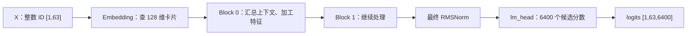

# 3. 模型构建：编号怎样变成候选分数

前置：[Dataset 与 DataLoader](2.DataLoader.md)。本章沿着一条 `[1,63]` 输入穿过 [model_minimind.py](../model/model_minimind.py)。第一遍用 H=128、两层小模型；MoE 和位置外推放到第二遍。

## 本章实践卡

先记住一句话：**模型构建是在同一排 token 上反复加工向量，最后把每个位置变成一张词表打分表。**

```bash
.venv/bin/python scripts/lesson_lab.py --lesson model
```

然后在 VS Code 选择 `02 - Follow one training update (CPU)`，FORWARD 停点依次看：

```python
X.shape
shapes
logits.shape
logits[0, 0].topk(5)
```

预期是 `[1,63] → [1,63,128] → [1,63,6400]`。完成标准不是背下公式，而是能指出一次形状变化对应哪段代码，并解释 Attention 的 softmax 与词表 softmax 的候选轴不同。


## 1. 先看整条加工路线



把每个 token 想成一个零件编号，Embedding 根据编号查出一张向量卡片；Transformer 结合此前可见卡片计算上下文表示；lm_head 再把表示换成词表打分表。

卡片里的每个维度没有预先指定为“语法”“地点”等人类标签，Attention 权重也不是事实可信度。这个比喻用于理解数据流，不是完整解释模型语义的方法。

## 2. config 是结构蓝图，不是训练数据

| 参数 | 本课值 | 决定什么 |
| --- | --- | --- |
| `vocab_size` | 6400 | 输入编号范围和输出候选数 |
| `hidden_size` | 128 | 每个位置的内部向量宽度 |
| `num_hidden_layers` | 2 | 叠几层 Transformer Block |
| `num_attention_heads` | 8 | Q 分成几个头 |
| `num_key_value_heads` | 2 | K/V 分成几个头 |
| `intermediate_size` | 384 | FFN 中间宽度 |
| `dropout` | 0 | 当前配置不随机丢弃激活 |

每头宽度 `128/8=16`；每个 KV 头供四个 Q 头使用。这些数影响矩阵形状，与 `batch_size`、学习率或处理多少条语料不同。

## 3. Embedding：按整数查行，不是对编号做大小比较

```text
表的形状：[6400,128]
输入 ID： [47,261,...]
查出向量：[6400,128] 中的第 47、261 等行
输出：   [1,63,128]
```

ID=47 与 ID=48 相近，不表示对应 token 语义相近；训练后向量的位置关系才可能反映学习到的结构。训练会修改这张表，不只是查一个固定字典。

本模型将 Embedding 和 lm_head 的权重绑定为同一参数对象：

```python
model.model.embed_tokens.weight is model.lm_head.weight
```

输入时按 ID 取行，输出时与隐藏向量做线性映射。共享权重减少重复参数，但不是回答正确性的保证。

## 4. RMSNorm：控制向量尺度，不负责把均值减到零

先手算两维向量 `[3,4]`，忽略很小的 eps，初始缩放参数均为 1：

```text
均方根 = sqrt((3²+4²)/2) = sqrt(12.5) ≈ 3.536
结果   = [3/3.536, 4/3.536] ≈ [0.849,1.131]
```

两个数的比例仍是 3:4，尺度经过调整，均值却没有变成零。RMSNorm 不需要假设输入均值已经为零；它选择不执行 LayerNorm 的均值中心化步骤。

代码中的 `self.weight` 是可学习的每维缩放参数。`.float()`、均方、`rsqrt()` 和转换回输入精度是数值实现，不是另一个网络层。


## 5. Attention：当前这一片需要参考哪些前文

可以暂时把 Q 当成“查询”，K 当成“可匹配索引”，V 当成“被汇总的内容”。三者都是由同一输入通过不同可训练投影得到的向量。

| 步骤 | Q 形状 | K/V 形状 |
| --- | --- | --- |
| 从输入投影 | `[1,63,128]` | 各 `[1,63,32]` |
| 分头 | `[1,63,8,16]` | 各 `[1,63,2,16]` |
| KV 重复、转换到计算布局 | `[1,8,63,16]` | 各 `[1,8,63,16]` |

`repeat_kv` 重复的是头，不是把每个头的 16 维变成 64 维。KV Cache 保存的是重复之前的 K/V，因而保留较少的 KV 头。

Attention 的主要计算：

```text
Q 与各 K 点积 -> 按 sqrt(每头宽度) 缩放
-> 屏蔽不可见位置 -> 对可见位置 softmax
-> 用这些权重汇总 V -> 合并头、输出投影
```

例如两个可见位置的权重是 `[0.2,0.8]`，V 分别是 `[10,0]`、`[0,10]`，汇总得到 `[2,8]`。这里平均的是向量内容，不是在词表里选下一个 token；词表打分发生在最后的 lm_head。

## 6. 因果遮挡：整排输入，也不能偷看后面的答案

```text
             key 位置
               0  1  2
query 位置 0： 1  0  0
query 位置 1： 1  1  0
query 位置 2： 1  1  1
```

1 表示允许读取。模型可以并行计算全部位置，位置 0 的结果仍然只能使用位置 0。这就是 X/Y 错位与因果注意力配合的原因。

`loss_mask` 决定是否给目标计分，Attention mask 决定能读取谁。屏蔽 padding 的目标 loss，不等于自动为 Attention 传入 padding mask。

源码的 `flash_attn=True` 控制是否调用 PyTorch SDPA。实际使用 Flash、其他优化内核还是数学实现，由设备、dtype 和形状等条件决定，不应把这个布尔值理解为“已经安装且一定使用 Flash Attention 2”。

## 7. RoPE：给 Q/K 加上随位置变化的旋转

用二维示意：向量 `[1,0]` 旋转 90 度后变为 `[0,1]`。实际代码对 Q/K 的成对分量按位置和频率旋转，让点积能够携带相对位置信息。90 度只是方便手算的示例，不是当前每个 token 固定旋转的角度。

本实现用前后半维配对：

```text
[a,b,c,d] -> rotate_half -> [-c,-d,a,b]
```

再与 cos/sin 相乘相加。cos/sin 表在初始化时预计算，forward 按当前起始位置切片。

当前可选的 `inference_rope_scaling` 走仓库自己的频率缩放实现，不能与论文中的完整 YaRN 推导直接画等号；它也不是每次 forward 自动测得更长输入后重新设计频率。延长位置表或修改频率，不等于模型已经学会理解更长上下文。

第一遍只跟踪“位置索引在哪里进入计算”；第二遍再对照 [RoPE](https://arxiv.org/abs/2104.09864) 与 [YaRN](https://arxiv.org/abs/2309.00071) 原论文研究不同实现。

## 8. FFN：每个位置上使用同一套非线性加工

Attention 负责跨位置汇总；普通 FFN 分别加工每个位置的向量：

```text
128 维 x ── gate_proj → 384 维 → SiLU ──┐
         └─ up_proj   → 384 维 ─────────┤逐元素相乘
                                       └─ down_proj → 128 维
```

代码为：

```python
self.down_proj(self.act_fn(self.gate_proj(x)) * self.up_proj(x))
```

SiLU 是 `x*sigmoid(x)`，可以为负，也可以大于 1：

```text
SiLU(-1)≈-0.269
SiLU(0)=0
SiLU(2)≈1.762
```

所以门控相乘不应解释成严格的“0～1 通过比例”。这些线性层能处理最后一维符合要求的多种布局；模型主路径用 `[B,T,H]`，不表示 `nn.Linear` 本身只能接受三维输入。

## 9. 残差：保留输入，再加上处理结果

每个 Block 的基本结构是：

```text
x -> Norm -> Attention -> 与原 x 相加
  -> Norm -> FFN       -> 再与该段输入相加
```

加法要求形状一致，所以模块加工后返回 H 维。残差提供信息和梯度的直接路径，但不表示任何学习率或精度配置都能稳定。

MoE 可以替换这里的 FFN，Attention 与最终词表打分仍然存在。要研究路由，转到 [MoE](10.MoE.md)，先不要把所有分支同时打开。

## 10. 从 hidden 到 logits，再到下一次生成

最后的 `[1,63,128]` 经 lm_head 变为 `[1,63,6400]`。训练时每个位置用对应 Y 计分；生成时通常取末尾位置，从候选分布选择新 token，再接回输入。

KV Cache 为每层保留历史 K/V。假设已有三个位置，现在输入两个新位置，允许读取的范围应为：

```text
新 query 位置 3：key 0、1、2、3
新 query 位置 4：key 0、1、2、3、4
```

不能直接用左上角对齐的 2×5 因果图替代。当前代码根据 past_len 构造相应遮挡，测试会比较缓存前向与完整前向结果。缓存不是把模型答案存进数据库，也不会改变训练所得知识。

## 11. 动手：先看形状，再进一层

```bash
.venv/bin/python scripts/lesson_lab.py --lesson model
```

预期形状为 Embedding `[1,63,128]`、K/V 投影 `[1,63,32]`、logits `[1,63,6400]`，并打印 RMSNorm、SiLU 的实际数值。

VS Code 先选择 `02 - Follow one training update (CPU)`，在 FORWARD 停住看 `shapes`。第二遍再在 `Attention.forward` 的 Q/K/V 投影后、RoPE 后、KV 重复后各停一次。

动手改题：把 `logits.argmax(dim=-1)` 的形状先写在纸上，再执行。答案是 `[1,63]`，因为每个位置从 6400 个候选中取一个 ID；这不表示选出的 ID 一定等于 Y。

完成标准：能画出 ID→Embedding→两层 Block→lm_head→logits，并说明两处 softmax（注意力位置与输出词表）的候选轴不同。下一步进入 [预训练](4.Pretrain.md)。

参考：[SDPA 官方接口与内核选择](https://docs.pytorch.org/docs/2.14/generated/torch.nn.functional.scaled_dot_product_attention.html)。
