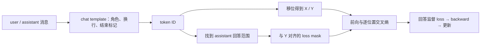
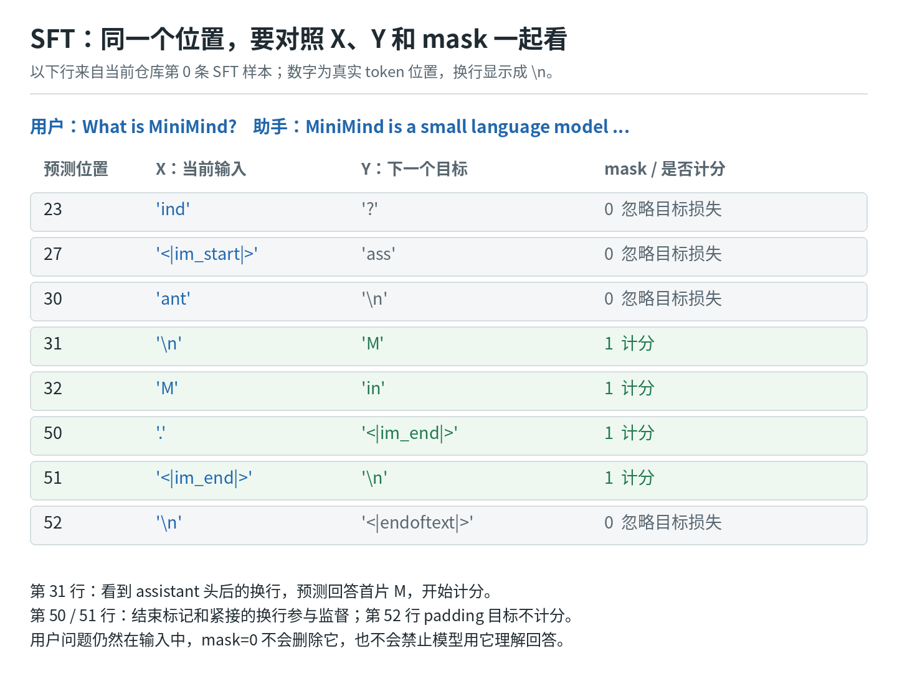

# 5. SFT：题干可以阅读，回答部分计分

SFT 是 **Supervised Fine-Tuning，监督微调**。先理解 [预训练闭环](4.Pretrain.md)，再看这一章。源码是 [SFTDataset](../dataset/lm_dataset.py) 和 [train_full_sft.py](../trainer/train_full_sft.py)。

## 1. 从接龙练习改成带题干的作答

预训练拿一段正文，让模型预测其中的下一个 token。SFT 则提供对话角色、用户问题和标准回答，主要训练 assistant 应该怎样回答。

```text
用户问题：What is MiniMind?
标准回答：MiniMind is a small language model project ...
```

模型仍然预测下一个 token，也仍然使用交叉熵；变化的是文本模板和计分范围。



## 2. 先看本机真实模板，不用猜特殊 token

```bash
.venv/bin/python scripts/lesson_lab.py --lesson sft
```

第 0 条样本会格式化为：

```text
<|im_start|>system
You are a helpful assistant<|im_end|>
<|im_start|>user
What is MiniMind?<|im_end|>
<|im_start|>assistant
MiniMind is a small language model project designed for learning and experiments.<|im_end|>
```

原样本只有 user 和 assistant，当前模板会补默认 system。模板不是解释性装饰：训练和推理必须保持兼容的角色边界。`add_generation_prompt=False` 表示训练样本已经有完整回答，不额外加一个待生成的 assistant 头。

推理时通常只有问题、没有标准回答，才使用 assistant 生成前缀。这个前缀决定接下来该输出哪个角色的内容；它本身不会自动赋予聊天能力。

## 3. 逐格看清 mask，保留换行才对得上

先看真实第 0 条样本中几个关键位置，再用下面的简化编号手算切片：



下面用简化 ID，保留当前实现依赖的换行。假设只有一轮对话，assistant 头后的片段是：

```text
原 input_ids 的位置：  6      7       8       9       10       11
内容：               BOS  assistant  \n    回答首片    EOS      \n
assistant 头：       [---- bos_id ---]
start = 8
end = 10
```

当前 `_generate_loss_mask()` 使用：

```python
start = i + len(self.bos_id)
# 从 start 往后找 eos，得到 end
for j in range(start + 1, min(end + len(self.eos_id) + 1, self.max_length)):
    loss_mask[j] = 1
```

假设 EOS 只有一个 token，就标记原位置 9、10、11。这里 `start+1` 跳过的是头后的换行；不是先跳过回答，再靠最后的 shift 神奇地补回来。

随后 `Y=input_ids[1:]`、`mask=mask[1:]`：

| 预测位置 | 当前 X token | 对应 Y token | mask |
| --- | --- | --- | --- |
| 7 | assistant 头最后一片 | 头后的换行 | 0 |
| 8 | 换行 | 回答首片 | 1 |
| 9 | 回答片段 | EOS | 1 |
| 10 | EOS | 后续换行 | 1 |

如果回答有多片，中间的回答 token 同样标为 1。多轮时继续扫描后面的 assistant 头。实际特殊 token ID 和切分长度始终以当前 tokenizer 为准，不能拿省略换行的示意序列推断真实边界。

## 4. mask=0 不等于“问题没有进入模型”

```text
X 中：系统提示、问题、角色标记、回答前文都可以作为上下文
Y 中：每个位置都有对应的下一个 token
loss 中：只有 mask=1 的目标位置参与当前监督汇总
```

例如预测回答里的 `MiniMind` 时，可以使用前面的 `What is MiniMind?`。问题目标位置的直接 loss 被屏蔽，但回答 loss 仍能沿相关计算路径影响处理问题的共享参数。

这里采用回答监督是任务设计选择，并不是“凡是训练用户 token 都一定跑偏”。不同 SFT 配方可能选择不同监督范围，本章解释当前代码。

## 5. 用真实数字验收监督范围

本地实验会把 `Y[mask.bool()]` 解码出来，应该包含回答、`<|im_end|>` 和紧接的换行，而不是用户问题。

```text
X/Y/mask 形状：各 [127]（组批后 [1,127]）
非 padding 目标：52
实际监督目标：  21
```

52 与 21 不同是正常的：非 padding 范围还包括系统、用户和角色头。不能仅按“不是 padding 就训练”构造本章的 mask。

VS Code 中先选 `03 - Inspect SFT loss mask (CPU)`，观察：

```python
tokenizer.decode(Y[0][loss_mask[0].bool()].tolist())
loss_mask.sum().item()
```

再选 `06 - Follow SFT update (CPU)`，在四站继续观察 logits、loss、gradient 和 weight_delta。它是随机初始化小模型的教学实验，不能与“加载预训练权重再微调”的效果混为一谈。

## 6. 接入已经保存的预训练模型

如果已运行第 5 项预训练调试配置，存在 `out/debug_accum/pretrain_128.pth`，可以跑真实 SFT 入口：

```bash
OMP_NUM_THREADS=2 MKL_NUM_THREADS=2 .venv/bin/python -m trainer.train_full_sft \
  --device cpu --dtype float32 \
  --hidden_size 128 --num_hidden_layers 2 \
  --data_path dataset/demo_sft.jsonl \
  --save_dir out/debug_accum --checkpoint_dir checkpoints/sft_lesson \
  --from_weight pretrain --from_resume 0 \
  --epochs 1 --batch_size 1 --num_workers 0 \
  --max_seq_len 128 --max_steps 2 \
  --log_interval 1 --save_interval 1
```

产物是 `out/debug_accum/full_sft_128.pth` 和对应续训文件。基础模型结构与 tokenizer 必须兼容；不能给 128 维结构加载 512 维模型。

`lesson_lab --lesson pretrain` 的文件保存在临时目录，结束会清理，所以不能拿它代替上述持久化权重前置条件。完整 512 维 demo 微调路线见 [一天跑通](0.一天跑通.md)。

## 7. 自己动手改一次

先预测：把 `max_seq_len` 截得很短，若整个回答都被截掉，会发生什么？

运行：

```bash
.venv/bin/python scripts/debug_train_step.py \
  --task sft --max_seq_len 16 --stop_after data
```

教学脚本应报告没有 supervised tokens，需要增加长度。这是预期的反例，不是安装失败。训练前检查监督数可以避免“输入形状没错，但没学到回答”的问题。

完成标准：从真实表中找到一个用户目标（mask=0）、回答首片（mask=1）和回答结束标记（mask=1），并解释每一个位置为什么这样设置。下一步进入 [LoRA](6.LoRA.md)，保留这个任务，改变更新参数的方式。

## 历史实验图与参考


- [聊天模板官方说明](https://huggingface.co/docs/transformers/v4.57.1/chat_templating)
- [交叉熵](https://docs.pytorch.org/docs/2.14/generated/torch.nn.CrossEntropyLoss.html)
