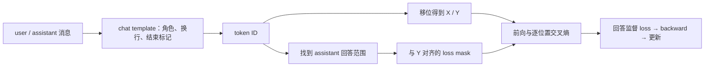

# 5. SFT：题干可以阅读，回答部分计分

SFT 是 **Supervised Fine-Tuning，监督微调**。先理解 [预训练闭环](4.Pretrain.md)，再看这一章。源码是 [SFTDataset](../dataset/lm_dataset.py) 和 [train_full_sft.py](../trainer/train_full_sft.py)。

## 本章实践卡

这一章只换两件事：**输入从连续正文变成带角色的对话，loss 从“正文都计分”变成“回答范围计分”。**

```bash
.venv/bin/python scripts/lesson_lab.py --lesson sft
```

先把 `参与计分的 Y` 解码出来，再在 VS Code 选择 `03 - Inspect SFT loss mask (CPU)`。如果想看一次完整更新，选择 `06 - Follow SFT update (CPU)`。

完成标准：在真实 token 表中找到用户问题的 `mask=0`、回答首片的 `mask=1`、`<|im_end|>` 附近的监督位置，并说明问题为什么仍然存在于 X。

## 1. 从接龙练习改成带题干的作答

预训练拿一段正文，让模型预测其中的下一个 token。SFT 则提供对话角色、用户问题和标准回答，主要训练 assistant 应该怎样回答。

```text
用户问题：What is MiniMind?
标准回答：MiniMind is a small language model project ...
```

模型仍然预测下一个 token，也仍然使用交叉熵；变化的是文本模板和计分范围。



### “监督”来自哪里，模型又输出什么

数据作者提供 user 问题与 assistant 回答，Dataset 把回答变成 Y。模型只接收 X，不会将 Y 作为额外输入；每个位置输出 6400 个候选分数，再与同一位置的 Y 比较。

训练时，回答的真实前文也在 X 中，因此可以同时训练回答中的多个预测位置。生成时没有后续真实答案，要把自己选出的 token 接回前缀。两者仍共用因果规则。

把 SFT 想成有题干的练习：题干需要读，主要评分的是作答。读题过程可以影响回答损失，只是不直接给每个题干目标算分。

## 2. 先看本机真实模板，不用猜特殊 token

```bash
.venv/bin/python scripts/lesson_lab.py --lesson sft
```

第 0 条样本会格式化为：

```text
<|im_start|>system
You are a helpful assistant<|im_end|>
<|im_start|>user
What is MiniMind?<|im_end|>
<|im_start|>assistant
MiniMind is a small language model project designed for learning and experiments.<|im_end|>
```

原样本只有 user 和 assistant，当前模板会补默认 system。模板不是解释性装饰：训练和推理必须保持兼容的角色边界。`add_generation_prompt=False` 表示训练样本已经有完整回答，不额外加一个待生成的 assistant 头。

推理时通常只有问题、没有标准回答，才使用 assistant 生成前缀。这个前缀决定接下来该输出哪个角色的内容；它本身不会自动赋予聊天能力。

## 3. 逐格看清 mask，保留换行才对得上

先看真实第 0 条样本中几个关键位置，再用下面的简化编号手算切片：


下面用简化 ID，保留当前实现依赖的换行。假设只有一轮对话，assistant 头后的片段是：

```text
原 input_ids 的位置：  6      7       8       9       10       11
内容：               BOS  assistant  \n    回答首片    EOS      \n
assistant 头：       [---- bos_id ---]
start = 8
end = 10
```

当前 `_generate_loss_mask()` 使用：

```python
start = i + len(self.bos_id)
# 从 start 往后找 eos，得到 end
for j in range(start + 1, min(end + len(self.eos_id) + 1, self.max_length)):
    loss_mask[j] = 1
```

假设 EOS 只有一个 token，就标记原位置 9、10、11。这里 `start+1` 跳过的是头后的换行；不是先跳过回答，再靠最后的 shift 神奇地补回来。

随后 `Y=input_ids[1:]`、`mask=mask[1:]`：

| 预测位置 | 当前 X token | 对应 Y token | mask |
| --- | --- | --- | --- |
| 7 | assistant 头最后一片 | 头后的换行 | 0 |
| 8 | 换行 | 回答首片 | 1 |
| 9 | 回答片段 | EOS | 1 |
| 10 | EOS | 后续换行 | 1 |

如果回答有多片，中间的回答 token 同样标为 1。多轮时继续扫描后面的 assistant 头。实际特殊 token ID 和切分长度始终以当前 tokenizer 为准，不能拿省略换行的示意序列推断真实边界。

### 直接打印真实范围，不手猜边界

```python
# doc-example: sft-supervision
import torch
from transformers import AutoTokenizer
from dataset.lm_dataset import SFTDataset

tok = AutoTokenizer.from_pretrained("model")
ds = SFTDataset("dataset/demo_sft.jsonl", tok, max_length=128)
x, y, mask = ds[0]
assert tuple(x.shape) == (127,)
assert mask.sum().item() == 21
assert (y != tok.pad_token_id).sum().item() == 52
assert torch.equal(x[1:], y[:-1])
answer = tok.decode(y[mask.bool()].tolist())
assert "What is MiniMind?" not in answer
assert "MiniMind is" in answer and "<|im_end|>" in answer
print(repr(answer))
for pos in mask.nonzero().flatten()[:5].tolist():
    print(pos, repr(tok.decode([x[pos].item()])),
          "->", repr(tok.decode([y[pos].item()])), mask[pos].item())
```

这里的 pos 是移位后的预测位置。某位置的 X 还是换行，但 Y 已经是回答首片，所以应按 Y 判断是否计分。

## 4. mask=0 不等于“问题没有进入模型”

```text
X 中：系统提示、问题、角色标记、回答前文都可以作为上下文
Y 中：每个位置都有对应的下一个 token
loss 中：只有 mask=1 的目标位置参与当前监督汇总
```

例如预测回答里的 `MiniMind` 时，可以使用前面的 `What is MiniMind?`。问题目标位置的直接 loss 被屏蔽，但回答 loss 仍能沿相关计算路径影响处理问题的共享参数。

这里采用回答监督是任务设计选择，并不是“凡是训练用户 token 都一定跑偏”。不同 SFT 配方可能选择不同监督范围，本章解释当前代码。

### 从逐位置误差到一个 SFT loss

假设一份说明性逐题误差是 `[2,5,3,1]`，目标 mask 是 `[0,0,1,1]`，则回答 loss 为 `(3+1)/2=2`，不是总和除以四个位置。真实实验对 127 个预测位置做同样的选择与汇总。

下面调用实际 SFT 教学流程，检查完整更新：

```python
# doc-example: sft-update
from scripts.debug_train_step import main

metrics = main(["--task", "sft", "--max_seq_len", "128", "--token_rows", "0"])
assert metrics["supervised_tokens"] == 21
assert metrics["logits_shape"] == (1, 127, 6400)
assert metrics["gradient_norm"] > 0 and metrics["weight_delta"] > 0
```

一个目标 mask=0，不代表任何相关内部表示的梯度都为零；该输入位置仍可能被后续回答通过 Attention 读取。

## 5. 用真实数字验收监督范围

本地实验会把 `Y[mask.bool()]` 解码出来，应该包含回答、`<|im_end|>` 和紧接的换行，而不是用户问题。

```text
X/Y/mask 形状：各 [127]（组批后 [1,127]）
非 padding 目标：52
实际监督目标：  21
```

52 与 21 不同是正常的：非 padding 范围还包括系统、用户和角色头。不能仅按“不是 padding 就训练”构造本章的 mask。

VS Code 中先选 `03 - Inspect SFT loss mask (CPU)`，观察：

```python
tokenizer.decode(Y[0][loss_mask[0].bool()].tolist())
loss_mask.sum().item()
```

再选 `06 - Follow SFT update (CPU)`，在四站继续观察 logits、loss、gradient 和 weight_delta。它是随机初始化小模型的教学实验，不能与“加载预训练权重再微调”的效果混为一谈。

## 6. 接入已经保存的预训练模型

如果已运行第 5 项预训练调试配置，存在 `out/debug_accum/pretrain_128.pth`，可以跑真实 SFT 入口：

```bash
OMP_NUM_THREADS=2 MKL_NUM_THREADS=2 .venv/bin/python -m trainer.train_full_sft \
  --device cpu --dtype float32 \
  --hidden_size 128 --num_hidden_layers 2 \
  --data_path dataset/demo_sft.jsonl \
  --save_dir out/debug_accum --checkpoint_dir checkpoints/sft_lesson \
  --from_weight pretrain --from_resume 0 \
  --epochs 1 --batch_size 1 --num_workers 0 \
  --max_seq_len 128 --max_steps 2 \
  --log_interval 1 --save_interval 1
```

产物是 `out/debug_accum/full_sft_128.pth` 和对应续训文件。基础模型结构与 tokenizer 必须兼容；不能给 128 维结构加载 512 维模型。

`lesson_lab --lesson pretrain` 的文件保存在临时目录，结束会清理，所以不能拿它代替上述持久化权重前置条件。完整 512 维 demo 微调路线见 [一天跑通](0.一天跑通.md)。

加载刚才的小模型，执行一条短推理：

```bash
OMP_NUM_THREADS=2 MKL_NUM_THREADS=2 .venv/bin/python eval_llm.py \
  --device cpu --save_dir out/debug_accum --weight full_sft \
  --hidden_size 128 --num_hidden_layers 2 \
  --max_new_tokens 16 --prompt "What is MiniMind?"
```

预期能重新加载权重、生成文本并退出。几步训练的文本仍可能混乱，本步验收的是“保存的模型能够进入推理”，不是回答质量。

### 微调继承什么，重新开始什么

从预训练 `.pth` 初始化 SFT，会继承模型权重；一般会为新阶段创建自己的优化器与调度。续训 SFT 则需要本阶段 resume 文件，以恢复权重、优化器和进度。

| 操作 | 起点 | 预期 |
| --- | --- | --- |
| 随机小实验 | 随机初始化 | 学代码，不衡量聊天能力 |
| 开始 SFT | 兼容预训练权重 | 用对话监督调整参数 |
| 恢复 SFT | SFT resume | 沿原阶段进度继续 |
| 推理 | SFT 模型权重 | 无标准回答，逐步生成 |

加载成功后仍要核对模板、EOS 和保存目录。仅换文件名，不能把一个 512 维权重解释成 128 维模型。

## 7. 自己动手改一次

先预测：把 `max_seq_len` 截得很短，若整个回答都被截掉，会发生什么？

运行：

```bash
.venv/bin/python scripts/debug_train_step.py \
  --task sft --max_seq_len 16 --stop_after data
```

教学脚本应报告没有 supervised tokens，需要增加长度。这是预期的反例，不是安装失败。训练前检查监督数可以避免“输入形状没错，但没学到回答”的问题。

完成标准：从真实表中找到一个用户目标（mask=0）、回答首片（mask=1）和回答结束标记（mask=1），并解释每一个位置为什么这样设置。下一步进入 [LoRA](6.LoRA.md)，保留这个任务，改变更新参数的方式。

### 多轮对话与截断再做两个预测

多轮样本会有多段 assistant 回答；当前扫描逻辑继续寻找后续 assistant 头，并为对应范围计分。不是只训练最后一轮，也不是把 user 内容删除。

若截断恰好落在回答内部，可能保留部分监督；若截在回答开始前，监督数可以变成 0。实际项目应检查每条样本或批次的有效监督数量，而不是只检查 shape。

练习时只改变 max_length，再打印 `repr(模板文本)`、截断后解码和 `mask.sum()`。把“少了多少输入”与“少了多少回答目标”分别记录。

## 8. 多轮对话再沿着边界走一次

假设对话是 user 问 A、assistant 答 A、user 问 B、assistant 答 B。第二份回答可以读取前面的全部可见对话；当前 mask 扫描会为两段 assistant 作答都建立监督。

```text
角色/问题 A -> 回答 A -> 问题 B -> 回答 B
主要计分：       是                 是
可作上下文：前面已出现的内容都可供后续读取
```

下面直接用真实模板与 `_generate_loss_mask` 检查多轮边界：

```python
# doc-example: sft-multiturn
multi_ds = SFTDataset("dataset/demo_sft.jsonl", tok, max_length=256)
messages = [
    {"role": "user", "content": "Say A."},
    {"role": "assistant", "content": "A"},
    {"role": "user", "content": "Say B."},
    {"role": "assistant", "content": "B"},
]
formatted = multi_ds._create_chat_prompt(messages)
ids = tok(formatted, add_special_tokens=False).input_ids
full_mask = multi_ds._generate_loss_mask(ids)
targets = torch.tensor(ids[1:])
aligned_mask = torch.tensor(full_mask[1:]).bool()
supervised = tok.decode(targets[aligned_mask].tolist())
assert "A<|im_end|>" in supervised and "B<|im_end|>" in supervised
assert "Say A." not in supervised and "Say B." not in supervised
print(repr(formatted))
print("两段监督：", repr(supervised))
```

“只训练回答”并不等于只训练最后一个 assistant，也不意味着第一个回答无法成为后面的上下文。改为只监督最后一轮是另一种数据策略，需要明确实现。

### 为什么模板、扫描器和 tokenizer 必须一起看

扫描器当前假定 assistant 头后有换行，并按该约定设置 start+1。如果模板删掉换行而扫描逻辑不变，可能跳过回答首片；如果换行的切分发生变化，也必须重新核对。

因此不建议只在肉眼可读文本中圈出一句回答就断言 mask 正确。应同时保存：

1. 模板的 `repr`，看见换行和特殊标记。
2. 原 input_ids 与角色头 ID 列表。
3. 原 mask 与移位后的 Y/mask 对照。
4. 最终 `Y[mask==1]` 的完整解码。

### 评价 SFT 时固定什么

固定未出现在训练样本中的问题、模板、生成长度和解码策略。训练集 loss 下降说明模型更能拟合训练监督；泛化、事实性与对话体验需要另外检查。

极少量 demo 的目标是理解与验证闭环。观察到模型重复训练答案，不应直接当作“学会理解所有类似问题”。

## 历史实验图与参考


- [聊天模板官方说明](https://huggingface.co/docs/transformers/v4.57.1/chat_templating)
- [交叉熵](https://docs.pytorch.org/docs/2.14/generated/torch.nn.CrossEntropyLoss.html)
