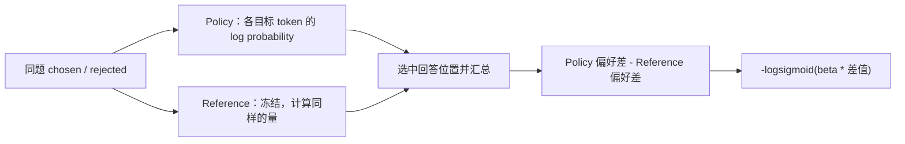

# 8. DPO：比较一对回答，直接训练偏好

DPO 是 **Direct Preference Optimization，直接偏好优化**。前置：[SFT](5.SFT.md) 与 [logits / log probability](0.概念速查.md)。当前实现位于 [train_dpo.py](../trainer/train_dpo.py)。

## 1. 不是只给好回答再做一次 SFT

一条偏好数据包含同一个问题的两份回答：

```text
问题：What is MiniMind?
chosen：一份被标记为更合适的解释
rejected：一份被标记为较差的回答
```

SFT 主要模仿给定答案；DPO 比较模型对好坏两份回答的相对偏好，还对照冻结的参考模型。chosen/rejected 来自数据标注，不是 DPO 自己判断事实真伪。



## 2. 跟一个数字走完全程

下面四个数是假设已经汇总好的回答分数，都是平均 log probability：

| 模型 | chosen | rejected | chosen 减 rejected |
| --- | --- | --- | --- |
| Reference | -2 | -2 | 0 |
| Policy，情况 A | -1 | -2 | 1 |
| Policy，情况 B | -3 | -2 | -1 |

log probability 通常非正，`-1` 比 `-3` 对应更大的概率。与参考模型比较：

```text
情况 A：偏好提升 delta = 1 - 0 = 1
情况 B：偏好提升 delta = -1 - 0 = -1
beta = 0.1

情况 A loss = -log(sigmoid(0.1))  ≈ 0.644397
情况 B loss = -log(sigmoid(-0.1)) ≈ 0.744397
```

因此优化目标会鼓励更大的相对偏好差。它不要求每次更新 chosen 的绝对概率一定上升且 rejected 一定下降；神经网络的共享参数和其他样本也会影响变化。

## 3. 原始 logits 怎样变成回答分数

模型给 `[2B,T,V]` 的词表分数，代码先 `log_softmax`，再按真实目标 ID `gather`：

```text
词表 logits：[2B,T,V]
选出每个 Y 的 log probability：[2B,T]
乘回答 mask，按序列汇总：[2B]
前 B 条是 chosen，后 B 条是对应 rejected
```

chosen 与 rejected 的顺序必须一一对应。不能把两种回答随意交错后仍然照原方式切前后半。

## 4. 本仓库的长度平均不是整句概率

当前 `dpo_loss` 用：

```python
score = (token_log_probs * mask).sum(dim=1) / mask.sum(dim=1).clamp_min(1e-8)
```

严格的自回归整句 log probability 是有效 token 对数概率的和。这里除以有效长度后，得到的是平均每 token 的 log probability，已经改变了原始序列级 DPO 的目标；不能写成“整句概率约等于这个平均”。

长度平均能改变长短回答的相对尺度，但不保证消除长度偏差，也不是对所有数据都更合适。比较公式与脚本时，要先确认汇总方式。

`beta` 出现在偏好差的缩放和原始理论的参考约束关系中。固定同一 delta 改 beta 会改变 loss 和梯度尺度，不能直接从一个 batch 断言“beta 越大，任何训练都会更保守”。

## 5. 先调用真实损失函数做实验

```bash
.venv/bin/python scripts/lesson_lab.py --lesson dpo
```

预期看到情况 A 的 loss≈0.644397，情况 B≈0.744397。实验还检查 Policy chosen 分数的梯度为负、rejected 为正：在这个独立分数示例中，梯度下降倾向于提高 chosen 分数、降低 rejected 分数。

这里使用一个 token 的简化回答，使“序列总和”和“长度平均”一致，便于先核对公式。把它扩成不同长度后，再比较两种汇总方式。

## 6. 回到实际训练入口

阅读顺序为 `DPODataset → torch.cat([chosen,rejected]) → logits_to_log_probs → dpo_loss → backward`。数据中两份回答都应携带兼容的角色模板，并有有效回答监督。

Policy 需要梯度，Reference 保持冻结；本项目完整 DPO 训练还需要额外的偏好数据和基础权重，本地损失算例没有验证端到端训练、恢复与数据质量。

自查：如果 Policy 与 Reference 完全相同，delta 为 0，loss 应是多少？答案是 `-ln(0.5)≈0.693147`。这个数表示当前相对偏好还没有提高，不是“分类准确率只有一半”的直接测量。

下一步可选择 [蒸馏](9.白盒蒸馏.md) 或 [PPO](7.PPO.md)，比较监督信号怎样改变。

## 历史实验图与参考


- [DPO 原论文](https://arxiv.org/abs/2305.18290)
