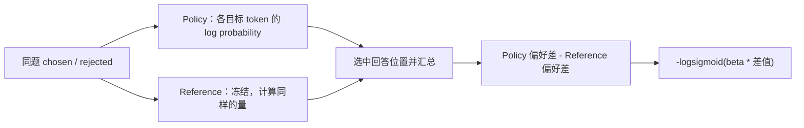

# 8. DPO：比较一对回答，直接训练偏好

DPO 是 **Direct Preference Optimization，直接偏好优化**。前置：[SFT](5.SFT.md) 与 [logits / log probability](0.概念速查.md)。当前实现位于 [train_dpo.py](../trainer/train_dpo.py)。

## 本章实践卡

把一对回答想成同一道题的“较好作答”和“较差作答”，先跑：

```bash
.venv/bin/python scripts/lesson_lab.py --lesson dpo
```

观察 chosen 偏好提升时 loss 变小、chosen 与 rejected 的 log probability 梯度方向相反。再回源码看 `logits_to_log_probs → mask 汇总 → 前后半 batch 配对 → logsigmoid`。

完成标准：能从四个平均 log probability 手算 `delta` 和 loss，并指出当前代码使用长度平均而不是原始整句 log probability 总和。

## 1. 不是只给好回答再做一次 SFT

一条偏好数据包含同一个问题的两份回答：

```text
问题：What is MiniMind?
chosen：一份被标记为更合适的解释
rejected：一份被标记为较差的回答
```

SFT 主要模仿给定答案；DPO 比较模型对好坏两份回答的相对偏好，还对照冻结的参考模型。chosen/rejected 来自数据标注，不是 DPO 自己判断事实真伪。



### 为什么要再减去参考模型的偏好差

假如参考模型本来就更喜欢 chosen，Policy 只是维持这个偏好，并不等于相对起点有所改善。DPO 将 Policy 的 chosen-rejected 差与 Reference 的相同差相减，衡量相对变化。

```text
Policy 差 = 1，Reference 差 = 0 -> 相对提升 1
Policy 差 = 1，Reference 差 = 1 -> 相对提升 0
```

两种情况下 Policy 的绝对差相同，但 loss 不同。Reference 是固定基准，不是每批跟着 Policy 更新的第二个学生。

## 2. 跟一个数字走完全程

下面四个数是假设已经汇总好的回答分数，都是平均 log probability：

| 模型 | chosen | rejected | chosen 减 rejected |
| --- | --- | --- | --- |
| Reference | -2 | -2 | 0 |
| Policy，情况 A | -1 | -2 | 1 |
| Policy，情况 B | -3 | -2 | -1 |

log probability 通常非正，`-1` 比 `-3` 对应更大的概率。与参考模型比较：

```text
情况 A：偏好提升 delta = 1 - 0 = 1
情况 B：偏好提升 delta = -1 - 0 = -1
beta = 0.1

情况 A loss = -log(sigmoid(0.1))  ≈ 0.644397
情况 B loss = -log(sigmoid(-0.1)) ≈ 0.744397
```

因此优化目标会鼓励更大的相对偏好差。它不要求每次更新 chosen 的绝对概率一定上升且 rejected 一定下降；神经网络的共享参数和其他样本也会影响变化。

## 3. 原始 logits 怎样变成回答分数

模型给 `[2B,T,V]` 的词表分数，代码先 `log_softmax`，再按真实目标 ID `gather`：

```text
词表 logits：[2B,T,V]
选出每个 Y 的 log probability：[2B,T]
乘回答 mask，按序列汇总：[2B]
前 B 条是 chosen，后 B 条是对应 rejected
```

chosen 与 rejected 的顺序必须一一对应。不能把两种回答随意交错后仍然照原方式切前后半。

### gather 选的是目标，不是最高分项

`log_softmax` 为每个位置保留全部候选的对数概率；`gather` 用 Y 的 ID 取出实际回答片段的值，不能改为 argmax，否则就丢掉了数据提供的 chosen/rejected。

```python
# doc-example: dpo-log-probability
import torch
from trainer.train_dpo import logits_to_log_probs, dpo_loss

# 保留真实词表轴；人工分数用来隔离并核对损失接口。
logits = torch.zeros(2, 3, 6400, requires_grad=True)
labels = torch.tensor([[47, 261, 75], [47, 261, 75]])
token_logp = logits_to_log_probs(logits, labels)
assert tuple(token_logp.shape) == (2, 3)
torch.testing.assert_close(token_logp, torch.full((2, 3), -torch.log(torch.tensor(6400.)).item()))
mask = torch.ones(2, 3)
loss = dpo_loss(token_logp.detach(), token_logp, mask, beta=0.1)
torch.testing.assert_close(loss, torch.log(torch.tensor(2.)))
loss.backward()
assert logits.grad[0, 0, 47] < 0
assert logits.grad[1, 0, 47] > 0
print("相同参考分数时 loss：", loss.item())
```

上半 batch 的目标分数收到提高方向的梯度，下半收到降低方向的梯度。真实模型有共享参数，因此单次更新的实际概率变化不能只由一个独立坐标推断。

## 4. 本仓库的长度平均不是整句概率

当前 `dpo_loss` 用：

```python
score = (token_log_probs * mask).sum(dim=1) / mask.sum(dim=1).clamp_min(1e-8)
```

严格的自回归整句 log probability 是有效 token 对数概率的和。这里除以有效长度后，得到的是平均每 token 的 log probability，已经改变了原始序列级 DPO 的目标；不能写成“整句概率约等于这个平均”。

长度平均能改变长短回答的相对尺度，但不保证消除长度偏差，也不是对所有数据都更合适。比较公式与脚本时，要先确认汇总方式。

`beta` 出现在偏好差的缩放和原始理论的参考约束关系中。固定同一 delta 改 beta 会改变 loss 和梯度尺度，不能直接从一个 batch 断言“beta 越大，任何训练都会更保守”。

### 长度平均甚至可能改变回答排序

```text
回答 A 两个目标的 logp：[-0.2,-0.2]
回答 B 一个目标的 logp：[-0.3]

按和比较：A=-0.4，B=-0.3，B 更高
按均值：  A=-0.2，B=-0.3，A 更高
```

因此平均与求和不是只差一个统一比例。两份回答有效长度不同，会改变偏好差与梯度。

真实数据还必须确保每对问题相同、chosen/rejected 没有串行错配、两边有有效回答目标。全零 mask 虽可被 clamp 避免除零，仍不构成有意义的偏好样本。

## 5. 先调用真实损失函数做实验

```bash
.venv/bin/python scripts/lesson_lab.py --lesson dpo
```

预期看到情况 A 的 loss≈0.644397，情况 B≈0.744397。实验还检查 Policy chosen 分数的梯度为负、rejected 为正：在这个独立分数示例中，梯度下降倾向于提高 chosen 分数、降低 rejected 分数。

这里使用一个 token 的简化回答，使“序列总和”和“长度平均”一致，便于先核对公式。把它扩成不同长度后，再比较两种汇总方式。

## 6. 回到实际训练入口

阅读顺序为 `DPODataset → torch.cat([chosen,rejected]) → logits_to_log_probs → dpo_loss → backward`。数据中两份回答都应携带兼容的角色模板，并有有效回答监督。

Policy 需要梯度，Reference 保持冻结；本项目完整 DPO 训练还需要额外的偏好数据和基础权重，本地损失算例没有验证端到端训练、恢复与数据质量。

自查：如果 Policy 与 Reference 完全相同，delta 为 0，loss 应是多少？答案是 `-ln(0.5)≈0.693147`。这个数表示当前相对偏好还没有提高，不是“分类准确率只有一半”的直接测量。

下一步可选择 [蒸馏](9.白盒蒸馏.md) 或 [PPO](7.PPO.md)，比较监督信号怎样改变。

### 在源码里保留这条证据链

| 停靠点 | 核对值 | 发现什么问题 |
| --- | --- | --- |
| Dataset 返回 | 六个 x/y/mask 字段 | 模板与监督范围 |
| cat 后 | `[chosen0,chosen1,...,rejected0,rejected1,...]` | 配对顺序错误 |
| gather 后 | `[2B,T]` | 是否已移位、选择真实目标 |
| 汇总后 | `[2B]` | 长度平均是否符合预期 |
| delta 后 | `[B]` | 相对参考的偏好变化 |
| backward 后 | Policy 有梯度，Reference 无 | 冻结是否有效 |

当前 DPO 入口的尾组缩放和保存实现与主预训练入口并不完全相同；局部损失实验不覆盖其完整训练与恢复。先验证局部公式，再逐项核对新入口。

## 7. 从一条真实格式的偏好数据走到一次反向

下面临时创建一对同题回答，经过真实 DPODataset、6400 词表小模型、Reference 和损失函数。它比独立分数算例多验证了模板、移位、mask、拼接和计算图；仍不是完整 `train_dpo.py` 的训练、保存与恢复验证。

```python
# doc-example: dpo-data-to-backward
import json
from pathlib import Path
from tempfile import TemporaryDirectory
from torch.utils.data import DataLoader
from transformers import AutoTokenizer
from dataset.lm_dataset import DPODataset
from model.model_minimind import MiniMindConfig, MiniMindForCausalLM

torch.manual_seed(42)
tok = AutoTokenizer.from_pretrained("model")
question = {"role": "user", "content": "What is MiniMind?"}
pair = {
    "chosen": [question, {"role": "assistant", "content": "MiniMind is a small language model."}],
    "rejected": [question, {"role": "assistant", "content": "I do not know."}],
}
with TemporaryDirectory(prefix="dpo_pair_") as directory:
    path = Path(directory) / "pair.jsonl"
    path.write_text(json.dumps(pair) + "\n", encoding="utf-8")
    ds = DPODataset(path, tok, max_length=128)
    batch = next(iter(DataLoader(ds, batch_size=1, num_workers=0)))
    x = torch.cat([batch["x_chosen"], batch["x_rejected"]])
    y = torch.cat([batch["y_chosen"], batch["y_rejected"]])
    mask = torch.cat([batch["mask_chosen"], batch["mask_rejected"]])
    assert tuple(x.shape) == (2, 127) and (mask.sum(1) > 0).all()
    config = MiniMindConfig(hidden_size=128, intermediate_size=384,
                            num_hidden_layers=2, max_position_embeddings=128)
    policy = MiniMindForCausalLM(config)
    reference = MiniMindForCausalLM(config).eval().requires_grad_(False)
    reference.load_state_dict(policy.state_dict())
    with torch.no_grad():
        ref_logp = logits_to_log_probs(reference(x).logits, y)
    policy_logp = logits_to_log_probs(policy(x).logits, y)
    actual_loss = dpo_loss(ref_logp, policy_logp, mask, beta=.1)
    torch.testing.assert_close(actual_loss, torch.log(torch.tensor(2.)))
    actual_loss.backward()
    assert policy.lm_head.weight.grad.norm().item() > 0
    assert all(p.grad is None for p in reference.parameters())
    print("两份回答有效目标：", mask.sum(1).tolist(), "初始 loss：", actual_loss.item())
```

初始化 Policy=Reference 时，相对偏好提升为 0，loss 为 ln2；但对 Policy 的梯度仍可非零，因为提高相对偏好仍有下降方向。“loss 有固定初值”不表示训练停住。

### 这对数据在哪些地方复用了 SFT

两份回答分别套模板，各自移位 X/Y，各自标 assistant 监督范围，然后才在 batch 轴拼接。它没有把 chosen 文本与 rejected 文本首尾拼成一个长回答。

| SFT | DPO |
| --- | --- |
| 每条一份参考回答 | 每条一对 chosen/rejected |
| 主要提高参考回答目标概率 | 优化相对参考模型的偏好差 |
| 不需要另一份冻结模型计算此损失 | 需要 Reference 的同题分数 |
| mask 选回答目标 | 两边 mask 分别选对应回答目标 |

### beta 的作用怎样用一个数检查

令 `z=beta*delta`，单对样本损失 `L=-logsigmoid(z)`：

```text
dL/d(delta) = -beta * sigmoid(-beta*delta)
delta=0 时：导数 = -beta/2
```

delta=0 时改变 beta，初始 loss 仍为 ln2，但梯度尺度会变化。讨论 beta 时同时观察数值与导数，不能只看 loss 初值。

完成标准：拿这对实际数据，指出问题相同在哪里、两段答案 mask 在哪里、前后半 batch 怎样配对，以及 Reference 为什么没有梯度。

## 历史实验图与参考


- [DPO 原论文](https://arxiv.org/abs/2305.18290)
