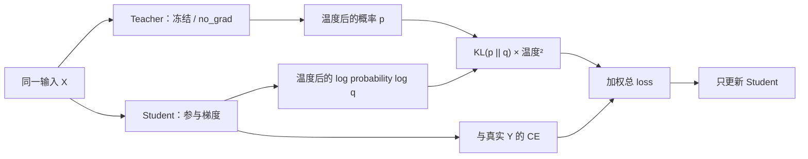

# 9. 白盒蒸馏：不仅学答案，也学教师的候选分布

前置：[SFT](5.SFT.md) 与 logits/softmax。先区分两条路线：白盒蒸馏比较教师与学生的概率分布；用教师生成的回答再做 SFT 则只需要文本样本，不一定能访问教师 logits。

## 本章实践卡

```bash
.venv/bin/python scripts/lesson_lab.py --lesson distill
```

先看教师 `[2,1,0]` 在温度 2 下的软概率，再看学生反向分布的 KD loss。你要在控制台确认：教师没有梯度，学生有梯度；相同分布的 KD loss 接近 0。

完成标准：能说清 `p` 是教师概率、`log q` 是学生对数概率，为什么 `F.kl_div` 的参数顺序看起来和数学公式相反，以及文本答案蒸馏与白盒 logits 蒸馏不是同一条路径。

## 1. 一个标准答案和一张概率表，有什么区别

假设一道题有三个候选：

```text
硬标签：正确答案是第 0 项
教师分布：[0.7,0.2,0.1]
```

硬标签主要要求提高正确项概率；教师分布还告诉学生第 1 项比第 2 项更接近教师的偏好。白盒蒸馏使用这样的软目标，但教师不保证永远正确，模仿也不等于获得相同能力。



### 教师和学生可以多大程度不同

教师可以更深、更宽，学生的内部 H 不必与教师相同；但逐项比较最终词表分布时，候选轴必须对应同一组 token 语义。

```text
教师：[B,T,教师H] -> [B,T,6400]
学生：[B,T,128]   -> [B,T,6400]
                        ↑ 比较这一条候选轴
```

同一个输入位置也必须对齐：都是根据同一前缀预测同一个下一 token。不能用教师位置 t 的分布监督学生位置 t+1。

## 2. 温度像把领先差距暂时拉平

教师原 logits 为 `[2,1,0]`。当温度 τ=2 时，先除以 2 再 softmax：

```text
教师 logits：     [2,1,0]
除以温度：        [1,0.5,0]
教师软概率约：    [0.5065,0.3072,0.1863]
```

温度大于 1 会使该分布更平缓，让非最高项也有较明显的目标概率；τ=1 不改变原 softmax。不是让学生输出更随机，而是在训练目标上比较软化后的分布。

## 3. 调用顺序为什么是 log q 在前、p 在后

当前 [distillation_loss](../trainer/train_distillation.py) 的签名接收两份 logits：

```python
def distillation_loss(student_logits, teacher_logits, temperature=1.0,
                      reduction="batchmean"):
    # 教师在 no_grad 下转成概率
    # 学生转成 log_softmax
    # F.kl_div(student_log_probs, teacher_probs, ...)
    ...
```

默认参数语义下，`F.kl_div(log q, p)` 对应：

$$
D_{KL}(p\Vert q)=\sum_i p_i(\log p_i-\log q_i).
$$

因此这里的方向是“教师 p 到学生 q”。参数顺序看起来与数学记号相反，不能把普通概率 q 直接当成第一个输入。

教师和学生完全相同，KL 应约为 0；若学生更偏爱教师不偏爱的候选，损失会增大。乘 τ² 是常用的梯度尺度补偿，并不保证所有数值与 τ=1 时完全等价。

### 一次实验拆开 KL 的每个量

```python
# doc-example: distillation-components
import torch
import torch.nn.functional as F
from trainer.train_distillation import distillation_loss

teacher = torch.tensor([[2., 1., 0.]], requires_grad=True)
student = torch.tensor([[0., 1., 2.]], requires_grad=True)
temperature = 2.
p = (teacher.detach() / temperature).softmax(-1)
logq = (student / temperature).log_softmax(-1)
manual = (p * (p.log() - logq)).sum(-1).mean() * temperature**2
actual = distillation_loss(student, teacher, temperature)
torch.testing.assert_close(manual, actual)
actual.backward()
assert teacher.grad is None and student.grad.norm().item() > 0
print("p：", p.tolist(), "KD：", actual.item(), "学生梯度：", student.grad.tolist())
```

教师没有梯度，学生的每个候选都可以收到软目标的反馈，而不只最高概率项。教师也可能犯错，所以白盒监督仍需要数据和任务评估。

## 4. 接上 mask、CE 和 MoE 时，照当前代码算

脚本先按回答 mask 选出有效位置，把 `[B,T,V]` 变成 `[有效位置数,V]`，再计算 KD。这样题干或补齐位置不会混入这个软目标均值。

当前总损失在累积缩放前为：

```text
稠密模型：alpha * CE + (1-alpha) * KD
MoE 模型：alpha * (CE + aux_loss) + (1-alpha) * KD
```

因为代码把 aux_loss 先加入 ce_loss，所以它也被 alpha 加权；不能另写成一个始终独立相加的 aux 项。alpha=0 时，这条实现里的 CE 与对应 aux 贡献都消失。

教师和学生必须对候选 ID 使用兼容语义。仅把教师 logits 截成学生词表长度，不会自动把两个不同 tokenizer 的词表对齐。此处最容易出现“形状吻合、监督语义却错位”的问题。

### reduction 为什么要特别看输入形状

本入口先从 `[B,T,6400]` 中按回答 mask 选出 M 个位置，形成 `[M,6400]`，再用 `batchmean`，相当于对每个位置的 KL 求和后除以 M。

如果直接把原三维张量交给同一 reduction，它只按首维 batch 数归一化，不自动按有效 token 数平均；因此不能只复制损失函数而漏掉 mask 和 reshape。

空监督时 M=0，没有可供学生模仿的回答分布。clamp 或忽略 NaN 不能替代检查数据中的回答是否被截断。

## 5. 先做三候选的真实损失实验

```bash
.venv/bin/python scripts/lesson_lab.py --lesson distill
```

预期：

```text
相同分布 KD loss≈0
教师 [2,1,0]、学生 [0,1,2]、温度 2：KD loss≈1.280627
学生有梯度，教师无梯度
PASS distill
```

这调用仓库损失函数，不加载任何教师权重。可以先手写两种分布，预测损失会不会为零，再运行核对。

下一步改温度：比较 τ=1、2、4 下的教师概率。保持 logits 不变，观察变平的是候选概率差，不是 token ID 顺序。

## 6. 推理文本训练与白盒分布蒸馏分开理解

[train_distill_reason.py](../trainer/train_distill_reason.py) 当前使用对话文本与加权 CE，没有在训练循环里调用一个在线教师来比较软概率。它强调 `<think>`、`<answer>` 等格式成分，不应与前面的白盒 KD 混为同一个算法。

其标签加权逻辑需要特别仔细看：

```python
# all_tag_token_ids 是几个标签编码后组成 token ID 的拼接列表
sp_ids = torch.isin(Y.view(-1), torch.tensor(all_tag_token_ids, device=Y.device))
loss_mask[sp_ids] = 10
```

这按单个组成 token 的 ID 匹配，不是精确查找完整标签片段。同一 ID 在普通正文或 prompt 中出现也可能命中；直接赋值为 10 还可能把原 mask=0 的位置重新加入监督。因此不能把它等价描述为“只将真实标签位置原有权重乘 10”。

下面仅用一个本来就参与监督、且被确认为标签的目标举例：

```text
逐题 loss：   [2, 3, 1.5]
原 mask：     [1, 1, 1]
加权后：      [1,10, 1]
原有效数量：  3
结果：(2 + 30 + 1.5) / 3 ≈ 11.167
```

分母是加权前的有效数量，故改变了总体损失尺度。标签格式学得更好也不等于模型必然学会正确推理。

### 软目标与硬目标怎样共同作用

假设真实标签要求候选 A，教师更偏候选 B，CE 与 KD 可能给出不同方向的反馈。alpha 控制当前代码中两种目标的混合，并不是教师可信度的自动评分。

| alpha | 稠密模型的目标 | 需要理解的结果 |
| --- | --- | --- |
| 1 | 只保留 CE | 不再使用教师软分布作直接目标 |
| 0 | 只保留 KD | 学教师偏好，仍要求有效位置 |
| 0～1 | 两者加权 | 两条反馈在学生参数上汇合 |

温度也不是生成时必须使用的温度。训练中将分布软化，是为了改变学习目标的相对概率信息；推理策略可另行设置。

## 7. 读源码与完整训练前置条件

白盒路线按 `student forward → teacher no_grad forward → 有效位置 → CE/KD → 更新学生` 阅读。教师权重和 tokenizer 兼容性、空监督样本、显存及恢复状态都需另行验证。

本机已验证上面的损失小算例；没有通过它证明完整蒸馏入口、教师质量或生成能力。完整训练所需教师权重不是仓库 demo 的一部分。

完成标准：能解释 p 和 q 分别来自谁、谁有梯度、mask 选择什么，以及文本答案蒸馏与白盒 logits 蒸馏的区别。结构扩展可继续学习 [MoE](10.MoE.md)。

### 调试时一次只追一个目标位置

先查看学生和教师在同一 Y 位置的 top-k；再比较加温度前后概率；然后看 mask 是否选中了这个位置；最后看 CE、KD 与总 loss 三个值。

本例三个候选用于手算，不表示真实训练换了词表。对当前 6400 词表，所有归一化、KL 求和和 token 位置筛选都沿同样的轴进行。

## 8. 真实 6400 词表：两种内部宽度在回答位置相遇

现在将三个候选的手算扩展到当前 SFT 数据。学生使用 H=128，教师演示使用 H=256，两者都使用同一 tokenizer 的 6400 个候选，分别完成各自内部计算。

```text
同一 X：[1,127]
学生 logits：[1,127,6400]
教师 logits：[1,127,6400]
回答 mask：[1,127]，21 项有效
筛选后：学生和教师各 [21,6400]
比较分布 -> 一个 KD 标量
```

下面两者都随机初始化，用来验证真实形状、mask 与梯度，不是用随机教师提升学生能力的训练配方。

```python
# doc-example: actual-vocabulary-distillation
from transformers import AutoTokenizer
from dataset.lm_dataset import SFTDataset
from model.model_minimind import MiniMindConfig, MiniMindForCausalLM

torch.manual_seed(42)
tok = AutoTokenizer.from_pretrained("model")
ds = SFTDataset("dataset/demo_sft.jsonl", tok, max_length=128)
X, Y, mask = (item.unsqueeze(0) for item in ds[0])
student_model = MiniMindForCausalLM(MiniMindConfig(
    hidden_size=128, intermediate_size=384, num_hidden_layers=2,
    max_position_embeddings=128,
))
teacher_model = MiniMindForCausalLM(MiniMindConfig(
    hidden_size=256, intermediate_size=768, num_hidden_layers=2,
    max_position_embeddings=128,
)).eval().requires_grad_(False)
student_scores = student_model(X).logits
with torch.no_grad():
    teacher_scores = teacher_model(X).logits
valid = mask.bool()
assert tuple(student_scores[valid].shape) == (21, 6400)
kd = distillation_loss(student_scores[valid], teacher_scores[valid], temperature=2.)
ce_map = F.cross_entropy(student_scores.flatten(0, 1), Y.flatten(),
                         reduction="none").view_as(Y)
ce = (ce_map * mask).sum() / mask.sum()
total = .5 * ce + .5 * kd
total.backward()
assert student_model.lm_head.weight.grad.norm().item() > 0
assert all(p.grad is None for p in teacher_model.parameters())
print("CE / KD / 总损失：", ce.item(), kd.item(), total.item())
```

这里通过布尔 mask 同时选择前两条轴，所以 `[1,127,6400]` 变成 `[21,6400]`。没有把 6400 个候选也筛成 21 个，21 是位置数。

### 用导数理解软目标的反馈

对一个位置，温度为 τ、教师概率 p、学生概率 q，乘 τ² 的 KL 对学生原始 logit 第 j 项的导数为 `τ*(q[j]-p[j])`。再按位置均值和目标系数缩放，就是对应训练反馈的一部分。

若学生给某候选的概率高于教师，就收到降低方向；低于教师则收到提高方向。它不是只强迫学生模仿教师 argmax，而是比较整张分布。

不过 q 与 p 本身也随温度改变，所以乘 τ² 并不保证所有温度下梯度相同。实验里应同时记录温度、软概率和 KD，而不是只改一个温度数字后比较总 loss。

### 检查教师是否真的冻结

`eval()` 主要切换运行行为；`requires_grad_(False)` 控制教师参数是否求导；`no_grad()` 让这次教师前向不记录图。当前入口三者配合使用。

完整训练还要检查教师是否比学生在目标任务上有用、词表是否真正对齐、样本是否有回答监督。能完成本节反向，只说明这段数学与数据流接通。

## 历史实验图与参考


- [知识蒸馏原论文](https://arxiv.org/abs/1503.02531)
- [PyTorch KLDivLoss](https://docs.pytorch.org/docs/2.14/generated/torch.nn.KLDivLoss.html)
